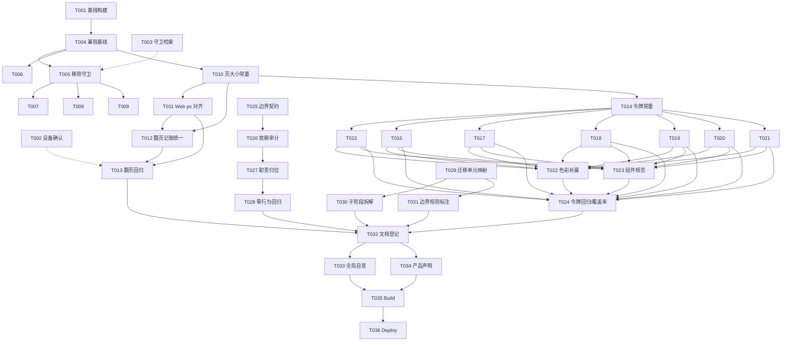

# Tasks: 工程重构总规划（Engineering Refactor）

**Input**: Design documents from `spec/engineering-refactor/`
**Prerequisites**: plan.md（技术方案）、spec.md（用户故事与优先级）

> **规划轮说明**：本文件为**实施路线图**——供未来实施轮照单执行。当前规划轮（2026-10-10）只产出本文档，**不执行其中任何代码任务**。US4（Phase 6，V2 迁移）为远期，任务仅产出细分文档。
>
> **实施进度（2026-10-11）**：轮 1（Phase A + US1，T001-T012）→ 轮 2（US2 令牌化，T014-T024）→ 轮 3（US3 + US4，T025-T031）→ 收尾轮（T032-T036）均已完成（提交链 63a3beb / 79dab7a / daaf391 起）；T013 降级衔接走查欠真机/模拟器。V2 迁移批次实施（`v2-migration-roadmap.md`）自批次 1 起另行推进。

## Format

任务格式：`- [ ] [TaskID] [P?] [Story?] Description with exact file path`

- `[P]`：可并行（不同文件、无未完成依赖）
- `[Story]`：用户故事标签（`[US1]`~`[US4]`），仅用户故事阶段任务携带
- 每条任务以确切文件路径结尾

## Path Conventions

- 源码根：`entry/src/main/ets/`（pages/ 页面、service/ 服务、component/ 组件、model/ 模型）
- 资源根：`entry/src/main/resources/`（base/ 与 dark/ 的 element/color.json 等）
- 工程配置：仓库根 `build-profile.json5`、`AppScope/app.json5`
- 规划文档：`spec/engineering-refactor/`（spec.md / plan.md / tasks.md 及实施轮产出的 architecture-boundary.md、v2-migration-roadmap.md）

**全局执行约束（实施轮适用）**：

- 遵循 AGENTS.md：`Constants` 唯一真相源、禁 any/unknown/as、代码零注释（`ponytail:` 除外）
- API 26 既定前提：实施前先落地 Phase A（全局前提），全程不引入 API<26 兼容设计
- 令牌替换**数值不变**（纯标准化，不改变观感）；色彩一律 `$r('app.color.*')`
- 每任务完成即 `arkts_check` 预检 + `devecocli build` 通过后再进入下一任务

---

## Phase 1: Setup（前置核查）

**Purpose**: 确认实施基线与环境，隔离问题

- [x] T001 执行一次全量构建确认当前基线绿色（`devecocli build`）
- [x] T002 确认 API 26 设备/模拟器可用（`devecocli device list` / 模拟器管理）
- [x] T003 [P] 全局检索 `[API24-COMPAT]` 标记，确认当前仅 `entry/src/main/ets/service/MediaSession.ets` 一处

**Checkpoint**: 基线绿色 + 目标设备就绪

---

## Phase 2: Foundational（全局前提 Phase A + 共享基础设施）

**Purpose**: API 26 基线化（FR-A 系列）与跨 US 常量基础设施，任何用户故事前必须完成

**⚠️ CRITICAL**: US1-US4 全部依赖本阶段（API 26 前提）

- [x] T004 提升兼容基线：`build-profile.json5` 的 `compatibleSdkVersion` 由 `6.1.1(24)` 改为 `26.0.0`
- [x] T005 移除守卫标记：`entry/src/main/ets/service/MediaSession.ets` 删除 `[API24-COMPAT]` 注释标记，保留 `setMediaCenterControlType` 的防御性 try/catch（不写注释）
- [x] T006 版本号提升：`AppScope/app.json5` 的 `versionCode` 2000→3000、`versionName` 0.2.0→0.3.0
- [x] T007 [P] 文档同步：`AGENTS.md` L55 移除/更新 `[API24-COMPAT]` 守卫说明
- [x] T008 [P] 文档同步：`PROJECT_NOTES.md` §四「API 26 基线化」改为已完成、守卫清单清空
- [x] T009 [P] 文档同步：`spec/ui-testing-playbook.md` L71 移除「API<26 设备无微调按钮」降级预期条目
- [x] T010 页大小常量：`entry/src/main/ets/service/Constants.ets` 新增 `UP_PAGE_SIZE=20`/`SEASON_PAGE_SIZE=20`/`FAV_PAGE_SIZE=20`（US1 前置）

**Checkpoint**: 全局前提落地，常量基础设施就绪

---

## Phase 3: User Story 1 - 订阅翻页不漏条目（Phase B · KI-9）(Priority: P1)

**Goal**: APP 签名链（20/页）与 Web 退避链（30/页）页界对齐，链路切换/降级无漏条无重复

**Independent Test**: 触发链路降级/回切场景，对比翻页结果无漏条、无重复、无整段缺失

### Implementation for User Story 1

- [x] T011 [US1] Web 链页大小对齐：`entry/src/main/ets/service/BiliService.ets` 的 `fetchUpVideosViaWeb` 请求 `ps` 由 30 改为 `UP_PAGE_SIZE`（依赖 T010）
- [x] T012 [US1] 翻页记账统一：`entry/src/main/ets/pages/SourcePage.ets` 的 `olderPageSize()` UP 分支返回值由 30 改为 `UP_PAGE_SIZE`；`fetchUpWebOlder` 的 `pn` 推算基准随之统一（`floor(len/20)+1`，`upWebLastPage` 兜底保留）（依赖 T010、T011）
- [ ] T013 [US1] 降级衔接回归：构建通过后，真机/模拟器对 UP 订阅执行「APP 链→Web 链降级→回切」翻页走查，确认全量条目无漏无重（依赖 T011、T012）

**Checkpoint**: 翻页页界对齐，US1 独立可交付

---

## Phase 4: User Story 2 - 全局视觉风格一致（Phase C）(Priority: P1)

**Goal**: 数字令牌 + 色彩补漏 + 组件规范，令牌覆盖率 ≥95%，观感不变或更协调

**Independent Test**: 逐页提取色彩/圆角/间距/字号值，全部落在令牌档位表内；四类部件跨页面样式一致

### Implementation for User Story 2

- [x] T014 [US2] 令牌常量：`entry/src/main/ets/service/Constants.ets` 定义 `TOKEN_RADIUS_S/M/L/XL`（8/12/16/20）、`TOKEN_FONT_CAPTION/AUX/BODY/BODY_M/TITLE/TITLE_L`（10/11/13/14/16/22）、`TOKEN_SPACE_XS/S/M/L/XL`（4/8/12/16/24）
- [x] T015 [P] [US2] 令牌替换：`entry/src/main/ets/pages/LogPage.ets` 圆角/字号/间距裸数字 → `TOKEN_*` 常量（依赖 T014）
- [x] T016 [P] [US2] 令牌替换：`entry/src/main/ets/pages/HomePage.ets` 同上（依赖 T014）
- [x] T017 [P] [US2] 令牌替换：`entry/src/main/ets/pages/AddSubscriptionSheet.ets` 同上（依赖 T014）
- [x] T018 [P] [US2] 令牌替换：`entry/src/main/ets/pages/SourcePage.ets` 同上（依赖 T014）
- [x] T019 [P] [US2] 令牌替换：`entry/src/main/ets/pages/PlayerOverlay.ets` 同上（依赖 T014）
- [x] T020 [P] [US2] 令牌替换：`entry/src/main/ets/pages/SettingsPage.ets` 同上（体量最大）（依赖 T014）
- [x] T021 [P] [US2] 令牌替换：`entry/src/main/ets/component/` 下 MiniPlayer/QueueSheet/QueueDrawer/CoverThumb/SettingsRow/SettingsGroup/EdgeHint 同上（依赖 T014）
- [x] T022 [US2] 色彩补漏：`entry/src/main/resources/base/element/color.json` 与 `dark/element/color.json` 补缺失语义色，页面残余 `Color.White` 等硬编码归一为 `$r('app.color.*')`；必须字面量场景登记豁免（依赖 T014、T015-T021 主体完成）
- [x] T023 [US2] 组件规范：列表行/卡片/弹窗/空态四类部件样式归一——以现状为基准抽共享 `@Builder` 或公共组件（目标目录 `entry/src/main/ets/component/`），数值不变只统一来源（依赖 T015-T021 至少主体完成）
- [x] T024 [US2] 回归与覆盖率：深浅色/主题色切换回归全部页面；全局检索令牌覆盖率 ≥95%（圆角/间距/字号全部落档位表内），残余豁免项登记（依赖 T015-T023）

**Checkpoint**: 令牌化与组件规范完成，US2 独立可交付

---

## Phase 5: User Story 3 - 开发者维护时职责清晰（Phase D）(Priority: P2)

**Goal**: 模块边界契约化 + 依赖方向单向化，零功能行为变化

**Independent Test**: 依据边界契约对服务/页面做职责归属抽查，均无跨边界依赖；功能回归零变化

### Implementation for User Story 3

- [x] T025 [US3] 边界契约文档：产出模块边界契约（每模块职责/允许依赖/禁止依赖，见 plan.md「模块边界契约」表），落盘 `spec/engineering-refactor/architecture-boundary.md`
- [x] T026 [US3] 依赖方向审计：全局检索 import 关系，确认「service→model、pages→service/model、component 独立、Constants 零业务依赖」单向成立，列出违反项（依赖 T025）
- [x] T027 [US3] 低风险职责归位：按审计结果做常量/小逻辑归位（如页大小与令牌常量统一引用），**不做文件拆分**（拆分登记远期）（依赖 T026）
- [x] T028 [US3] 零行为变化回归：全量构建 + 主要功能走查，确认与重构前行为一致（依赖 T027）

**Checkpoint**: 边界契约落地，US3 独立可交付

---

## Phase 6: User Story 4 - 渐进迁移到 V2（Phase E，远期）(Priority: P3)

**Goal**: V2 渐进迁移细化为可执行子阶段任务（本期不实施迁移本身）

**Independent Test**: 迁移单元映射完整覆盖全部页面/服务/模型；每单元含独立验收标准

### Implementation for User Story 4（产出细分文档）

- [x] T029 [US4] 迁移单元映射：将 plan.md「V2 迁移单元映射」细化为逐文件清单（6 模型 / 3 组件迁移（CoverThumb/SettingsGroup/EdgeHint 免迁，SettingsRow 并入 SettingsPage 批次）/ 7 页面 / 全局状态 + PlayerController），落盘 `spec/engineering-refactor/v2-migration-roadmap.md`
- [x] T030 [US4] 子阶段任务拆解：按「模型→组件→页面→全局状态」4 批拆解为可独立执行/独立验收的逐单元任务（每单元含回归方式与回滚方式）（依赖 T029）
- [x] T031 [US4] 边界规则与风险标注：明确迁移边界 4 规则（单页范式不混用/V1 不持有 V2 实例/全局存储最后切/批次独立提交），标注风险最高单元（PlayerController、全局状态）置于最后（依赖 T029）

**Checkpoint**: V2 迁移路线图细化完成（远期，不实施）

---

## Phase 7: Polish & Cross-Cutting Concerns

**Purpose**: 横切收尾与文档治理

- [x] T032 [P] 文档登记：`AGENTS.md`/`PROJECT_NOTES.md` 登记重构进度（US1-US3 完成情况、Phase A 已落地、远期 V2 待办指向 roadmap 文档）
- [x] T033 全局自查：令牌/常量/守卫残留检索；豁免项（Canvas/窗口层受限色、必须字面量）登记齐全；历史 spec 轮次文档未被改动
- [x] T034 [P] 产品声明：README/商店信息同步最低版本要求（API 26 起），标注不再支持 API<26 设备

**Checkpoint**: 横切项收尾

---

## Phase 8: Verification

<!-- verification_scope: build-only -->

**Purpose**: 构建与部署验证（用户已选 build-only）

- [x] T035 Build project and fix any compilation errors（调用 `devecocli build`，迭代修复直至成功）
- [x] T036 Deploy application to device/emulator（调用 `devecocli run --skip-build`）

---

## Dependencies & Execution Order

### Phase Dependencies

- **Setup（Phase 1）**：无依赖，可立即开始
- **Foundational（Phase 2）**：依赖 Setup 完成——阻塞全部用户故事（API 26 前提）
- **US1（Phase 3）**：依赖 T010（页大小常量）；US1 内串行（T011→T012→T013）
- **US2（Phase 4）**：依赖 T014（令牌常量）；页面替换 T015-T021 可并行，T022/T023/T024 依赖其主体完成
- **US3（Phase 5）**：独立链（T025→T026→T027→T028），可与 US1/US2 并行
- **US4（Phase 6）**：独立链（T029→T030→T031），产出文档、无代码
- **Polish（Phase 7）**：依赖各 US 完成
- **Verification（Phase 8）**：依赖全部实施任务

### Dependency Graph



## ⚡ Parallel Execution Guide

| Phase | Tasks | Required Files | Execution Notes |
|---|---|---|---|
| Setup | T003 | 全局检索 | 与 T001/T002 并行 |
| Foundational | T007/T008/T009 | AGENTS.md / PROJECT_NOTES.md / ui-testing-playbook.md | 文档任务可并行，均在 T005 后 |
| US1 | — | BiliService.ets / SourcePage.ets | 串行（T011→T012→T013） |
| US2 | T015-T021 | 6 页面 + component/（7 组件） | 同文件锁：每页一个任务，可并行但避免同文件并发 |
| US2 | T022/T023/T024 | color.json / 组件文件 | T024 依赖 T015-T023 主体完成 |
| US3 | T025-T028 | architecture-boundary.md + 服务/页面 | 串行（契约→审计→归位→回归） |
| US4 | T029-T031 | v2-migration-roadmap.md | 串行（映射→拆解→标注） |
| Polish | T032/T034 | AGENTS.md / PROJECT_NOTES.md / README | 可并行 |
| Verification | T035/T036 | 全工程 | 串行（先 build 后 deploy） |

## Parallel Example

US2 令牌替换（T015-T021）并行示例——每页/组件一个独立任务，同文件不并发：

```text
Task: "令牌替换 LogPage.ets"      → entry/src/main/ets/pages/LogPage.ets
Task: "令牌替换 HomePage.ets"      → entry/src/main/ets/pages/HomePage.ets
Task: "令牌替换 AddSubscriptionSheet.ets" → entry/src/main/ets/pages/AddSubscriptionSheet.ets
Task: "令牌替换 SourcePage.ets"    → entry/src/main/ets/pages/SourcePage.ets
Task: "令牌替换 PlayerOverlay.ets" → entry/src/main/ets/pages/PlayerOverlay.ets
Task: "令牌替换 SettingsPage.ets"  → entry/src/main/ets/pages/SettingsPage.ets
Task: "令牌替换 component/ 组件"    → entry/src/main/ets/component/*.ets
```

## Implementation Strategy

### 建议 MVP 范围（首次实施轮）

1. Phase 1（Setup）→ Phase 2（Foundational：Phase A 全局前提 + 常量）
2. Phase 3（US1 · KI-9 页界统一）——独立可交付最小增量
3. **STOP and VALIDATE**：翻页降级/回切回归
4. 后续轮次按 US2 → US3 → US4 推进

### 实施轮次建议（每次一个独立增量）

- **轮 1**：Phase 1 + Phase 2 + Phase 3（API 26 前提 + KI-9）→ 构建 + 部署验证（Phase 8 子集）
- **轮 2**：Phase 4（界面令牌 + 组件规范）→ 构建 + 部署 + 深浅色走查
- **轮 3**：Phase 5 + Phase 6（架构边界 + V2 路线图细化）→ 构建 + 部署
- **收尾轮**：Phase 7（Polish）+ Phase 8（Verification 全量：T032-T036）——所有功能轮次完成后的收尾验证
- **轮 4（远期）**：按 `v2-migration-roadmap.md` 逐批实施 V2 迁移（每批独立验证，最终再执行收尾轮）

## Notes

- 本文件为规划轮产物，任务未被实施；实施时按「实施轮次建议」分批执行
- [P] 标记 = 不同文件、无未完成依赖
- [USx] 标签映射 spec.md 用户故事，US1/P1、US2/P1、US3/P2、US4/P3
- 每任务完成需 `arkts_check` 预检 + `devecocli build` 通过
- Phase A（全局前提）与 US1-US4 的依赖见 Dependency Graph；全局前提不完成则后续全部阻塞
