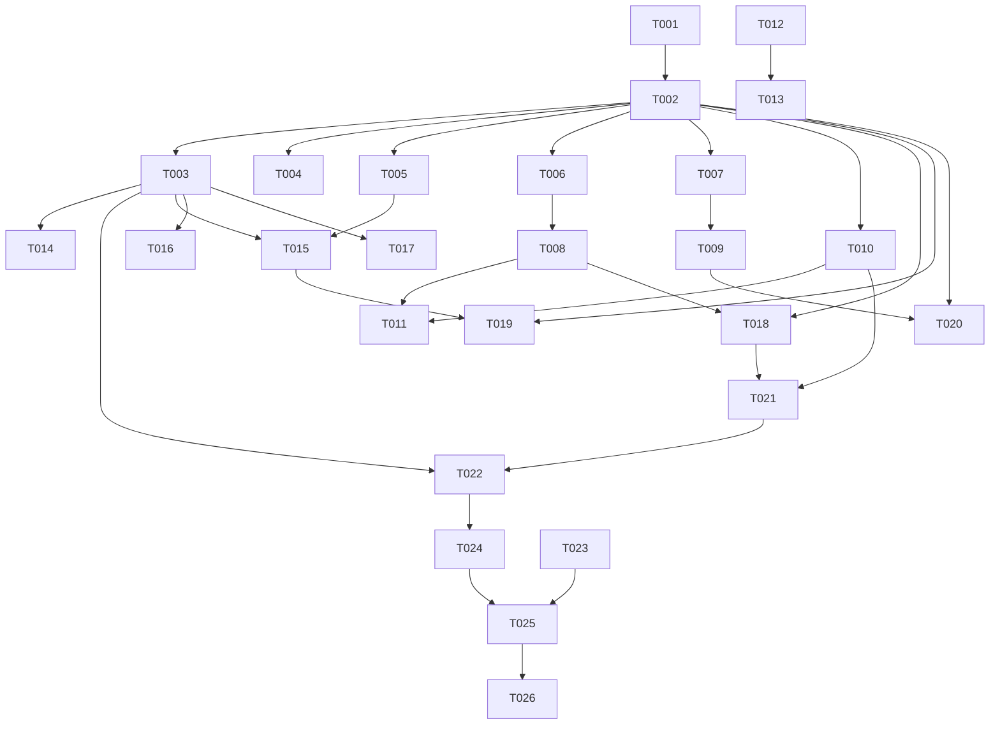

# Tasks: v0.3 Bug 修复第二轮（v0.3-bugfix-round2）

**Input**: Design documents from `spec/v0.3-bugfix-round2/`
**Prerequisites**: plan.md（决策 D1-D10）、spec.md（用户故事 US1-US9 + E 项销项）

> **轮次性质**：修复+交互改造轮——9 用户故事全部为既有文件定向修改 + 1 个新增 service 文件（BackHandler.ets）。无数据模型变更、无资源新增。**验证范围：仅构建验证（build-only）**——AGENTS.md 默认值，用户未显式提出 UI 验证；真机行为由用户实测反馈。
> **用户指令**：P3→P4→P5 连续执行（Phase 3/4 门已预批准）。

## Format

任务格式：`- [ ] [TaskID] [P?] [Story?] Description with exact file path`

- `[P]`：可并行（不同文件、无未完成依赖）
- `[Story]`：用户故事标签（`[US1]`~`[US9]`），仅用户故事阶段任务携带
- 每条任务以确切文件路径结尾

## Path Conventions

- 源码根：`entry/src/main/ets/`（pages/ 页面、service/ 服务、component/ 组件）
- 文档：仓库根 `PROJECT_NOTES.md`
- 源码根目录：`.`（仓库根）

**全局执行约束（实施轮适用）**：

- 遵循 AGENTS.md：`Constants` 唯一真相源（魔法值/文案常量只在此定义）、禁 any/unknown/as 类型断言、代码零注释（`ponytail:` 除外）、已迁 V2 文件内新代码必须 V2 装饰器、CoverThumb 保持 V1 只加 `@Prop`
- 每批次完成即 `arkts_check`（该批涉改 .ets）+ `devecocli build` 通过后再进下一批
- 无人值守规则：小问题（不影响行为）记录继续；大问题（可能行为回归/返工）暂停报告；同一目标构建失败最多 3 次即暂停报告
- 行号为 plan.md 定稿时参考值，实施时以实际内容定位为准

---

## Phase 1: Setup（前置核查）

**Purpose**: 确认基线绿色

- [X] T001 执行一次全量构建确认当前基线绿色（`devecocli build`）

**Checkpoint**: 基线绿色

---

## Phase 2: Foundational（阻塞前置）

**Purpose**: 三处左滑与四个返回处理点共同依赖的基建（常量 + BackHandler 模块）

- [X] T002 Constants 新增：`TOKEN_DELETE_ANIM_MS = 250`、`DRAWER_CLOSE_DELAY_MS = 260`、左滑删除确认弹窗文案常量（历史条目/队列条目/订阅三份：title+message）、多选移除确认文案、清理已播计数式文案（「确定清除 N 首已播条目吗？」模板）、清空队列文案沿用现状不新增——`entry/src/main/ets/service/Constants.ets`
- [X] T003 新建 BackHandler 模块：模块级 `queueCloseHandle` + `registerQueueClose(handle)`（注册/注销 undefined）+ `dismissOverlaysForBack(): boolean`（队列开→多选优先退（AS_PLAYLIST_SELECT_MODE）/句柄滑出关闭（句柄空回退置 AS_SHOW_QUEUE_SHEET=false）→true；浮层开且历史面板开→关 AS_SHOW_PLAY_HISTORY→true；浮层开→关 AS_SHOW_PLAYER_OVERLAY→true；否则 false）+ `closeQueueAndOverlay(): void`（滑出关队列 + `setTimeout(DRAWER_CLOSE_DELAY_MS)` 后置 AS_SHOW_PLAYER_OVERLAY=false）——`entry/src/main/ets/service/BackHandler.ets`
- [X] T004 QueueDrawer 本地常量 `DRAWER_CLOSE_DELAY_MS` 改引 `Constants.DRAWER_CLOSE_DELAY_MS`（`DRAWER_SLIDE_MS` 保持组件内）——`entry/src/main/ets/component/QueueDrawer.ets`

**Checkpoint**: BackHandler 可被四处消费；常量就位

---

## Phase 3: User Story 1 - 三处左滑删除二次确认 (Priority: P1) 🎯 MVP

**Goal**: 历史/队列/订阅三处左滑升级 SwipeActionItem（红色垃圾桶图标 + 滑过阈值双触发），统一 AlertDialog 二次确认，取消经 closeAllSwipeActions 复位

**Independent Test**: 三处分别左滑→垃圾桶图标→点图标弹确认；滑过阈值松手弹确认；取消不删且行收起；确认才删

### Implementation for User Story 1

- [X] T005 [P] [US1] 历史左滑升级：`swipeAction` end 从裸 `historyDeleteAction` 按钮改 `SwipeActionItem`（builder=红色垃圾桶图标按钮：`sys.symbol.trash`+`danger_red` 底+`fg_on_dark` 前景，点击→确认弹窗；`onAction`→同一确认弹窗；`actionAreaDistance` 默认 56vp 不显式传）；确认弹窗 AlertDialog.show（T002 文案常量，确认→`removeHistoryItem(item)`、取消→`closeAllSwipeActions()`）；`historyScroller` 类型 `Scroller`→`ListScroller`——`entry/src/main/ets/pages/SettingsPage.ets`（参考挂点 L1088 挂 end、L146 scroller、L378-391 旧按钮）
- [X] T006 [P] [US1] 队列左滑升级：同款改造 `queueDeleteAction`（确认→`removeQueueItem(item)`、取消→`closeAllSwipeActions()`）；`listScroller` 类型换 `ListScroller`——`entry/src/main/ets/component/QueueSheet.ets`（参考挂点 L578-580、L118、L332-344）
- [X] T007 [P] [US1] 订阅左滑升级：同款改造 `subDeleteAction`（确认→`removeSub(row)`、取消→`closeAllSwipeActions()`）；订阅列表无 scroller 则补 `ListScroller` 并挂入 List——`entry/src/main/ets/pages/HomePage.ets`（参考挂点 L349、L261-273）

**Checkpoint**: 三处左滑均双触发进确认、取消复位（构建验证；真机手感用户实测）

---

## Phase 4: User Story 2 - 批量移除与长按删除确认 (Priority: P1)

**Goal**: 队列多选「移除所选」与订阅长按菜单「删除订阅」补二次确认

**Independent Test**: 多选选中多条点移除→弹确认、取消保留；长按菜单删除→弹确认、取消保留

### Implementation for User Story 2

- [X] T008 [US2] `removeSelected` 头部加 AlertDialog 确认（T002 文案；确认→既有 `exitSelectMode()` + `controller.removeSelectedFromPlaylist(bvids)`、取消不动）——`entry/src/main/ets/component/QueueSheet.ets`（参考 L235-243）
- [X] T009 [P] [US2] `removeSub` 头部加 AlertDialog 确认（与 T007 确认弹窗共用同一次实现时合并为私有确认方法，左滑/长按两入口同弹窗）——`entry/src/main/ets/pages/HomePage.ets`

**Checkpoint**: 两个批量入口均先确认后执行（构建验证）

---

## Phase 5: User Story 3 - 清理已播语义修正 (Priority: P1)

**Goal**: 「清理已播」改为移除所有已听完条目（playedSet 语义、排除当前播放），修复倒序清错

**Independent Test**: 倒序模式清理→仅已听完条目被移除、当前与未播保留

### Implementation for User Story 3

- [X] T010 [US3] PlayerController：新增只读 `isPlayed(bvid: string): boolean`（内存 playHistory 命中 bvid 且 progress===-1）与 `hasPlayedItems(): boolean`（playlist 存在非当前条目且 isPlayed）；`clearPlayedItems` 重写——计算 playlist 中 isPlayed 且非当前播放 bvid 的集合，空集静默 return，非空调 `removeSelectedFromPlaylist(集合)`（索引修正/空队列重置/持久化语义复用）；删除 [0, currentIndex) 前缀逻辑与 currentItemEnded 参与判定——`entry/src/main/ets/service/PlayerController.ets`（参考 L1445-1472 旧实现、L1393 removeSelectedFromPlaylist）
- [X] T011 [US3] `confirmClearPlayed` 联动：可清判定 `currentIndex > 0 || currentItemEnded` 改 `controller.hasPlayedItems()`（无可清 toast 保留）；弹窗 message 弃 ENDED/PLAYING 双态常量改计数式文案常量（用实际可清条目数代入 N）；确认 action 仍调 `clearPlayedItems()`——`entry/src/main/ets/component/QueueSheet.ets`（参考 L254-279）

**Checkpoint**: 清理已播与播放模式无关、当前条目保留（构建验证）

---

## Phase 6: User Story 4 - 高亮边框跟随修复 (Priority: P1)

**Goal**: CoverThumb.highlight 补 @Prop 修传播根因；边框色改运行时主题色

**Independent Test**: 切歌后队列新当前条目高亮、旧条目取消

### Implementation for User Story 4

- [X] T012 [P] [US4] CoverThumb：`highlight: boolean = false` 改 `@Prop`；新增 `@Prop accent: string = Constants.ACCENT_DEFAULT`；两处高亮边框色 `$r('app.color.primary_color')` 改 `this.accent`（L31 与 L43-45）——`entry/src/main/ets/component/CoverThumb.ets`
- [X] T013 [US4] QueueSheet 唯一传 highlight 的调用补传 `accent: this.accentColor.value`——`entry/src/main/ets/component/QueueSheet.ets`（参考 L518）

**Checkpoint**: 高亮实时跟随、颜色为主题色（构建验证）

---

## Phase 7: User Story 5 - 系统返回完整分层修复 (Priority: P1)

**Goal**: 四个返回处理点统一调用 BackHandler 关闭序列（先关队列→再关浮层）

**Independent Test**: 源页开浮层+队列→返回仅关队列→再按关浮层→再按 pop；日志页同链路；设置页经历史重播链路同构

### Implementation for User Story 5

- [X] T014 [US5] Index 接线：`onBackPress` 队列+浮层两段（L109-135）替换为 `if (BackHandler.dismissOverlaysForBack()) { return true; }`，后段 playHistory/speed/mode/sleepTimerPicker/sleepTimer/selectMode 分支原样保留；两处 `onRegisterClose` 回调体（QueueDrawer L205、PlayerOverlay L217）改调 `BackHandler.registerQueueClose`；删除 `queueClose` 成员——`entry/src/main/ets/pages/Index.ets`
- [X] T015 [US5] SettingsPage.onBackPressed 头部插 `if (BackHandler.dismissOverlaysForBack()) { return true; }`，其后 showQualitySheet/showPlayHistory 分支保留——`entry/src/main/ets/pages/SettingsPage.ets`（参考 L1409-1429）
- [X] T016 [P] [US5] SourcePage 补 `.onBackPressed((): boolean => BackHandler.dismissOverlaysForBack())`（import BackHandler）——`entry/src/main/ets/pages/SourcePage.ets`
- [X] T017 [P] [US5] LogPage 补同款 `.onBackPressed`——`entry/src/main/ets/pages/LogPage.ets`

**Checkpoint**: 三链路返回分层正确、无 AS_SHOW_QUEUE_SHEET/AS_SHOW_PLAYER_OVERLAY 残留（构建验证；真机链路用户实测）

---

## Phase 8: User Story 6 - 删除补位动画 (Priority: P2)

**Goal**: 三处列表全部删除路径的数据变更包 animateTo（TOKEN_DELETE_ANIM_MS），下方条目平滑补位

**Independent Test**: 队列删除中间条目→下方条目动画上移；历史/订阅同

### Implementation for User Story 6

- [X] T018 [US6] QueueSheet 四条删除路径包 `this.getUIContext().animateTo({ duration: Constants.TOKEN_DELETE_ANIM_MS, curve: Curve.EaseOut }, ...)`：左滑单删（removeQueueItem 的 controller 调用）、多选移除（removeSelected 的 controller 调用）、清理已播（clearPlayedItems 调用）、清空（clearQueue 的 controller 调用）——`entry/src/main/ets/component/QueueSheet.ets`
- [X] T019 [US6] SettingsPage `removeHistoryItem` 数据变更（@State splice + notifyDataDelete）包 animateTo 同款——`entry/src/main/ets/pages/SettingsPage.ets`（参考 L357-376）
- [X] T020 [US6] HomePage `removeSub` 数据变更包 animateTo 同款——`entry/src/main/ets/pages/HomePage.ets`

**Checkpoint**: 删除后补位平滑无跳变（构建验证；已知局限：队列删当前播放条目因 await 边界该次跳变，接受）

---

## Phase 9: User Story 7 - 播放列表已播 ✓ 标记 (Priority: P2)

**Goal**: 队列已听完条目显示 ✓（isPlayed 数据源）

**Independent Test**: 播完一集开队列→该条目带 ✓；未听完无 ✓

### Implementation for User Story 7

- [X] T021 [US7] 行内 ✓ 渲染：非多选态且 `controller.isPlayed(item.bvid)` 为真时显示 `SymbolGlyph($r('sys.symbol.checkmark_circle'))` + success_green（视觉对齐 SourcePage ✓ L435-440），位置在行内不与多选 Checkbox 冲突——`entry/src/main/ets/component/QueueSheet.ets`（参考行结构 L500-543）

**Checkpoint**: ✓ 标记正确呈现且随完播刷新（构建验证；依赖 T010）

---

## Phase 10: User Story 8 - 清空队列自动关两层 (Priority: P2)

**Goal**: 清空确认后面板滑出关闭、浮层随后收起

**Independent Test**: 浮层内开队列→清空→面板滑出→浮层收起；首页队列清空→面板滑出

### Implementation for User Story 8

- [X] T022 [US8] `clearQueue` 确认 action 在 `removeSelectedFromPlaylist(all)` 后追加 `BackHandler.closeQueueAndOverlay()`——`entry/src/main/ets/component/QueueSheet.ets`（参考 L293-299）

**Checkpoint**: 清空后两层由深到浅自动关闭（构建验证；依赖 T003）

---

## Phase 11: User Story 9 - 封面占位换耳机图标 (Priority: P2)

**Goal**: 播放页空封面占位 ♪ 换耳机图标

**Independent Test**: 空封面时占位为耳机图标

### Implementation for User Story 9

- [X] T023 [P] [US9] 空封面占位 `Text('♪')` 换 `SymbolGlyph($r('sys.symbol.headphones'))`（fontSize 对齐原 56 量级、取 Constants 既有字号 token，颜色保持 accentColor.value）——`entry/src/main/ets/pages/PlayerOverlay.ets`（参考 L880-892；范围仅此一处，CoverThumb L34 与 HomePage L278 的 ♪ 不动）

**Checkpoint**: 封面占位为耳机图标（构建验证）

---

## Phase 12: Polish（销项记录）

**Purpose**: E 项销项结论落档

- [X] T024 PROJECT_NOTES.md 记录 E 项销项：屏幕常亮无代码改动——全库无 keepScreenOn，实测常亮为系统层行为（最可能开发者选项「不锁定屏幕」，USB 调试充电触发），验证方式拔线重测——`PROJECT_NOTES.md`

---

## Phase 13: Verification

<!-- verification_scope: build-only -->

**Purpose**: 构建验证全部修复（用户指定默认 build-only；真机行为由用户实测反馈）

- [X] T025 构建验证：对 T005-T023 涉改的全部 `.ets` 执行 `arkts_check` 零诊断 + `devecocli build` 通过（迭代修复至绿）——**PASS**（12 文件 0 诊断；BUILD SUCCESSFUL，1/10 次尝试）
- [X] T026 部署验证：`devecocli run --skip-build` 部署到可用设备（无活动设备时记录「待用户真机部署」并跳过，不阻塞收尾）——**PASS**（拉起 Mate 90 Pro 模拟器部署成功，安装+启动冒烟 PASS）

---

## Dependencies & Execution Order

### Phase Dependencies

- **Setup (Phase 1)**: T001 为一切前置
- **Foundational (Phase 2)**: T002→T003（BackHandler 引用 Constants 新常量）；T004 依赖 T002；**阻塞全部用户故事**
- **User Stories (Phase 3-11)**: 依赖 Phase 2 完成
- **Polish (Phase 12)**: 依赖全部用户故事
- **Verification (Phase 13)**: 依赖 T005-T024 全部完成

### User Story Dependencies

- **US1 (T005-T007)**: 依赖 T002（文案常量）；三处不同文件可并行
- **US2 (T008-T009)**: 依赖 T002；T008 与 US1 队列任务同文件顺序
- **US3 (T010-T011)**: T010 独立；T011 依赖 T010（hasPlayedItems）+ T002
- **US4 (T012-T013)**: T012 独立可并行；T013 依赖 T012 + 与队列任务同文件顺序
- **US5 (T014-T017)**: 依赖 T003；T016/T017 可并行；T014/T015 与各自文件的 US1 任务同文件顺序
- **US6 (T018-T020)**: 依赖 T002；包 animateTo 为后加包裹层，在对应文件 US1/US2 任务之后执行（同文件顺序）
- **US7 (T021)**: 依赖 T010（isPlayed）
- **US8 (T022)**: 依赖 T003（closeQueueAndOverlay）
- **US9 (T023)**: 独立（仅依赖 T001/T002 无关，可任意时机并行）

### 同文件顺序约束（严格执行，避免冲突）

- **QueueSheet.ets**：T006 → T008 → T011 → T013 → T018 → T021 → T022（单一纵队）
- **SettingsPage.ets**：T005 → T015 → T019（单一纵队）
- **HomePage.ets**：T007 → T009 → T020（单一纵队）
- **PlayerController.ets**：T010 单任务
- **Index.ets**：T014 单任务
- **CoverThumb.ets**：T012 单任务；**PlayerOverlay.ets**：T023 单任务
- **SourcePage.ets (T016) / LogPage.ets (T017)**：不同文件可并行

### Parallel Opportunities

- Phase 2 后首波：T005/T006/T007（三文件并行）+ T012（CoverThumb）+ T023（PlayerOverlay）+ T010（PlayerController）+ T014/T016/T017（Index/SourcePage/LogPage）
- QueueSheet 纵队执行期间，HomePage/SettingsPage/其余文件任务可交错并行

---

## ⚡ Parallel Execution Guide

| Phase | Tasks | Required Files | Execution Notes |
|-------|-------|----------------|-----------------|
| 基建 | T002→T003, T004 | Constants.ets, BackHandler.ets(新), QueueDrawer.ets | T003 引用 T002 常量，顺序 |
| US1 左滑 | T005, T006, T007 | SettingsPage/QueueSheet/HomePage | 三文件并行；每文件内纵队起点 |
| US2 确认 | T008, T009 | QueueSheet, HomePage | 随各自文件纵队 |
| US3 清已播 | T010, T011 | PlayerController, QueueSheet | T010 先行（US7 亦依赖） |
| US4 高亮 | T012, T013 | CoverThumb, QueueSheet | T012 可最先行 |
| US5 分层 | T014, T015, T016, T017 | Index/SettingsPage/SourcePage/LogPage | T016/T017 并行；T015 随 SettingsPage 纵队 |
| US6 动画 | T018, T019, T020 | QueueSheet/SettingsPage/HomePage | 各文件纵队末段 |
| US7/US8/US9 | T021, T022, T023 | QueueSheet, PlayerOverlay | T021/T022 随 QueueSheet 纵队；T023 任意 |
| 验证 | T025, T026 | 全部涉改文件 | build-only |

## 📊 Dependency Graph



---

## Parallel Example

```text
# 基建完成后首波并行（不同文件）：
Task: T005 [US1] SettingsPage.ets 历史左滑升级
Task: T006 [US1] QueueSheet.ets 队列左滑升级
Task: T007 [US1] HomePage.ets 订阅左滑升级
Task: T010 [US3] PlayerController.ets isPlayed/hasPlayedItems/clearPlayedItems
Task: T012 [US4] CoverThumb.ets @Prop 化
Task: T014 [US5] Index.ets 返回分层接线
Task: T016 [US5] SourcePage.ets 补 onBackPressed
Task: T017 [US5] LogPage.ets 补 onBackPressed
Task: T023 [US9] PlayerOverlay.ets 耳机图标

# QueueSheet 纵队（同文件严格顺序，不可并行）：
Task: T006 → T008 → T011 → T013 → T018 → T021 → T022
```

---

## Implementation Strategy

### MVP First（最小可交付）

1. T001 基线 → T002-T004 基建 → US5（T014-T017）返回分层独立交付（P1 bug 族根治）
2. **STOP and VALIDATE**：构建绿 + 用户真机复测返回链路

### Incremental Delivery（建议实施批次，每批构建验证 + 独立提交）

1. **批 1**：T001（基线）
2. **批 2**：T002 + T003 + T004（基建）→ 构建
3. **批 3**：T010（PlayerController）+ T012（CoverThumb）+ T023（PlayerOverlay）+ T014/T016/T017（Index/SourcePage/LogPage）→ 构建
4. **批 4**：QueueSheet 纵队 T006→T008→T011→T013→T018→T021→T022 → 构建
5. **批 5**：SettingsPage 纵队 T005→T015→T019 + HomePage 纵队 T007→T009→T020 → 构建
6. **批 6**：T024（销项记录）→ T025/T026（验证）

### 执行模式

- 无人值守：小问题记录继续、大问题暂停报告、构建失败同一目标最多 3 次
- 每批独立提交（沿用批次提交惯例，提交信息一行主题）

---

## Notes

- **总任务数**：26（Setup 1 / Foundational 3 / US1 3 / US2 2 / US3 2 / US4 2 / US5 4 / US6 3 / US7 1 / US8 1 / US9 1 / Polish 1 / 验证 2）
- **每故事任务数**：US1=3、US2=2、US3=2、US4=2、US5=4、US6=3、US7=1、US8=1、US9=1
- **E 项**：销项，T024 记录，无代码改动
- **[P] 标注基准**：不同文件且无未完成依赖
- **验证范围**：build-only（AGENTS.md 默认值 + 用户「P3/4/5 连做」指令）；无 UI 验证任务
- **同文件纵队**：QueueSheet（7 任务）、SettingsPage（3）、HomePage（3）严格顺序，是本轮并行度的主要约束
- **补位动画覆盖声明**：FR-006 由 T018/T019/T020 覆盖全部删除路径（单删/批量/清理/长按），清空历史（onDataReloaded 整表卸载）与清空队列（面板随即关闭）无补位语义、不适用
