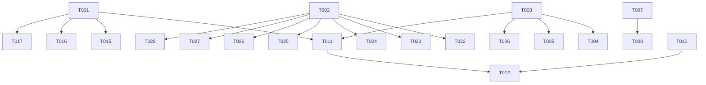

# Tasks: v0.3-bugfix-round3（播放意图先行重写 + 八项真机反馈修复）

**Input**: Design documents from `spec/v0.3-bugfix-round3/`
**Prerequisites**: plan.md (required), spec.md (required for user stories)

**Organization**: Tasks are grouped by user story to enable independent implementation and testing of each story. US5（光晕截断）已移出本轮（播放页重设计另开轮次），故事编号空缺保持映射稳定。

**Tests**: 无测试套件（项目现状），不生成测试任务；验证走 arkts_check + devecocli build + 部署冒烟（build-only）。

## Format: `[ID] [P?] [Story] Description`

- **[P]**: Can run in parallel (different files, no dependencies)
- **[Story]**: Which user story this task belongs to (e.g. US1, US2, US3)
- Include exact file paths in descriptions

## Path Conventions

- 单模块 HarmonyOS 应用，源码根 `entry/src/main/ets/`，资源根 `entry/src/main/resources/`
- 以下任务路径均相对仓库根

## Phase 1: Setup（共享基础设施，阻塞所有用户故事）

**Purpose**: 本轮新常量与色值登记，全部用户故事的前置

- [X] T001 Constants 增删：新增 `CLEAR_QUEUE_DATA_DELAY_MS = 400`（清空队列延时）、左滑圆钮尺寸常量（44vp 圆/半径 22）、垃圾桶图标字号常量；删除 `PLAY_STATE_DEBOUNCE_MS`（去抖基建随 US1 移除）——entry/src/main/ets/service/Constants.ets
- [X] T002 [P] 新增按压反馈色 `item_pressed_background`（浅色 `#12000000`、深色 `#14FFFFFF`）——entry/src/main/resources/base/element/color.json 与 entry/src/main/resources/dark/element/color.json

**Checkpoint**: 常量与色值就绪，用户故事可开始

---

## Phase 2: User Story 1 - 播放/暂停意图先行重写 (Priority: P1) 🎯 MVP

**Goal**: `playIntent` 统一意图字段，UI 点击瞬间切图标，事件只做校准，删除 300ms 去抖

**Independent Test**: 冷启动点播放→出声瞬间即暂停键；播放中点暂停→立即变播放键；连续快速点按 10 次无卡死错位

### Implementation for User Story 1

- [X] T003 [US1] PlayerController 意图字段核心：`playWhenReady` 泛化为公开广播字段 `playIntent`（默认 `false`），维护点即时翻转并 `emitUi`——`togglePlay`（准备期内外统一翻转）、`playRequest`（置 true）、`pauseRequest`（置 false）、`playIndex`（置 true）、prepared 恢复路径与 wasPlaying 赋值目标改名——entry/src/main/ets/service/PlayerController.ets
- [X] T004 [US1] PlayerController 校准复位与去抖基建删除：`onError`/`onPlayerState('idle'/'stopped')`/`handleCompleted` 停止分支/`onAudioInterrupt('INTERRUPT')` 显式复位 `playIntent=false`；`END_INTERRUPT` 续播经 `playRequest` 置回；删除 `schedulePlaying`/`playStateTimerId`/`cancelPlayStateDebounce`；`setPlaying` 简化为 `playingNow`/`isPlaying` 直写；MediaSession 锁屏态保持 `playingNow` 不变（depends T003）——entry/src/main/ets/service/PlayerController.ets
- [X] T005 [US1] [P] PlayerOverlay 播放键/加载动画改读 `playIntent`（判定表：`isPreparing && playIntent`→LoadingProgress、`playIntent`→暂停键、其余→播放键）；光晕强度 updateGlow/glowStrength 与封面 brightness/scale 的动画触发源由 `isPlaying` 边沿检测改为 `playIntent`；骨架与光晕布局不动（US5 已移出）——entry/src/main/ets/pages/PlayerOverlay.ets
- [X] T006 [US1] [P] MiniPlayer 播放图标改读 `playIntent`（判定表同 T005，MiniPlayer 无加载动画分支：`playIntent`→暂停键、其余→播放键）——entry/src/main/ets/component/MiniPlayer.ets

**Checkpoint**: US1 完成可独立验证（真机快速点按回归）

---

## Phase 3: User Story 2 - 首页取消订阅删除生效 (Priority: P1) 🎯 MVP

**Goal**: 订阅删除三薄弱点加固（id 匹配 + 数据源删除通知 + 保存后校验），删除持久生效

**Independent Test**: 删除订阅→杀进程冷启动→不复活；重复 10 次全部生效

### Implementation for User Story 2

- [X] T007 [US2] SubDataSource 新增 `delete(index: number): void`（rows.splice + `notifyDataDelete(index)`，越界静默返回）——entry/src/main/ets/pages/HomePage.ets
- [X] T008 [US2] `removeSub` 健壮化重写：按 `sub.id` 定位替代 `indexOf(row.sub)` 引用匹配；`animateTo` 闭包内 `provider.delete + subs.splice + saveSubscriptions + removeEpisodes`，闭包内不再调 `rebuild()`；保存后调 `SubscriptionStore.subExists(id)` 校验，仍存在则 `hilog.error`——entry/src/main/ets/pages/HomePage.ets

**Checkpoint**: US2 完成可独立验证（删除 + 冷启动回归）

---

## Phase 4: User Story 3 - 设置页退出胶囊时序 (Priority: P2)

**Goal**: 胶囊在设置页退场动画播完后才出现

**Independent Test**: 打开设置页→返回→胶囊仅在设置页滑出动画完全结束后才开始上浮

### Implementation for User Story 3

- [X] T009 [US3] `AS_ON_SETTINGS_PAGE` 复位从 `onWillDisappear` 移至 `onHidden`（`Callback<VisibilityChangeReason>`，本机 SDK nav_destination.d.ts L703）；置位 `onWillAppear` 不动——entry/src/main/ets/pages/SettingsPage.ets

**Checkpoint**: US3 完成可独立验证（进出设置页观察胶囊）

---

## Phase 5: User Story 4 - 清空队列退出节奏 + 空队列胶囊限制 (Priority: P2)

**Goal**: 清空队列先关层后清数据全程不闪空态；空队列胶囊点按不开播放页；播放页空态分支删除

**Independent Test**: 队列有内容→打开播放页→打开队列→清空→两层退出全程无空态文案；清空后点胶囊→播放页不打开

### Implementation for User Story 4

- [X] T010 [US4] BackHandler 新增 `closeBothLayersNow(): void`：队列面板经注册句柄滑出（无句柄回退置 flag）+ `AS_SHOW_PLAYER_OVERLAY` 无条件立即置 false（两层同收，去 260ms 错峰；既有 `closeQueueAndOverlay` 若无其他调用方则改造为本函数）——entry/src/main/ets/service/BackHandler.ets
- [X] T011 [US4] [P] PlayerController 新增 `clearAllWithExitDelay(): void`：调用即停声（`player.pause()`，准备期同时 `playIntent=false`）；`setTimeout(CLEAR_QUEUE_DATA_DELAY_MS)` 后经 `removeSelectedFromPlaylist(全量 bvid)` 清数据并持久化（depends T001 常量、T003 playIntent 字段）——entry/src/main/ets/service/PlayerController.ets
- [X] T012 [US4] QueueSheet `clearQueue` 确认动作改编排：`closeBothLayersNow()` + `controller.clearAllWithExitDelay()` 替代现「animateTo 清数据 + closeQueueAndOverlay」顺序（depends T010、T011）——entry/src/main/ets/component/QueueSheet.ets
- [X] T013 [US4] [P] MiniPlayer 空态占位条移除 `onClick`（点按无动作；有内容时正常打开不变）——entry/src/main/ets/component/MiniPlayer.ets
- [X] T014 [US4] [P] PlayerOverlay 删除空态引导分支（`if (this.trackIndex < 0 || this.playlistCount === 0)` 的「暂无播放内容」块整体移除，Scroll 分支无条件渲染）——entry/src/main/ets/pages/PlayerOverlay.ets

**Checkpoint**: US4 完成可独立验证（清空队列慢放观察 + 空态点按）

---

## Phase 6: User Story 6 - 左滑删除改圆形小按钮 (Priority: P3)

**Goal**: 三处左滑删除改 44vp 圆形红底白垃圾桶（加粗），触发交互不变

**Independent Test**: 三处左滑均显示圆形小按钮，点击/滑过阈值仍弹二次确认

### Implementation for User Story 6

- [X] T015 [US6] HomePage `subDeleteAction` builder 改圆形小按钮（44vp 圆、`danger_red` 底、白色 `sys.symbol.trash` `fontWeight(FontWeight.Bold)`、垂直居中、尺寸/字号用 T001 常量）（depends T001）——entry/src/main/ets/pages/HomePage.ets
- [X] T016 [US6] [P] SettingsPage `historyDeleteAction` builder 改同款圆形小按钮（depends T001）——entry/src/main/ets/pages/SettingsPage.ets
- [X] T017 [US6] [P] QueueSheet 队列条目删除 builder 改同款圆形小按钮（depends T001）——entry/src/main/ets/component/QueueSheet.ets

**Checkpoint**: US6 完成（三处左滑视觉统一）

---

## Phase 7: User Story 7 - 确认弹窗删除执行钮改红 (Priority: P3)

**Goal**: 8 个删除/清空类弹窗执行钮 `fontColor` 改 `danger_red`；4 个非删除弹窗不动

**Independent Test**: 逐个触发存量确认弹窗，删除执行钮均为红色，取消钮默认色

### Implementation for User Story 7

- [X] T018 [US7] [P] HomePage 删除订阅弹窗执行钮改红——entry/src/main/ets/pages/HomePage.ets
- [X] T019 [US7] [P] SourcePage 取消订阅弹窗执行钮改红（删除逻辑不动，D11）——entry/src/main/ets/pages/SourcePage.ets
- [X] T020 [US7] [P] SettingsPage 删除单条历史 + 清空播放历史两处弹窗执行钮改红——entry/src/main/ets/pages/SettingsPage.ets
- [X] T021 [US7] [P] QueueSheet 移除所选/删除队列条目/清除已播/清空队列四处弹窗执行钮改红——entry/src/main/ets/component/QueueSheet.ets

**Checkpoint**: US7 完成（8 弹窗红色统一）

---

## Phase 8: User Story 8 - 全列表行按压反馈 (Priority: P3)

**Goal**: 7 类列表行按压背景加深松手恢复（`stateStyles` + `@Styles` + `item_pressed_background`），不影响点击与左滑

**Independent Test**: 逐类列表按住行观察背景加深、松手恢复；按住左滑手势不受影响

### Implementation for User Story 8

- [X] T022 [US8] HomePage 订阅行加按压态（depends T002）——entry/src/main/ets/pages/HomePage.ets
- [X] T023 [US8] [P] SettingsPage 历史行加按压态（depends T002）——entry/src/main/ets/pages/SettingsPage.ets
- [X] T024 [US8] [P] QueueSheet 队列行加按压态（depends T002）——entry/src/main/ets/component/QueueSheet.ets
- [X] T025 [US8] [P] SourcePage 剧集行加按压态（depends T002）——entry/src/main/ets/pages/SourcePage.ets
- [X] T026 [US8] [P] AddSubscriptionSheet 搜索结果/收藏夹/合集系列三个列表行加按压态（depends T002）——entry/src/main/ets/pages/AddSubscriptionSheet.ets
- [X] T027 [US8] [P] LogPage 日志行加按压态（depends T002）——entry/src/main/ets/pages/LogPage.ets
- [X] T028 [US8] [P] SettingsRow 设置菜单行加按压态（组件级一处覆盖全部设置组）（depends T002）——entry/src/main/ets/component/SettingsRow.ets

**Checkpoint**: US8 完成（全部列表行触感统一）

---

## Phase 9: User Story 9 - 音符占位统一换耳机 (Priority: P3)

**Goal**: CoverThumb 无封面 ♪ 与首页大空态 ♪ 换 `sys.symbol.headphones`，全应用无图占位统一耳机

**Independent Test**: 清空队列→MiniPlayer 占位为耳机；无封面条目→缩略图为耳机；清空订阅→首页空态为耳机

### Implementation for User Story 9

- [X] T029 [US9] CoverThumb 无封面分支 `Text('♪')` 改 `SymbolGlyph($r('sys.symbol.headphones'))`（字号按 thumbSize 比例、色 `text_secondary`；MiniPlayer 空态与队列/历史无封面行经组件一处生效）——entry/src/main/ets/component/CoverThumb.ets
- [X] T030 [US9] [P] HomePage `emptyView` 的 `Text('♪')` 42px 改同款耳机 `SymbolGlyph`（色 `placeholder_color`）——entry/src/main/ets/pages/HomePage.ets

**Checkpoint**: US9 完成（全量走查 0 音符残留）

---

## Phase 10: Polish（横切走查）

**Purpose**: 旧机制残留清零与存量注释修正

- [X] T031 全项目走查：`PLAY_STATE_DEBOUNCE_MS`/`playWhenReady`/`schedulePlaying` 残留引用清零（grep 验证）；`Text('♪')` 残留清零；存量注释中涉及去抖机制/旧空态分支的说明同步修正——entry/src/main/ets/ 全目录

---

## Phase 11: Verification

<!-- verification_scope: build-only -->

**Purpose**: 构建与部署验证（build-only，无 UI 验证任务）

- [ ] T032 Build project and fix any compilation errors (invoke `devecocli build`; iterate fix → build until success)
- [ ] T033 Deploy application to device/emulator (invoke `devecocli run --skip-build`)

---

## Dependencies & Execution Order

### Phase Dependencies

- **Setup（Phase 1）**: 无前置，立即开始；T001/T002 可并行
- **User Stories（Phase 2-9）**: 均依赖 Setup 完成；故事间无横向依赖，可按优先级顺序执行（P1→P2→P3）
- **Polish（Phase 10）**: 依赖全部用户故事完成（残留走查需终态代码）
- **Verification（Phase 11）**: 依赖 Polish 完成

### User Story Dependencies

- **US1（P1）**: 依赖 T001；T003→T004 串行（同文件），T005/T006 依赖 T003 后可并行（不同文件）
- **US2（P1）**: 无跨故事依赖；T007→T008 串行（同文件）
- **US3（P2）**: 无依赖
- **US4（P2）**: T011 依赖 T001+T003；T012 依赖 T010+T011；T013/T014 独立可并行
- **US6/US7/US8/US9（P3）**: 分别依赖 T001（圆钮常量）/无/T002（按压色）/无；同故事内不同文件任务可并行
- **同文件纵队提示**: HomePage（T008→T015→T018→T022→T030）、SettingsPage（T009→T016→T020→T023）、QueueSheet（T012→T017→T021→T024）、PlayerOverlay（T005→T014）、MiniPlayer（T006→T013）——按任务 ID 顺序执行即天然满足，勿乱序并行同文件任务

### 📊 Dependency Graph



### ⚡ Parallel Execution Guide

| Phase | Tasks | Required Files | Execution Notes |
|---|---|---|---|
| Setup | T001, T002 | Constants.ets; color.json ×2 | 两任务不同文件可并行 |
| US1 | T005, T006 | PlayerOverlay.ets; MiniPlayer.ets | T003 完成后两 UI 任务并行 |
| US4 | T010, T011 | BackHandler.ets; PlayerController.ets | T004 完成后并行；T012 等两者 |
| US4 | T013, T014 | MiniPlayer.ets; PlayerOverlay.ets | 与 T010-T012 并行（注意 T006/T005 同文件纵队） |
| US6 | T015, T016, T017 | HomePage.ets; SettingsPage.ets; QueueSheet.ets | 三任务不同文件可并行 |
| US7 | T018, T019, T020, T021 | 四个不同页面/组件文件 | 四任务可并行（与 US6 同文件的按纵队串行） |
| US8 | T022-T028 | 七个不同文件 | 七任务可并行（与 US6/US7 同文件的按纵队串行） |
| US9 | T029, T030 | CoverThumb.ets; HomePage.ets | 两任务不同文件可并行（T030 在 HomePage 纵队末尾） |

## Parallel Example: 批次 4（视觉打磨）

```text
# US6 圆钮三任务并行（不同文件）：
Task: T015 HomePage subDeleteAction 圆钮（pages/HomePage.ets）
Task: T016 SettingsPage historyDeleteAction 圆钮（pages/SettingsPage.ets）
Task: T017 QueueSheet 队列条目删除圆钮（component/QueueSheet.ets）

# US7 红钮四任务并行（不同文件，与 US6 同文件的按纵队串行）：
Task: T019 SourcePage 取消订阅红钮（pages/SourcePage.ets）
Task: T021 QueueSheet 四弹窗红钮（component/QueueSheet.ets，在 T017 之后）
```

---

## Implementation Strategy

### MVP First（US1 + US2）

1. 完成 Setup（T001-T002）
2. 完成 US1（T003-T006）——意图先行核心
3. 完成 US2（T007-T008）——订阅删除修复
4. 构建验证一次，真机快速回归播放按钮与订阅删除

### Incremental Delivery（建议实施轮次，每批独立提交+构建）

- **批次 1（意图先行核心）**: T001-T006（US1 全部）——最大改动 PlayerController 重写，独立提交便于回滚
- **批次 2（bug 修复）**: T007-T009（US2 + US3）
- **批次 3（清空编排）**: T010-T014（US4）
- **批次 4（视觉打磨）**: T015-T021、T029-T030（US6 + US7 + US9）
- **批次 5（按压反馈+走查）**: T022-T028、T031（US8 + Polish）
- **验证**: T032-T033

---

## Notes

- [P] 任务 = 不同文件、无依赖；同文件纵队严格按任务 ID 顺序执行
- [Story] 标签映射 spec.md 用户故事（US5 空缺 = 移出本轮，播放页重设计另开轮次）
- 每批次完成即 `arkts_check`（本批涉及 .ets 文件）+ `devecocli build` 验证、独立提交
- US1 是状态机重写：批次 1 提交前重点自查校准复位清单完整性（onError/idle/stopped/completed 停止分支/INTERRUPT）
- 验证失败不无限重试——同一目标最多 3 次，仍失败暂停报告
