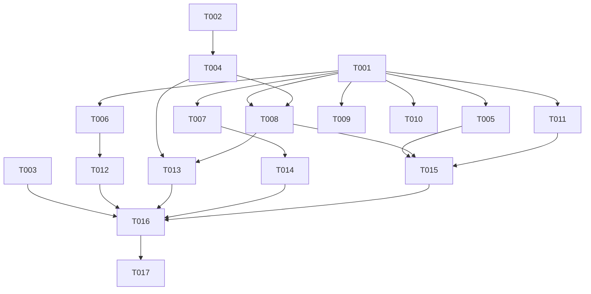

# Tasks: v0.3 真机反馈第四轮修复

**Input**: Design documents from `spec/v0.3-bugfix-round4/`
**Prerequisites**: plan.md (required), spec.md (required for user stories)

**Tests**: 无测试套件（项目现状），不生成测试任务。

**Organization**: 按用户故事分组，每个故事可独立实施与验证。改动集中、无跨故事依赖，建议单批一次实施完（17 任务量小，详见「实施轮次建议」）。

## Format: `[ID] [P?] [Story] Description`

- **[P]**: 可并行（不同文件、无未完成依赖）
- **[Story]**: 所属用户故事（US1–US4）
- 描述含精确文件路径

## Path Conventions

- 源码：`entry/src/main/ets/`（pages / component / service 分层，依赖单向）
- 资源：`entry/src/main/resources/base|dark/element/color.json`

---

## Phase 1: Setup (Shared Infrastructure)

无需 Setup 任务（既有项目，无脚手架/依赖变更）。

---

## Phase 2: Foundational (Blocking Prerequisites)

**Purpose**: 两个故事共用的前置产物（视效助手 + 常量），US3/US2 全部任务依赖本阶段。

- [X] T001 [P] 新建按压阴影视效助手 `entry/src/main/ets/component/PressShadow.ets`：导出 `pressShadowEffect(): VisualEffect`，内部 `import { hdsEffect } from '@kit.UIDesignKit'`，每次调用以 `HdsEffectBuilder` 链 `pressShadow(PressShadowType.BLEND_WHITE)` 后 `buildEffect()` 新建实例返回（类型与用法以本机 SDK `@hms.hds.hdsBaseComponent.d.ets` 为准）
- [X] T002 [P] 在 `entry/src/main/ets/service/Constants.ets` 新增 `NAV_EXIT_TRANSITION_MS: number = 400`（系统导航退场转场定值延时；附 `ponytail:` 注释标注天花板：无公开转场完成回调，定值略长于默认转场）

**Checkpoint**: 前置就绪，用户故事可开始。

---

## Phase 3: User Story 1 - 清空队列闪现修复 (Priority: P1) 🎯 MVP

**Goal**: 播放浮层内清空队列，两层一次性干净退出，杜绝 Index 层二次挂载队列面板的「闪现→无动画消失」。

**Independent Test**: 播放浮层内开队列→清空→确认：无队列面板二次出现、无无动画跳变、浮层滑出转场完整；首页层实例清空行为不回归。

### Implementation for User Story 1

- [X] T003 [US1] 重写 `entry/src/main/ets/service/BackHandler.ets` 的 `closeBothLayersNow()`：增加浮层态分支——`AS_SHOW_PLAYER_OVERLAY` 为 true 时**不调用**注册的滑出句柄、不起延时器，`AS_SHOW_QUEUE_SHEET` 与 `AS_SHOW_PLAYER_OVERLAY` 同帧直置 false（浮层以既有 350ms 转场退出）；浮层为 false 时保持现状（队列经句柄滑出，无句柄回退置 flag）。`clearAllWithExitDelay` 清数据编排不动

**Checkpoint**: US1 独立可测（清空链路三态走查：浮层内/首页层/多选态）。

---

## Phase 4: User Story 2 - 设置页退场胶囊时序重修 (Priority: P1) 🎯 MVP

**Goal**: 胶囊在设置页退场转场播完后才上浮；快速往返与日志页往返竞态消解。

**Independent Test**: 设置页往返（含快速往返）观察：退场动画全程胶囊零出现，播完后才上浮；进设置页即时隐藏不回归。

### Implementation for User Story 2

- [X] T004 [US2] 修改 `entry/src/main/ets/pages/SettingsPage.ets` 的在台标志生命周期：`onHidden` 中 `AS_ON_SETTINGS_PAGE` 复位改为 `setTimeout(Constants.NAV_EXIT_TRANSITION_MS)` 延时执行；`onWillAppear`/`onShown` 置位 true 前先取消 pending 定时器；`onShown` 补置位 true（修复日志页返回后标志残留 false 的既有缺口）；`onWillDisappear` 清理定时器句柄防泄漏。Index 侧零改动

**Checkpoint**: US2 独立可测（设置页↔首页往返、设置页↔日志页往返、快速往返三链路）。

---

## Phase 5: User Story 3 - 按压反馈机制重做 (Priority: P2)

**Goal**: 全库 13 处 `stateStyles({ pressed })` 替换为系统按压阴影，按压态系统托管，机制上不可卡死。

**Independent Test**: 设置页逐类行点按走查：按压加深、松手即消，无一残留；其余列表行抽查同样表现。

### Implementation for User Story 3

以下 7 任务全部依赖 T001；标注 [P] 者彼此文件不同可并行（与 US2/US4 同文件者除外，见依赖图）：

- [X] T005 [P] [US3] 替换 `entry/src/main/ets/component/SettingsRow.ets`：删除 `pressedStyle` @Styles 定义与 `.stateStyles({ pressed: ... })`（L31/L78），行容器改挂 `.visualEffect(pressShadowEffect())`
- [X] T006 [P] [US3] 替换 `entry/src/main/ets/pages/HomePage.ets` 订阅行的按压反馈（L295/L362）：同 T005 方式
- [X] T007 [P] [US3] 替换 `entry/src/main/ets/component/QueueSheet.ets` 队列行的按压反馈（L406/L620）：同 T005 方式
- [X] T008 [US3] 替换 `entry/src/main/ets/pages/SettingsPage.ets` 播放历史行的按压反馈（L410/L1128）：同 T005 方式（与 T004/T013 同文件，须串行）
- [X] T009 [P] [US3] 替换 `entry/src/main/ets/pages/SourcePage.ets` 剧集行的按压反馈（L342/L457）：同 T005 方式
- [X] T010 [P] [US3] 替换 `entry/src/main/ets/pages/LogPage.ets` 日志行的按压反馈（L127/L234）：同 T005 方式
- [X] T011 [P] [US3] 替换 `entry/src/main/ets/pages/AddSubscriptionSheet.ets` 的 4 处按压反馈（L423/L486/L631/L689/L726）：同 T005 方式

**Checkpoint**: US3 独立可测（8 文件 13 调用点全量走查：按压出现/松手消失/滚动取消/深浅色）。

---

## Phase 6: User Story 4 - 左滑删除按钮左右等距 (Priority: P3)

**Goal**: 三处左滑删除按钮停留位左右各 16vp（TOKEN_SPACE_M）等距，三处一致。

**Independent Test**: 三处分别左滑到停留位：按钮左右间距目测相等；触发与二次确认交互不变。

### Implementation for User Story 4

- [X] T012 [P] [US4] 修改 `entry/src/main/ets/pages/HomePage.ets` 的 `subDeleteAction`（L337）：按钮容器 Column 内边距 `{ right: TOKEN_SPACE_M }` → `{ left: TOKEN_SPACE_M, right: TOKEN_SPACE_M }`
- [X] T013 [US4] 修改 `entry/src/main/ets/pages/SettingsPage.ets` 的 `historyDeleteAction`（L434）：同 T012 方式（与 T004/T008 同文件，须串行）
- [X] T014 [P] [US4] 修改 `entry/src/main/ets/component/QueueSheet.ets` 的 `queueDeleteAction`（L402）：同 T012 方式（与 T007 同文件，须串行）

**Checkpoint**: 全部故事完成。

---

## Phase 7: Polish & Cross-Cutting Concerns

- [X] T015 移除孤儿颜色资源 `item_pressed_background`：先全库 grep 复核零引用，然后从 `entry/src/main/resources/base/element/color.json` 与 `entry/src/main/resources/dark/element/color.json` 删除（若复核发现残留引用，记录并保留资源）

---

## Phase 8: Verification

<!-- verification_scope: build-only -->

**Purpose**: 构建 + 部署验证（范围：仅构建验证，视觉修复效果由用户真机自测）。

- [X] T016 静态预检并构建：本轮全部改动的 `.ets` 文件传入 `arkts_check` 预检，通过后执行 `devecocli build`，编译错误进入修复循环直至成功
- [X] T017 部署应用（`devecocli run --skip-build`），确认安装启动正常

---

## Dependencies & Execution Order

### Phase Dependencies

- **Foundational（Phase 2）**: 无前置；T001 阻塞全部 US3 任务、T002 阻塞 US2
- **User Stories（Phase 3–6）**: US1 无前置可随时启动；US2/US3/US4 按各自文件依赖串行（见依赖图）
- **Polish（Phase 7）**: 依赖全部 US3 任务完成（资源孤儿化复核前置）
- **Verification（Phase 8）**: 依赖全部实施任务完成

### 📊 Dependency Graph



说明：
- `T004-->T008/T013`、`T008-->T013`：SettingsPage.ets 三任务同文件串行（US2 → US3 → US4 顺序）
- `T007-->T014`：QueueSheet.ets 两任务同文件串行
- `T006-->T012`：HomePage.ets 两任务同文件串行
- T003（US1）无前置依赖，可与 T001/T002 并行启动

### ⚡ Parallel Execution Guide

| Phase | Tasks | Required Files | Execution Notes |
|-------|-------|----------------|-----------------|
| Foundational | T001, T002 | PressShadow.ets（新建）/ Constants.ets | 不同文件，可并行 |
| US1 | T003 | BackHandler.ets | 独立文件，可与 Foundational 并行 |
| US2 | T004 | SettingsPage.ets | 依赖 T002；先于 T008/T013 执行 |
| US3 | T005, T006, T007, T009, T010, T011 | 各自独立文件 | 依赖 T001，六任务可并行；T008（SettingsPage）须在 T004 后 |
| US4 | T012, T014 | HomePage.ets / QueueSheet.ets | 分别在 T006/T007 后；T013（SettingsPage）在 T008 后 |
| Polish | T015 | base/dark color.json | 依赖全部 US3 任务 |
| Verification | T016, T017 | 全部改动文件 | 串行收尾 |

## Parallel Example: User Story 3

```bash
# T001 完成后，六文件并行启动：
Task: "替换 SettingsRow.ets 按压反馈 (T005)"
Task: "替换 HomePage.ets 订阅行按压反馈 (T006)"
Task: "替换 QueueSheet.ets 队列行按压反馈 (T007)"
Task: "替换 SourcePage.ets 剧集行按压反馈 (T009)"
Task: "替换 LogPage.ets 日志行按压反馈 (T010)"
Task: "替换 AddSubscriptionSheet.ets 4 处按压反馈 (T011)"
# T008（SettingsPage.ets）单独在 T004 完成后执行
```

---

## Implementation Strategy

### MVP First (User Story 1 + 2)

1. Complete Phase 2: Foundational（T001/T002）
2. Complete US1（T003）+ US2（T004）——双 P1 修复
3. **STOP and VALIDATE**: 清空链路三态走查 + 设置页往返三链路走查
4. 真机部署自测（`devecocli run --skip-build`）

### Incremental Delivery

1. Foundational → US1 → US2（MVP：双 P1）
2. US3（13 处按压替换 + Polish 资源清理）
3. US4（三处左滑等距）
4. Verification 收尾（T016/T017）

### 实施轮次建议

17 任务改动集中（10 源文件 + 2 资源文件）、无跨故事硬依赖，**建议单批一次实施完**（一批 = Foundational + US1–US4 + Polish，Verification 收尾）。若需分批：第一批 US1+US2（双 P1，MVP），第二批 US3+US4+Polish。

---

## Notes

- [P] 任务 = 不同文件、无未完成依赖；同文件任务须串行（依赖图已标注）
- [Story] 标签映射 spec.md 用户故事，可追溯
- 每个故事 Checkpoint 独立可测；任务描述含精确行号（以当前工作区为准，实施时若有漂移按内容定位）
- 编码规范：代码零注释（豁免 `ponytail:`）、数值一律 Constants 令牌、禁 any/unknown/as、V2 组件内禁 V1 装饰器
- 实施中遵循无人值守模式：小问题记录在案继续，大问题立即暂停报告，验证失败同一目标最多 3 次

## Summary Report

- **总任务数**: 17（Foundational 2 / US1 1 / US2 1 / US3 7 / US4 3 / Polish 1 / Verification 2）
- **每故事计数**: US1=1（T003）、US2=1（T004）、US3=7（T005–T011）、US4=3（T012–T014）
- **并行机会**: Foundational 2 任务并行；US3 六文件并行；US1 全程可并行穿插
- **独立测试标准**: 每故事 Checkpoint 均给出独立走查路径（见各 Phase）
- **MVP 范围建议**: US1 + US2（双 P1，修复核心链路观感）
- **验证范围**: build-only（构建 + 部署；视觉修复由用户真机自测）

---

## Phase 9: R4 迭代返修（真机验收后，[turn_1ptr50]）

**Purpose**: 修复真机验收发现的 US2 回归与 US3 机制失效；US1/US4 通过项不动。

**Independent Test**: US2——设置页退出后胶囊重新上浮（不再消失），推日志页后胶囊照常出现；US3——各列表行按压出现可见背景加深、松手/滚动/取消必清。

### Implementation for R4 迭代返修

- [X] T018 [US2] 修改 `entry/src/main/ets/pages/SettingsPage.ets` 生命周期：复位定时器改由 `onWillDisappear` 排定（`setTimeout` 置 `AS_ON_SETTINGS_PAGE=false`，延时 `Constants.NAV_EXIT_TRANSITION_MS`）；**删除** `onHidden` 的排定逻辑与 `onWillDisappear` 的取消逻辑；`onWillAppear`/`onShown` 的「取消 pending + 置位 true」保留
- [X] T019 [US3] 删除 `entry/src/main/ets/component/PressShadow.ets`，并从 7 个文件（SettingsRow/HomePage/QueueSheet/SettingsPage/SourcePage/LogPage/AddSubscriptionSheet）移除 `pressShadowEffect` import 与 `.visualEffect(pressShadowEffect())` 调用
- [X] T020 [P] [US3] 恢复按压色资源：`entry/src/main/resources/base/element/color.json` 加回 `item_pressed_background: #12000000`，`entry/src/main/resources/dark/element/color.json` 加回 `#14FFFFFF`（位置与原文件一致，实施前先读当前文件确认结构）
- [X] T021 [P] [US3] `entry/src/main/ets/component/SettingsRow.ets`：新增 `@Local isPressed: boolean = false`，行容器（现 `.onClick` 所在 Row）加 `.onTouch`（Down 置 true；Up/Cancel 置 false）+ 条件 `.backgroundColor(this.isPressed ? $r('app.color.item_pressed_background') : Color.Transparent)`
- [X] T022 [P] [US3] `entry/src/main/ets/pages/HomePage.ets` 订阅行：父组件新增 `@Local pressedKey: string = ''`，行（现 `subRowItem` 的 Row）加 `.onTouch` 置/清 `pressedKey`（键用该行 LazyForEach 键 `row.sub.id`）+ 条件 `.backgroundColor(this.pressedKey === row.sub.id ? item_pressed_background : card_background)`（保留 borderRadius）
- [X] T023 [P] [US3] `entry/src/main/ets/component/QueueSheet.ets` 队列行：父组件新增 `@Local pressedKey`，行 `.onTouch` 置/清（键用 `item.bvid`）+ 条件 `.backgroundColor(pressedKey === item.bvid ? item_pressed_background : Color.Transparent)`
- [X] T024 [US3] `entry/src/main/ets/pages/SettingsPage.ets` 播放历史行：父组件新增 `@Local pressedKey`，行 `.onTouch` 置/清（键用行唯一标识，历史 LazyForEach 键或 bvid）+ 条件 backgroundColor（原背景色查实后覆盖，行背景若非透明则按下态盖原色）（与 T018/T019 同文件，须在其后）
- [X] T025 [P] [US3] `entry/src/main/ets/pages/SourcePage.ets` 剧集行：同 T022 模式（键用行唯一标识）
- [X] T026 [P] [US3] `entry/src/main/ets/pages/LogPage.ets` 日志行：同 T022 模式（键用行唯一标识；注意行原背景与只读语义，仅按压反馈）
- [X] T027 [P] [US3] `entry/src/main/ets/pages/AddSubscriptionSheet.ets` 4 处行：父组件新增 `@Local pressedKey: string = ''`，每处行 `.onTouch` 置/清**复合键**（`列表标签_行键`，如 `folder_${id}`/`search_${bvid}`，防多列表同键误中）+ 条件 backgroundColor（按下盖原背景）
- [ ] T030 [US5] 修改 `entry/src/main/ets/pages/PlayerOverlay.ets` 模块级常量 `GLOW_FADE_IN_MS`：3200 → 500（ms），注释同步更新（**仅改此常量值与该注释；该文件含 v0.4.0 在途未提交改动，禁止触碰其他任何代码**）

**依赖说明**: T018 先行（SettingsPage）；T019 在 T021–T027 之前（同文件先删旧机制再加新机制）；T020 与 T021–T027 无依赖可并行；T024 在 T018/T019 后；US3 各文件任务彼此独立（SettingsPage 除外）；T030 独立（PlayerOverlay.ets，不与 US3/US2 同文件）。

**Checkpoint**: 迭代返修完成，进入验证。

---

## Phase 10: Verification（迭代返修）

<!-- verification_scope: build-only -->

**Purpose**: 迭代返修后构建 + 部署验证（范围不变：仅构建验证，视觉修复由用户真机自测）。

- [X] T028 静态预检并构建：`devecocli build`，编译错误进入修复循环直至成功（`arkts_check` 本机 SDK 基线兼容缺陷不可用时以 build 为准）
- [X] T029 部署应用（`devecocli run --skip-build`），确认安装启动正常（本轮无可用设备/模拟器，部署未执行，build-only 记 PASS）

---

## 迭代 Summary Report

- **迭代任务数**: 13（T018–T030；US2 1 / US3 9 / US5 1 / 验证 2）
- **依赖要点**: T018→T024（SettingsPage 串行）；T019→T021/T022/T023/T025/T026/T027（删旧机制先行）；T020 可并行；T030 独立（PlayerOverlay.ets）
- **验证范围**: build-only（不变）
