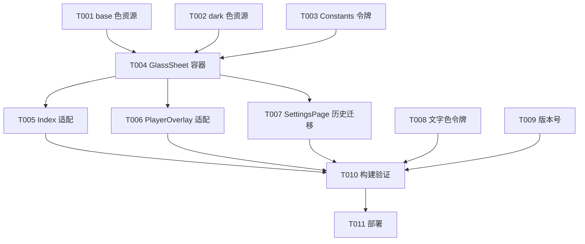

# Tasks: 浮层视觉重设计（播放队列 + 播放历史）

**Input**: Design documents from `spec/v0.4-Part1-sheet-visual-redesign/`（spec.md + plan.md）  
**Baseline**: `69d8c7f`（对照基线）  
**Tests**: 未要求测试任务，不生成

## Format: `[ID] [P?] [Story] Description`

- **[P]**: 可并行（不同文件、无未完成依赖）
- **[Story]**: 所属用户故事（US1–US7，映射 spec.md）
- 实施轮次建议：T001–T009 单轮顺序执行（单子代理），T010–T011 为验证阶段（spec-verify 执行）

## Path Conventions

- 单模块 HarmonyOS 工程，源码根 `entry/src/main/ets/`（pages/component/service/model 分层）
- 资源根 `entry/src/main/resources/`（base/dark 双目录）
- 应用级配置 `AppScope/app.json5`
- spec 工件 `spec/v0.4-Part1-sheet-visual-redesign/`

---

## Phase 1: Setup

无 Setup 任务（既有项目，无脚手架/依赖/工具链改动）。

---

## Phase 2: Foundational (Blocking Prerequisites)

**Purpose**: 颜色资源与常量令牌——所有用户故事的前置

- [X] T001 调整浅色色彩资源：`queue_panel_background` 条目改名 `sheet_panel_background` 且调值为 `#D9FFFFFF`；新增 `sheet_top_separator` `#14000000`、`sheet_shadow` `#14000000`、`sheet_fade_from` `#00FFFFFF`，文件 `entry/src/main/resources/base/element/color.json`
- [X] T002 [P] 调整深色色彩资源：`queue_panel_background` 条目改名 `sheet_panel_background` 且调值为 `#E61C1C1E`；新增 `sheet_top_separator` `#1AFFFFFF`、`sheet_shadow` `#80000000`、`sheet_fade_from` `#001C1C1E`，文件 `entry/src/main/resources/dark/element/color.json`
- [X] T003 [P] 常量令牌：新增 `SHEET_SLIDE_MS = 300`、`SHEET_FADE_HEIGHT = 80`、`SHEET_SHADOW_RADIUS_LIGHT = 16`、`SHEET_SHADOW_RADIUS_DARK = 24`、`SHEET_SHADOW_OFFSET_LIGHT = -4`、`SHEET_SHADOW_OFFSET_DARK = -8`；`DRAWER_CLOSE_DELAY_MS` 260→310（保持略长于动画时长），文件 `entry/src/main/ets/service/Constants.ets`

**注**: T001/T002 改名后 `QueueDrawer.ets` 的旧资源引用暂时失效，由 T004 统一切换（同轮实施、末尾统一构建，中间态不构建）。

**Checkpoint**: 资源与令牌就绪，容器重构可开始。

---

## Phase 3: User Story 1/2/4/5 - 通用容器 GlassSheet（队列浮层新视觉 + 动画 + 渐隐）(Priority: P1/P2/P3) 🎯 MVP

**Goal**: QueueDrawer 泛化改名 GlassSheet，承载全部视觉规范（US1/US2）、300ms 滑入+渐显动画（US4）、底部 80px 渐隐（US5），队列浮层率先达标。

**Independent Test**: 构建通过后，首页/播放页打开队列浮层，浅/深色逐项对照视觉规范。

- [X] T004 [US1] [US2] [US4] [US5] 容器重构：`git mv` 改名 `entry/src/main/ets/component/QueueDrawer.ets` → `entry/src/main/ets/component/GlassSheet.ets` 并重构——组件名 QueueDrawer→GlassSheet；新增 `@Param openState: BoolState`（替代内部 connectBool AS_SHOW_QUEUE_SHEET）、`@Param panelHeight: string = '65%'`、`@BuilderParam body: () => void`（替代直挂 QueueSheet()）；`@Param onRegisterClose` 关闭句柄注册机制原样保留；面板视觉：顶圆角 `TOKEN_RADIUS_XXL`（24px）、背景 `$r('app.color.sheet_panel_background')` + `backdropBlur(20)`、顶缘 1px 边框 `sheet_top_separator`、投影 `shadow(radius/offsetY 用 Constants 令牌, color: sheet_shadow)`；动画：位移 + 透明度双状态 300ms（`SHEET_SLIDE_MS`）同帧驱动，退出镜像反向 + `DRAWER_CLOSE_DELAY_MS` 延时卸载，遮罩过渡时长同步 300ms；底部渐隐带：body 内容区底部叠加 `SHEET_FADE_HEIGHT` 高度 `linearGradient`（`sheet_fade_from` → `sheet_panel_background`，`hitTestBehavior(HitTestMode.None)`）；删除文件内局部 `DRAWER_SLIDE_MS` 常量
- [X] T005 [US1] [US2] 挂载适配：`entry/src/main/ets/pages/Index.ets` 内容层 `QueueDrawer({ onRegisterClose: registerQueueClose })` 改为 `GlassSheet({ openState: 该页队列 BoolState 实例, panelHeight: '65%', onRegisterClose: registerQueueClose })` + body 传 `QueueSheet()`，条件挂载逻辑（内容层/播放层互斥）不变
- [X] T006 [P] [US1] [US2] 挂载适配：`entry/src/main/ets/pages/PlayerOverlay.ets` 播放层 GlassSheet 同款适配（约 1296 行处）

**Checkpoint**: 队列浮层两个挂载点均呈现新视觉 + 新动画 + 底部渐隐。

---

## Phase 4: User Story 3 - 播放历史面板迁移 GlassSheet (Priority: P1)

**Goal**: 历史面板弃系统 bindSheet，迁入 GlassSheet 共用容器（FR-008 复用），视觉/动画与队列完全一致。

**Independent Test**: 构建通过后，设置页 → 播放历史：面板视觉同队列；回放/左滑删除/清空二次确认回归；遮罩点击与系统返回均动画关闭。

- [X] T007 [US3] 历史面板迁移：`entry/src/main/ets/pages/SettingsPage.ets`——移除根节点 `.bindSheet(this.showPlayHistory.value, this.playHistoryPanel(), {...})` 全部选项块（height '62%'/dragBar/showClose/backgroundColor/preferType/onDisappear/onWillDismiss 整体删除）；页面根改为 Stack 结构、条件挂载 `GlassSheet({ openState: this.showPlayHistory, panelHeight: '62%', onRegisterClose: 历史关闭句柄注册 })`，body 传 `this.playHistoryPanel()`；`playHistoryPanel` @Builder 根节点移除 `.backgroundColor($r('app.color.page_background'))`（背景由容器提供），内部布局/数据源/回放/删除/清空逻辑零改动；新增历史动画关闭句柄成员（onRegisterClose 回调存入）；`onBackPressed` 的 showPlayHistory 分支改调动画关闭句柄（句柄未注册时回退直接置 false）；`openPlayHistory()`/HistoryDataSource/多选相关逻辑不动

**Checkpoint**: 两面板共用同一容器，历史面板行为对齐队列（无 dragBar、无下拉关闭，遮罩/返回关闭带动画）。

---

## Phase 5: User Story 6 - 全局文字色令牌 (Priority: P2)

**Goal**: text_primary/text_secondary 对齐设计稿色阶，全应用生效。

**Independent Test**: 构建通过后任意页面文字色为新色阶（深色次色 #8E8E93 可感知变暗）。

- [X] T008 [P] [US6] 文字色令牌调值：`text_primary` `#1A1A1A`→`#1D1D1F`、`text_secondary` `#666666`→`#6E6E73`，文件 `entry/src/main/resources/base/element/color.json`；`text_primary` `#FFFFFF`→`#F5F5F7`、`text_secondary` `#B3B3B8`→`#8E8E93`，文件 `entry/src/main/resources/dark/element/color.json`；`fg_on_light*`、`text_disabled`、`placeholder_color` 等其他令牌不动

---

## Phase 6: User Story 7 + Polish - 版本号 (Priority: P3)

- [X] T009 [US7] 版本号：`versionCode` 3000→4000、`versionName` "0.3.0"→"0.4.0"，文件 `AppScope/app.json5`

**Polish 检查**（随 T009 一并执行，无独立任务）：全仓确认无 `queue_panel_background`/`QueueDrawer` 残留引用（grep 校验）；`spec/feature.json` 已指向本目录无需改动。

---

## Phase 7: Verification

<!-- verification_scope: build-only -->

**Purpose**: 构建与部署验证（无 UI 验证任务）

- [x] T010 对本轮全部改动 `.ets` 文件运行 `arkts_check`，通过后执行 `devecocli build` 并修复编译错误（修复→重建循环直至成功）（✅ 2026-10-13 spec-verify：1 轮修复后 BUILD SUCCESSFUL，修复 GlassSheet `@Require @Param` 缺失 + PlayerOverlay 尾随闭包后链式 `.zIndex(100)` 改 Column 包装）
- [x] T011 部署应用到设备/模拟器（`devecocli run --skip-build`）（✅ 2026-10-13：模拟器重启后部署成功，v0.4.0(4000) 已在 Mate 90 Pro 模拟器运行，浅色+深色全量 UI 测试通过——含重启后复验）

---

## 📊 Dependency Graph



## ⚡ Parallel Execution Guide

| Phase | Tasks | Required Files | Execution Notes |
|---|---|---|---|
| Foundational | T001, T002, T003 | base/dark color.json、Constants.ets | 三任务不同文件可并行；T004 前必须全部完成 |
| 容器与挂载 | T005, T006, T007 | Index.ets、PlayerOverlay.ets、SettingsPage.ets | T004 完成后三挂载点可并行（不同文件） |
| 令牌与版本 | T008, T009 | color.json ×2、app.json5 | 与容器阶段无依赖，任意时机可并行 |
| Verification | T010, T011 | — | 全部实施任务完成后顺序执行 |

## Dependencies & Execution Order

- **Foundational（Phase 2）**: 无外部依赖，立即开始；阻塞全部用户故事
- **US1/US2/US4/US5（Phase 3）**: 依赖 T001–T003；T004 先行，T005/T006 随后
- **US3（Phase 4）**: 依赖 T004（共用容器）；与 T005/T006 无依赖
- **US6/US7（Phase 5/6）**: 无实施依赖，任意时机可做
- **Verification（Phase 7）**: 依赖全部实施任务

## Parallel Example

```text
# T004 完成后，三个挂载点任务并行（不同文件）:
Task: "T005 Index.ets 挂载适配"
Task: "T006 PlayerOverlay.ets 挂载适配"
Task: "T007 SettingsPage.ets 历史迁移"

# 任意时机并行（与容器阶段零交叉）:
Task: "T008 文字色令牌调值（base+dark color.json）"
Task: "T009 版本号 0.4.0/4000（app.json5）"
```

## Implementation Strategy

### MVP First（仅队列浮层）

1. 完成 T001–T003（资源与令牌）
2. 完成 T004–T006（容器 + 两挂载点）
3. **STOP and VALIDATE**: 构建并核验队列浮层浅/深色视觉
4. T008/T009 可随 MVP 一同交付

### Incremental Delivery

1. T001–T003 → 资源就绪
2. T004–T006 → 队列浮层新视觉闭环（MVP）
3. T007 → 历史面板并入共用容器
4. T008/T009 → 文字色阶 + 版本号
5. T010–T011 → 验证（spec-verify 子代理）

## Notes

- [P] 任务 = 不同文件、无未完成依赖
- [Story] 标签映射 spec.md 用户故事，可追溯
- T004 是唯一多故事承载任务（容器级实现天然覆盖 US1/US2/US4/US5）
- 中间态允许资源/引用短暂失配（单轮末统一构建），但 T010 前必须全绿
- 提交策略：实施完成后单独提交，`git diff 69d8c7f` 即为全量改动

## Summary Report

- **总任务数**: 11（实施 9 + 验证 2）
- **按故事**: US1/US2 各 3（T004–T006 共享）、US3 1（T007）、US4/US5 各 1（T004 承载）、US6 1（T008）、US7 1（T009）、基础设施 3（T001–T003）
- **并行机会**: T001/T002/T003 并行；T005/T006/T007 并行；T008/T009 任意并行
- **独立测试标准**: 每阶段 Checkpoint 均可独立构建核验（MVP = T001–T006 完成即队列浮层全量达标）
- **MVP 范围建议**: T001–T006（队列浮层新视觉闭环），T007–T009 为完整交付
- **格式自检**: ✅ 全部任务 `- [ ] [Txxx]` 格式、ID 唯一递增、US 阶段带 Story 标签、验证阶段无 Story 标签、计数一致
