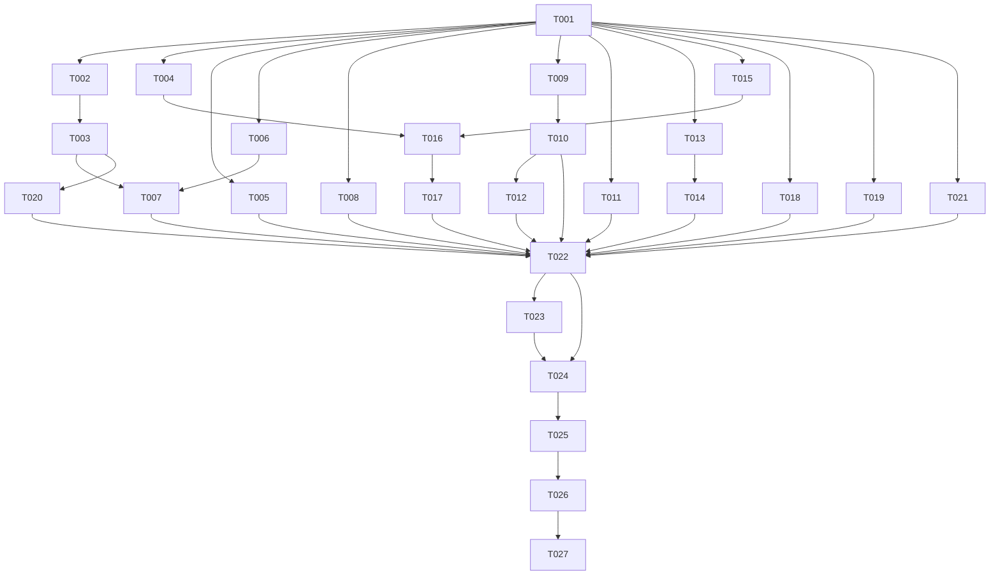

# Tasks: v0.4-Part1 UX 修复轮

**Input**: Design documents from `spec/v0.4-Part1-ux-fixes/`
**Prerequisites**: plan.md (required), spec.md (required for user stories)

**Organization**: 按用户故事分组（10 故事 / 17 项故事任务），全部为既有文件修改，零新增文件。

## Format: `[ID] [P?] [Story] Description`

- **[P]**: 可并行（不同文件、无未完成依赖）
- **[Story]**: 所属用户故事（US1–US10）
- 含确切文件路径

## Path Conventions

- 源码根：`entry/src/main/ets/`（pages / component / service / model 分层）
- 本轮零新增文件，全部为既有文件修改

## Phase 1: Setup

- [X] T001 通读 spec.md / plan.md / tasks.md，核对 12 项修复涉及的 11 个文件基线（重点：PlayerOverlay chevron 区 L876–885、详情 sheet L812–866、SettingsPage 历史面板/关于/音质区、BiliService fetchNav L346–363、GlassSheet 玻璃公式）

---

## Phase 2: Foundational (阻塞 US2/US7/US9)

- [X] T002 [P] BiliSession 扩展内存字段 vipStatus: number / face: string（clear() 一并清零，不落盘）entry/src/main/ets/service/BiliSession.ets
- [X] T003 fetchNav 补解析 data.vipStatus / data.face 并写入 BiliSession（零新增请求；字段缺失容错为 0/''）entry/src/main/ets/service/BiliService.ets（依赖 T002）
- [X] T004 [P] Constants 新增四个链接常量（GitCode/GitHub 项目地址 + BiliMusic/PiliPlus 仓库）entry/src/main/ets/service/Constants.ets

---

## Phase 3: User Story 1 - 播放层收起按钮修复 (P1) 🎯 MVP

**Goal**: chevron 点击可靠关闭播放层
**Independent Test**: 打开播放层 → 点收起按钮 → 播放层关闭（任意滚动位置、深浅色）

- [X] T005 [US1] chevron 容器重构：裸 SymbolGlyph.onClick 外包可点击容器（对齐同 Scroll 内已验证可用的 ▶按钮「外包 Row、识别器参战」结构）；若重构后命中链仍止于 Scroll，执行二级方案（顶栏移出滚动区）entry/src/main/ets/pages/PlayerOverlay.ets

**Checkpoint**: 收起按钮 10 次点击全部关闭

---

## Phase 4: User Story 2 - 音质档位与实际一致 (P1) 🎯 MVP

**Goal**: 音质选择页只列可用档位，显示与实际播放一致
**Independent Test**: 未登录/非会员/大会员三种状态核对可选项与提示

- [X] T006 [P] [US2] AudioQuality 档位可用性判定：输入 isLogged+vipStatus → 输出可用档位数组（64K 全员/132K 登录/192K 大会员/最高语义档）；含已存档位收敛逻辑 entry/src/main/ets/model/AudioQuality.ets
- [X] T007 [US2] 音质选择页档位过滤 + 分场景提示（未登录=「登录后可用更高音质」沿用；非会员=192K 需大会员；nav 失败按非会员）entry/src/main/ets/pages/SettingsPage.ets（依赖 T002/T003/T006）

**Checkpoint**: 三种账号状态可选项与 plan 矩阵完全一致

---

## Phase 5: User Story 3 - MiniPlayer 平滑重现 (P1) 🎯 MVP

**Goal**: 设置页返回无「消失-突现」闪现
**Independent Test**: 往返设置页 10 次观察 MiniPlayer 重现；快速往返验证竞态不回归

- [X] T008 [US3] 闪现定位与修复：加日志定位 onWillDisappear 定时器 → onSettingsPage 翻转 → Index Monitor animateTo 链路的帧序列，按定位结果做最小修复（T021/R4 竞态修复逻辑保留）entry/src/main/ets/pages/Index.ets（含 entry/src/main/ets/pages/SettingsPage.ets 返回链路）

**Checkpoint**: 往返 10 次零闪现，快速往返最终状态正确

---

## Phase 6: User Story 4 - 播放历史多选管理 (P2)

**Goal**: 历史面板多选交互与队列一致，移除清空按钮
**Independent Test**: 长按进入 → 勾选 → 删除所选（二次确认）→ 列表正确；重开面板选中不残留

- [X] T009 [P] [US4] 历史面板头部改造：新增队列同款 36×36 玻璃图标多选按钮（btn_glass+blur+border），移除「清空」文字按钮 entry/src/main/ets/pages/SettingsPage.ets
- [X] T010 [US4] 历史多选状态与交互：@Local selectMode/selectedIds、长按进入、点行勾选、操作行（全选/删除所选(计数)/返回）、批量删除二次确认、面板关闭自动复位 entry/src/main/ets/pages/SettingsPage.ets（依赖 T009）

**Checkpoint**: 全选+删除所选等价完成原「清空」能力

---

## Phase 7: User Story 5 - 多选态禁左滑 (P2)

**Goal**: 多选模式下队列/历史左滑删除禁用
**Independent Test**: 多选态左滑任意行无删除；退出多选恢复左滑

- [X] T011 [P] [US5] 队列 swipeAction 改条件挂载（仅非多选态挂删除动作）entry/src/main/ets/component/QueueSheet.ets
- [X] T012 [US5] 历史行左滑删除改条件挂载（同模式）entry/src/main/ets/pages/SettingsPage.ets（依赖 T010）

**Checkpoint**: 两面板多选态左滑零删除触发

---

## Phase 8: User Story 6 - 视频详情页视觉对齐 (P2)

**Goal**: 详情 sheet 玻璃公式背景 + 系统图标展开指示
**Independent Test**: 深浅双模式打开详情 sheet 核对背景/分隔线/指示图标

- [X] T013 [US6] 详情 sheet 背景玻璃公式：内容根容器 sheet_background → sheet_panel_background + backdropBlur(20) + 顶 1px sheet_top_separator（保留 bindSheet detents/dragBar/下滑关闭）entry/src/main/ets/pages/PlayerOverlay.ets
- [X] T014 [US6] 展开指示「▼」Text 字符 → sys.symbol.chevron_down SymbolGlyph（打开/关闭 180° 旋转保留）entry/src/main/ets/pages/PlayerOverlay.ets（依赖 T013，同文件顺序执行）

**Checkpoint**: 详情 sheet 与队列面板同公式，指示图标为 SymbolGlyph

---

## Phase 9: User Story 7 - 关于页重做 (P2)

**Goal**: 视觉对齐 + 确切文案内容 + 四链接二次确认跳转
**Independent Test**: 打开关于核对文案/链接点击确认跳转/调试模式开关不受影响

- [X] T015 [P] [US7] 关于 bindSheet 内容根容器玻璃公式对齐（sheet_panel_background + 顶分隔线，保留系统 sheet 交互）entry/src/main/ets/pages/SettingsPage.ets
- [X] T016 [US7] 关于内容重写：spec FR-009 确切文案（简介段 → 五条核心功能 → 关于本项目声明段；声明段 BiliMusic/PiliPlus 用可点击 Span），排除部署/运行/签名内容 entry/src/main/ets/pages/SettingsPage.ets（依赖 T004/T015）
- [X] T017 [US7] 四链接统一跳转交互：点击 → AlertDialog 二次确认 → openLink(appLinkingOnly=false) 拉起浏览器，取消不跳转，失败 toast；项目地址两行（GitCode/GitHub）+ 声明段两 Span 复用同一实现 entry/src/main/ets/pages/SettingsPage.ets（依赖 T016）

**Checkpoint**: 四链接行为一致，文案与 spec 逐字一致

---

## Phase 10: User Story 8 - 按压态方角修复 (P2)

**Goal**: 分组首尾行按压背景跟随卡片圆角
**Independent Test**: 深浅双模式按压分组首/尾行观察无方角

- [X] T018 [P] [US8] SettingsGroup 卡片容器加 .clip(true)（裁剪子内容方形按压背景）entry/src/main/ets/component/SettingsGroup.ets
- [X] T019 [P] [US8] LogPage 列表同模式裁剪修复 entry/src/main/ets/pages/LogPage.ets

**Checkpoint**: 分组/日志首尾行按压零方角溢出

---

## Phase 11: User Story 9 - 账号行用户头像 (P3)

**Goal**: 已登录显示圆形用户头像
**Independent Test**: 登录显示头像；登出/加载失败回退 person 图标

- [X] T020 [P] [US9] 账号行头像：已登录且 face 非空 → 圆形裁切 Image 替代 sys.symbol.person，onError/URL 空回退原图标；未登录不变 entry/src/main/ets/pages/SettingsPage.ets（依赖 T002/T003）

**Checkpoint**: 三种状态（登录/失败回退/未登录）显示正确

---

## Phase 12: User Story 10 - 调试模式启动提醒 (P3)

**Goal**: 启动恢复 debug 状态并提醒
**Independent Test**: 开启调试 → 重启 → toast「调试模式运行中」；关闭 → 重启无提醒

- [X] T021 [P] [US10] debug 启动链路：Index aboutToAppear 读 KEY_DEBUG_MODE → Logger.setDebugMode（恢复前移，修复「不进设置页 debug 不生效」）+ 开启时 toast「调试模式运行中」；SettingsPage 重复 setDebugMode 移除（AppStore 读取供开关显示保留）entry/src/main/ets/pages/Index.ets（含 entry/src/main/ets/pages/SettingsPage.ets 恢复逻辑调整）

**Checkpoint**: 启动即生效 + 提醒；开关行为不回归

---

## Phase 13: Polish

- [X] T022 令牌/规范自查：本轮全部改动零裸数字硬编码（Constants.TOKEN_*）、零裸色值（$r('app.color.*')）、零注释（ponytail: 标注除外）、零 any/unknown/as 断言；arkts_check 静态预检全部改动 .ets 文件并清零
- [X] T023 文档同步：PROJECT_NOTES.md 标注本轮修复项（chevron/音质不符/MiniPlayer 闪现等）；AGENTS.md 若涉及行为描述变化同步更新

---

## Phase 14: Verification

<!-- verification_scope: build+ui -->

- [X] T024 构建并修复编译错误（devecocli build；修复循环直至成功）
- [X] T025 部署应用到模拟器（devecocli run --skip-build）
- [X] T026 逐用户故事 UI 验证：US1–US10 顺序验证（深浅双模式视觉全验：详情/关于/指示图标/按压圆角/头像/多选操作行；行为单模式 + 关键路径双模式抽查：chevron/多选/闪现）；每故事最多 3 轮验证-修复；全部通过后终验一轮
- [X] T027 UI 验证完成后关闭模拟器（释放资源， hdc 断开）
- [X] T028 [US7] 验证后真机反馈修复：关于页内容展示不全——aboutSheet 内层 Scroll `height('100%')` 被「完成」头行顶出 sheet 底界裁掉一段，滚到底仍缺尾段；改 `layoutWeight(1)` 占头部外剩余高度（与详情 sheet 同范式）entry/src/main/ets/pages/SettingsPage.ets

---

## 📊 Dependency Graph



## ⚡ Parallel Execution Guide

| Phase | Tasks | Required Files | Execution Notes |
|---|---|---|---|
| Foundational | T002, T004 | BiliSession.ets, Constants.ets | 可并行（不同文件）；T003 串行随后 |
| US1/US5/US8/US10 | T005, T011, T018, T019, T021 | PlayerOverlay/QueueSheet/SettingsGroup/LogPage/Index | 互不相干文件，可并行 |
| US4→US5 链 | T009→T010→T012 | SettingsPage.ets | 同文件内串行 |
| US6 链 | T013→T014 | PlayerOverlay.ets | 同文件串行；与 T005 同文件注意冲突 |
| US7 链 | T015→T016→T017 | SettingsPage.ets | 同文件串行；与 US4 链同文件 |
| US2/US9 | T006→T007, T020 | AudioQuality.ets, SettingsPage.ets | T007/T020 与 US4/US7 链同文件 |

**同文件串行约束**：SettingsPage.ets 被 4 条链触及（US4/US5/US7/US2/US9/US10），单代理实施时按 Phase 顺序执行即天然满足。

## Dependencies & Execution Order

- **Setup (Phase 1)**: 无依赖，立即开始
- **Foundational (Phase 2)**: 依赖 T001；T003 依赖 T002
- **User Stories (Phase 3–12)**: 均依赖 T001；标注依赖的按链执行
- **Polish (Phase 13)**: 依赖全部实施任务
- **Verification (Phase 14)**: 依赖 T022/T023；T024→T025→T026→T027 严格串行

## Parallel Example

```bash
# T001 完成后，互不相干文件的任务并行：
Task: "T005 [US1] chevron 容器重构 entry/src/main/ets/pages/PlayerOverlay.ets"
Task: "T011 [US5] 队列 swipeAction 条件挂载 entry/src/main/ets/component/QueueSheet.ets"
Task: "T018 [US8] SettingsGroup clip entry/src/main/ets/component/SettingsGroup.ets"

# SettingsPage.ets 涉及任务必须串行：
T009 → T010 → T012 → T015 → T016 → T017 → T020 → T007
```

## Implementation Strategy

### 实施轮次建议

- **单轮全量**（推荐）：任务均为局部修改，单次实施轮顺序执行全部 24 项实施任务（T001–T023）后进入验证
- 备选分两轮：轮 A = MVP（T001–T008，P1 三故事 + 基础层）+ 验证；轮 B = 其余故事 + Polish + 验证

### MVP First（P1 三故事）

1. T001 Setup → T002–T004 基础层
2. T005（US1 收起）→ T007（US2 音质）→ T008（US3 闪现）
3. 每个 Checkpoint 独立验证

## Notes

- [P] 任务 = 不同文件、无未完成依赖
- [Story] 标签映射到 spec.md 用户故事
- 每故事独立可测（见各 Phase Checkpoint）
- UI 验证完成后必须关闭模拟器（T027）
- 验证范围 build+ui：深浅双模式视觉全验，行为单模式 + 关键路径抽查

## Summary Report

- **总任务数**: 27（实施 23 + 验证 4）
- **按故事**: US1:1 / US2:2 / US3:1 / US4:2 / US5:2 / US6:2 / US7:3 / US8:2 / US9:1 / US10:1
- **基础层**: 3（BiliSession/fetchNav/Constants，阻塞 US2/US7/US9）
- **独立可测**: 每故事有独立验证标准
- **MVP 范围建议**: P1 三故事（US1 收起 / US2 音质 / US3 闪现）+ 基础层 = T001–T008
- **并行机会**: 基础层 2 任务并行；互不相干文件的 5 条实施链并行；单代理按 Phase 顺序执行天然满足同文件串行
