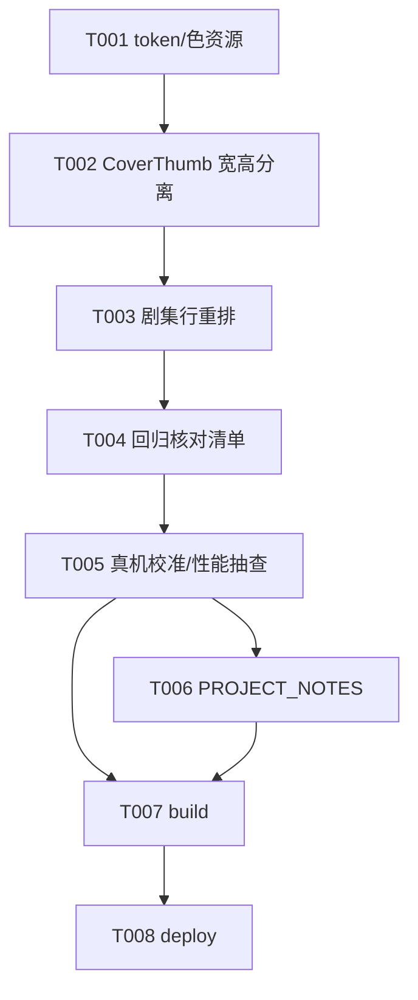

# Tasks: 订阅详情页重写——B 站风格剧集行（v0.4-Part2）

**Input**: Design documents from `spec/v0.4-Part2-source-page-redesign/`  
**Prerequisites**: plan.md（R1-R5 决策）、spec.md（US1-US2）  
**Tests**: 无测试套件（项目现状），纯 UI 特性，验证走构建 + 真机视觉检视

## Format: `[ID] [P?] [Story] Description`

- **[P]**: 可并行（不同文件、无未完成依赖）
- **[Story]**: 归属 User Story

## Path Conventions

- 单模块项目：源码 `entry/src/main/ets/`；资源 `entry/src/main/resources/`
- 本特性改动：`pages/SourcePage.ets`、`component/CoverThumb.ets`、`service/Constants.ets`、`resources/base/element/color.json`，无新文件

---

## Phase 1: Setup (Shared Infrastructure)

- [ ] T001 基础 token 与资源登记：Constants 新增 `EPISODE_THUMB_W/H`（16:9 剧集缩略图显示尺寸，vp，初值实施时按真机校准占位）与 `EPISODE_THUMB_REQ_W/H`（缩略请求像素档，16:9 比例、约 2 倍显示尺寸起步）；color.json 新增时长角标底色资源（半透明黑 scrim，如 `duration_badge_scrim`）与角标字色（白，无现成可复用 token 时新增）——`entry/src/main/ets/service/Constants.ets`、`entry/src/main/resources/base/element/color.json`

---

## Phase 2: Foundational (Blocking Prerequisites)

**⚠️ 本阶段完成前禁止开始任何 User Story**

- [ ] T002 CoverThumb 宽高分离扩展（plan R1）：新增普通成员 `thumbWidth: number = 0`、`thumbHeight: number = 0`；两者均 >0 时 `Image`/耳机占位 `Column` 以 `thumbWidth × thumbHeight` 定尺寸、缩略请求档改用 16:9 档 `CoverUrl.sized`，否则维持 `thumbSize` 方形；既有 4 处调用点（`SourcePage` 头部、`HomePage`、`SettingsPage`、`AddSubscriptionSheet`）零改动复核——`entry/src/main/ets/component/CoverThumb.ets`（依赖 T001）

**Checkpoint**: 16:9 缩略图能力就绪，剧集行重排可开始

---

## Phase 3: User Story 1 - 剧集行封面与时长角标 (Priority: P1) 🎯 MVP

**Goal**: 剧集行左图右文重排，时长角标贴封面右下角  
**Independent Test**: 打开任一有剧集的订阅详情页，逐行核对封面/角标/标题/日期/NEW/已播显示与位置

- [ ] T003 [US1] SourcePage 剧集行重排（plan R2/R3）：`Row { Stack(alignContent: BottomEnd) { CoverThumb(thumbWidth=EPISODE_THUMB_W, thumbHeight=EPISODE_THUMB_H, radius token) ; 时长角标 } + Column { 标题(TOKEN_FONT_BODY_L, ≤2行, 截断) ; Row { 日期, NEW, 已播 } } }`；角标 `Text(formatDuration(item.duration))`（scrim 底 + 白字 + TOKEN_FONT_AUX + 小圆角 + 底右小边距），`duration<=0` 不渲染；时长从原文字行移除；行按压态（pressedKey）/点击播放/ForEach key 沿用；色值/数值全走 `$r('app.color.*')`/`Constants.TOKEN_*`——`entry/src/main/ets/pages/SourcePage.ets`（依赖 T002）

**Checkpoint**: US1 独立可测（真机/模拟器视觉检视）

---

## Phase 4: User Story 2 - 全功能回归不变 (Priority: P1) 🎯 MVP

**Goal**: 重排零功能缺失（spec FR-004 清单）  
**Independent Test**: 按 FR-004 清单逐项操作回归，行为与重排前一致

- [ ] T004 [US2] 回归核对清单执行（复核型，发现回归才改码）：① NEW 徽标（pubdate 晚于 lastSeenAt）与已播标记显示逻辑零改动；② 「播放全部」入口与行为；③ 手动刷新含 Loading 态；④ 触底加载更早（UP/FAV/SEASON/SERIES 四类翻页链路）与「没有更多了」；⑤ 退订二次确认；⑥ 空态「暂无节目」；⑦ 行按压态；⑧ 触底加载行/到底行不套用新行布局（辅助行样式不变）——`entry/src/main/ets/pages/SourcePage.ets`（依赖 T003）

**Checkpoint**: US1+US2 全部达成，重写完整可交付

---

## Phase 5: Polish & Cross-Cutting Concerns

- [ ] T005 真机视觉校准与性能抽查：`EPISODE_THUMB_W/H` 与角标尺寸/边距按真机显示效果调 token（禁止散落数值）；100+ 集订阅快速滚动流畅性抽查，卡顿则按 plan R4 `ponytail:` 标注升级 `LazyForEach`+IDataSource（升级路径：历史面板 HistoryDataSource 先例）——`entry/src/main/ets/service/Constants.ets`、`entry/src/main/ets/pages/SourcePage.ets`（依赖 T004）
- [ ] T006 [P] 更新项目备忘：PROJECT_NOTES.md §五登记真机验证项（VR：剧集行封面/角标四类源一致性、无封面/无时长边界形态、长列表滚动性能）；若触发 LazyForEach 升级一并登记——`PROJECT_NOTES.md`（依赖 T005）

---

## Phase 6: Verification

<!-- verification_scope: build-only -->

**Purpose**: 构建 + 部署验证（视觉检视按 PROJECT_NOTES VR 项另行真机执行）

- [ ] T007 Build project and fix any compilation errors (invoke `devecocli build`; iterate fix → build until success)
- [ ] T008 Deploy application to device/emulator (invoke `devecocli run --skip-build`)

---

## Dependencies & Execution Order

### Phase Dependencies

- **Setup（Phase 1）**: 无依赖，即始；token 与色资源先行
- **Foundational（Phase 2）**: 依赖 Setup；**阻塞全部 User Story**（CoverThumb 16:9 能力是行重排前提）
- **User Stories（Phase 3-4）**: US1（行重排）→ US2（回归核对，依赖 US1 完成）
- **Polish（Phase 5）**: 依赖 US1/US2 完成
- **Verification（Phase 6）**: 依赖 Polish

### Dependency Graph

## Parallel Example

| Phase | Tasks | Required Files | Execution Notes |
|---|---|---|---|
| Polish | T006 | PROJECT_NOTES.md | 与 T007 可并行 |
| 与 A 轮（进度同步） | 本轮 T001 vs A 轮 T001 | Constants.ets | 两轮并行须错开该文件提交，建议同轮先后执行 |

## Implementation Strategy

### MVP First（US1+US2 同为 P1）

1. 完成 Phase 1-2（token + CoverThumb 扩展）
2. 完成 US1（T003 行重排）+ US2（T004 回归核对）→ **重写完整交付**
3. Polish（T005 校准）→ 构建/部署 → 真机视觉检视（VR 项）

### 实施轮次建议

- **单轮完成**：T001-T008（改动面小、链路短，一轮做完）
- 与 `v0.4-Part2-play-history-sync` 轮建议**同轮先后执行**（先 A 后 B，A 为 P1 核心闭环；唯一文件交集 Constants.ets，顺序执行天然错开）

## Notes

- [P] 任务=不同文件、无未完成依赖
- [Story] 标签映射 spec.md User Story，可独立实现/验证
- 每 Task 或逻辑组完成后提交；任一 Checkpoint 可停下独立验证
- 纯视觉重排红线：头部/路由/数据流/状态管理（@ComponentV2）零改动；四类订阅行为一致
- 令牌规范：色值 `$r('app.color.*')`、数值 `Constants.TOKEN_*`，禁裸数字硬编码
- 规划轮产出：本 tasks.md 为实施路线图，本轮不实施

## Summary Report

- **Total**: 8 tasks（实施 6 + 验证 2）
- **Per-story**: US1×1（T003）/ US2×1（T004）/ 基础设施 2（T001-T002）/ Polish 2（T005-T006）
- **MVP scope**: T001-T004（行重排 + 回归核对，即完整特性）
- **关键路径**: T001 → T002 → T003 → T004 → T005 → 构建
