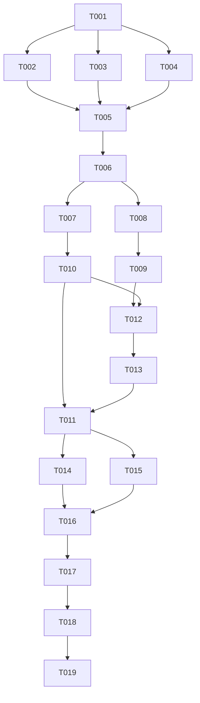

# Tasks: 四层 z 序重构（v0.4-Part2-z-layer-refactor）

**Input**: Design documents from `spec/v0.4-Part2-z-layer-refactor/`
**Prerequisites**: plan.md（分文件变更目标 #1–#11）、spec.md（US1–US8）

**Tests**: 项目无测试套件（devDependencies 有 hypium 但零测试文件），不生成测试任务；验证 = 构建 + 模拟器 UI 实测（用完关闭模拟器，结果回填 PROJECT_NOTES §五）。

**执行上下文（移交说明）**: 本清单由规划轮（2026-10-13，基线 commit f228390）产出，Phase 4/5 按序执行。任务行号为基线参考值，实施以实际内容定位为准；每任务的具体改法以 plan.md「分文件变更目标」对应条目（#1–#11）与「Research & Decisions」（D1–D10）为准，本清单给定顺序、依赖与验收。

## Format: `[ID] [P?] [Story] Description`

- **[P]**: 可并行（不同文件、无未完成依赖）
- **[Story]**: 对应 spec.md 用户故事；Setup/Foundational/Polish/Verification 阶段无故事标签

## Path Conventions

- 单模块工程：源码根 `entry/src/main/ets/`（pages/service/component/model 分层），资源根 `entry/src/main/resources/`
- 本清单所有任务路径均为仓库根相对路径；spec 工件在 `spec/v0.4-Part2-z-layer-refactor/`

---

## Phase 1: Setup

**Purpose**: 新键/常量就位（只增不删，退役键删除延至 T011 收尾）

- [X] T001 Constants.ets 增 `AS_SHOW_SETTINGS_PAGE`、`AS_SHOW_LOG_PAGE`（AS_* 瞬态键段）、`PAGE_LAYER_SLIDE_MS = 350`（动画常量段）——详见 plan.md 分文件目标 #1

---

## Phase 2: Foundational

**Purpose**: 返回链、两页去路由化——Index 接线（T005）前的全部独立文件工作；三任务互不触碰同一文件

- [X] T002 [P] BackHandler.ets `dismissOverlaysForBack` 扩为全链分层序列（队列→倍速→模式→睡眠选择→睡眠→浮层→日志层→设置句柄→设置层→false）+ 新增 `registerSettingsBack`（对齐 registerQueueClose 范式）+ 现浮层分支内历史面板处理（L32-35）迁出归设置句柄 + 头注释更新——详见 plan.md #2、D5
- [X] T003 [P] LogPage.ets 去路由化：`struct LogPage` 加 export、根 NavDestination→Column（补不透明底）、返回按钮改置 `AS_SHOW_LOG_PAGE` 假值、删属性链 L251-256 与 `navPathStack`/`dismissOverlaysForBack` 导入；`LogPageBuilder` 与 router_map 条目保留至 T006——详见 plan.md #6
- [X] T004 [P] SettingsPage.ets 去路由化：`struct SettingsPage` 加 export、根 NavDestination→Stack（补不透明底）、返回按钮改置 `AS_SHOW_SETTINGS_PAGE` 假值、`openLogPage` 改置 `AS_SHOW_LOG_PAGE` 真值、删 `navPathStack`/`onSettingsPageTimer`/NavDestination 属性链 L1744-1789 全段；`SettingsPageBuilder` 保留至 T006；历史面板全套（playHistoryPanel/historyClose/多选/openPlayHistory/replayHistory/数据同步/GlassSheet 挂载）原样保留——详见 plan.md #5

**Checkpoint**: 三个文件独立就绪，Index 仍走旧机制（路由+自维护返回链），构建通过、运行行为不变。

---

## Phase 3: User Story 1 - 退出设置页胶囊不再突现 (Priority: P1) 🎯 核心

**Goal**: Index Stack 层序重排 + 两层挂载 + 全部接线——US1（胶囊覆盖）与 US2（设置/日志行为不变）由本阶段交付；US2 无独立编码任务，其零回归红线（除三项批准变更外零可感知变化）是本阶段与 Phase 2 全部改动的验收约束。

**Independent Test**: 播放中反复进出设置页（含快速往返），设置层滑出全程胶囊逐帧揭示、无延时突现（模拟器实测，验证阶段执行）。

- [X] T005 [US1] Index.ets 层序重排：build Stack 自下而上改为 背景→Navigation→胶囊列→设置层条件块→日志层条件块→PlayerOverlay 条件块→队列 GlassSheet 条件块（移入末位，条件改仅 `showQueueSheet`）；删 `onSettingsPage`/`miniHidden`/`@Monitor onMiniVisibilityChanged` 全段/胶囊列 opacity-translate-hitTestBehavior 三属性；`onBackPress` 收敛为单调用 `dismissOverlaysForBack()`；增 `@Local showSettingsPage/showLogPage`；PlayerOverlay 传参删 `onRegisterClose`；导入 SettingsPage/LogPage——详见 plan.md #4
- [X] T006 [US1] 接线收口：HomePage.ets 设置入口（L400-403）改置 `AS_SHOW_SETTINGS_PAGE` 真值；删 `SettingsPageBuilder`/`LogPageBuilder`；router_map.json 摘除 `settingsPage`/`logPage`（保留 `sourcePage`）——详见 plan.md #3/#8

**Checkpoint**: US1/US2/US3 功能链完整——设置/日志层挂载、入口切换、返回链统一全部生效；构建通过。

---

## Phase 4: User Story 3 - 历史点播与分层返回链 (Priority: P1)

**Goal**: 设置页内部面板（音质/历史）接入统一返回链——历史点播语义与现状一致（浮层盖设置层，返回先关浮层）。

**Independent Test**: 设置页历史面板点播→返回→再返回，观察浮层与设置层开合次序（模拟器实测，验证阶段执行）。

- [X] T007 [US3] SettingsPage.ets settingsBackHandle 注册：aboutToAppear 经 `registerSettingsBack` 注册真句柄、aboutToDisappear 注销；句柄内部次序 `showQualitySheet`→关闭返 true、`showPlayHistory`→多选态先退多选返 true→historyClose 句柄（无则直置标志）返 true、否则 false——迁自原 onBackPressed L1796-1811，迁移非重写，详见 plan.md #5、Contracts「registerSettingsBack」

---

## Phase 5: User Story 4 - 队列单挂载点 (Priority: P2)

**Goal**: 队列收敛为 Index 单一挂载（T005 已完成 Index 侧：队列块移 Stack 末位、条件仅 `showQueueSheet`）；本阶段删 PlayerOverlay 内部份。

**Independent Test**: 播放页按钮与胶囊按钮两入口分别开队列，对照重构前位置/遮罩/关闭动画（模拟器实测，验证阶段执行）。

- [X] T008 [US4] PlayerOverlay.ets 删内部队列渲染块 L1319-1334（含注释）+ 删 `onRegisterClose` 参数（成员声明；Index 传参已于 T005 删）；保留 L1351 `noOverlayOpen` 中 showQueueSheet 判定——详见 plan.md #7

---

## Phase 6: User Story 5 - 未登录音质档位显示 (Priority: P2)

**Goal**: 未登录兜底流音质档位如实显示 64K 并引导登录（纯展示层，不动取流）。

**Independent Test**: 未登录与登录两态分别打开播放浮层音质面板，对照档位与文案（模拟器实测，验证阶段执行）。

- [X] T009 [US5] PlayerOverlay.ets 音质兜底改写：qualityPanel L664-704 else 分支档位「默认」→「64K」、提示文案「当前内容未提供多音质选择」→ 登录引导（措辞定稿方向「登录后可选更高音质」）、L664 旁「未登录不额外提示」注释随改移除；qualityEntryLabel L1246-1258 兜底分支同步「64K」——详见 plan.md #7、D9

---

## Phase 7: User Story 6 - 机制净删除 (Priority: P3)

**Goal**: 胶囊显隐时序修补机制与日志计数缓存全部退役；三页 padding 静态化。

**Independent Test**: 冷启动与清空队列两空态对照底部占位与预留；全仓检索退役键/常量名零残留。

- [X] T010 [US6] HomePage.ets/SourcePage.ets/SettingsPage.ets padding 静态化：删三处 `miniPlayerVisible` 成员（HomePage L70-71、SourcePage L57-58、SettingsPage L126-127），padding 三元删（HomePage L435、SourcePage L495、SettingsPage L1694），恒取 `MINI_PLAYER_CLEARANCE`——详见 plan.md #5/#8/#9
- [X] T011 [US6] Constants.ets 收尾删除：`AS_MINI_PLAYER_VISIBLE`（L59）、`AS_ON_SETTINGS_PAGE`（L60）、`NAV_EXIT_TRANSITION_MS`（L119）、`MINI_VISIBILITY_ANIM_MS`（L121）；删除后全仓检索四名零残留（消费方已于 T004/T005/T010 全删）——详见 plan.md #1

---

## Phase 8: User Story 7 - 账号栏大会员标识 (Priority: P3)

**Goal**: 登录且 vipStatus === 1 时账号栏昵称旁显示大会员标识（品牌粉小标签，贴近 B 站官方视觉）。

**Independent Test**: 大会员账号/普通账号/未登录三态查看设置页账号栏（模拟器实测，验证阶段执行）。

- [X] T012 [US7] color.json 增 `vip_badge_bg`（品牌粉）/`vip_badge_text`（白）+ SettingsRow.ets 新增可选 `@Param vipBadge`（默认 false，标题侧渲染「大会员」小标签）+ SettingsPage.ets 账号行（L1538-1544）传 `vipBadge`（BiliSession vipStatus === 1 判定）——详见 plan.md #10、D10

---

## Phase 9: User Story 8 - 列表计数移除 (Priority: P3)

**Goal**: 历史面板标题、历史入口行、日志入口行不再显示条数计数；logCount 机制随展示删除。

**Independent Test**: 有/无历史、有/无日志两态查看对应位置，无「(N)」「N 条」字样、无空计数占位。

- [X] T013 [US8] SettingsPage.ets 计数移除：历史面板标题（L1262）、历史入口行 valueText（L1655-1656）、日志入口行 valueText（L1666）计数删；`logCount` 成员（L108）与 aboutToAppear 初始化（L182）删（onShown 刷新已随 T004 属性链删除）；`Logger.count()` 引用随之清理——详见 plan.md #5、D6

---

## Phase 10: Polish & Cross-Cutting Concerns

**Purpose**: 文档登记与架构说明同步（两文件可并行）

- [X] T014 [P] PROJECT_NOTES.md：§三补轮次条目；§五登记本轮流模拟器实测项（层转场/返回链分层/队列盖浮层/历史点播覆盖序/深栈逐层关闭/静态 padding 空态/未登录音质 64K/VIP 徽标/计数移除后走查，结果由 T019 回填）；原「退出设置页胶囊突现」bug 销项说明（根因 z 序，时序修补整体退役）——详见 plan.md #11
- [X] T015 [P] AGENTS.md：架构「导航」节更新（设置/日志去路由改层级、历史面板留 L2、router_map 仅 sourcePage、四层 z 序）——详见 plan.md #11

---

## Phase 11: Verification

<!-- verification_scope: build+ui -->

**Purpose**: 构建 + 模拟器 UI 实测（模拟器为一次性资源，用完关闭）

- [X] T016 构建验证：对本轮全部改动 `.ets` 文件跑 arkts_check 预检，通过后 `devecocli build`；有错则修复→重建直至通过（同一目标最多 3 次仍败即暂停报告）
- [X] T017 模拟器部署：启动模拟器，`devecocli run --skip-build` 部署，确认安装启动正常
- [X] T018 UI 实测（模拟器）：US1–US8 逐故事走查（一故事一用例；层转场/返回链分层/队列盖浮层/历史点播覆盖序/深栈逐层关闭/静态 padding 空态/未登录音质 64K/VIP 徽标/计数移除）；异常→修复→重建→复验（每故事最多 3 次验证尝试）
- [X] T019 收尾：实测结果回填 PROJECT_NOTES §五（通过销项/失败登记）；关闭模拟器

---

## Dependencies & Execution Order

### 📊 Dependency Graph



### 硬依赖说明

- **T005 依赖 T001–T004**：Index 挂载需两页已 export、新键与转场常量已就位、返回链已可承接
- **T006 必须最后接线**：Builder 删除与 router_map 摘除若先于 Index 挂载/入口切换，设置入口运行时断裂
- **T011 必须在 T004/T005/T010 之后**：四个退役键/常量的消费方全部移除后 Constants 才能删（ArkTS 编译期校验）
- **T009 在 T008 之后**：同文件（PlayerOverlay）顺序执行，避免编辑冲突
- **T012/T013 在 T010 之后**：同文件（SettingsPage）顺序执行

### ⚡ Parallel Execution Guide

| Phase | Tasks | Required Files | Execution Notes |
|---|---|---|---|
| Foundational | T002 ∥ T003 ∥ T004 | BackHandler / LogPage / SettingsPage | 三文件互不交叉，可并行 |
| Polish | T014 ∥ T015 | PROJECT_NOTES.md / AGENTS.md | 两文档并行 |
| 其余 | — | — | 单文件簇内严格串行（Index→接线→SettingsPage 簇→PlayerOverlay 簇） |

## Parallel Example: Foundational 三任务

```bash
# 三文件互不交叉，可同时开工（单代理则按 T002→T003→T004 顺序）：
Task T002: "BackHandler.ets 返回链全链扩展 + registerSettingsBack"
Task T003: "LogPage.ets 去路由化（export/根 Column/返回置假/删属性链）"
Task T004: "SettingsPage.ets 去路由化（export/根 Stack/返回置假/openLogPage 置真/删属性链）"
```

---

## Implementation Strategy

### MVP First（轮次 1 = T001–T007）

1. 完成 Setup + Foundational（T001–T004）→ 三文件独立就绪
2. 完成核心层重构（T005–T007）→ US1/US2/US3 全部落地
3. **STOP and VALIDATE**：构建通过 + 对照 spec.md US1/US2/US3 验收场景自查代码路径
4. 此时已是可独立交付的 MVP——本轮重构直接动因（胶囊 bug 根因消除）完成

### Incremental Delivery

1. 轮次 1（T001–T007）：核心层重构 → 提交 `feat: v0.4.0-Part2（四层 z 序重构：设置/日志去路由 + 队列收敛 + 返回链统一）`
2. 轮次 2（T008–T013）：队列内部删 + 音质 64K + 净删除 + VIP 徽标 + 计数移除 → 提交 `feat: v0.4.0-Part2（音质 64K 显示 + 大会员标识 + 机制净删除）`
3. 轮次 3（T014–T019）：文档登记 + 构建 + 模拟器 UI 实测 + 结果回填 → 提交 `docs: v0.4.0-Part2（z 序重构登记 + 模拟器实测销项）`

### 单代理执行注意

- 单代理实施时忽略 [P] 并行标记，按 T001→T019 严格顺序执行即可
- 每任务完成后构建应保持通过（中途态允许功能未全接通，不允许编译断裂）
- 版本号不动（0.4.0/4000）；提交信息遵循 AGENTS.md「Git 提交」规范

---

## Notes

- [P] 任务 = 不同文件、无未完成依赖
- [Story] 标签映射 spec.md 用户故事，供验收追溯
- 验证失败处理遵循「无人值守模式」：小问题记录继续、大问题暂停报告、同一目标最多重试 3 次
- 全部行号为 f228390 基线参考，实施时以实际内容定位
