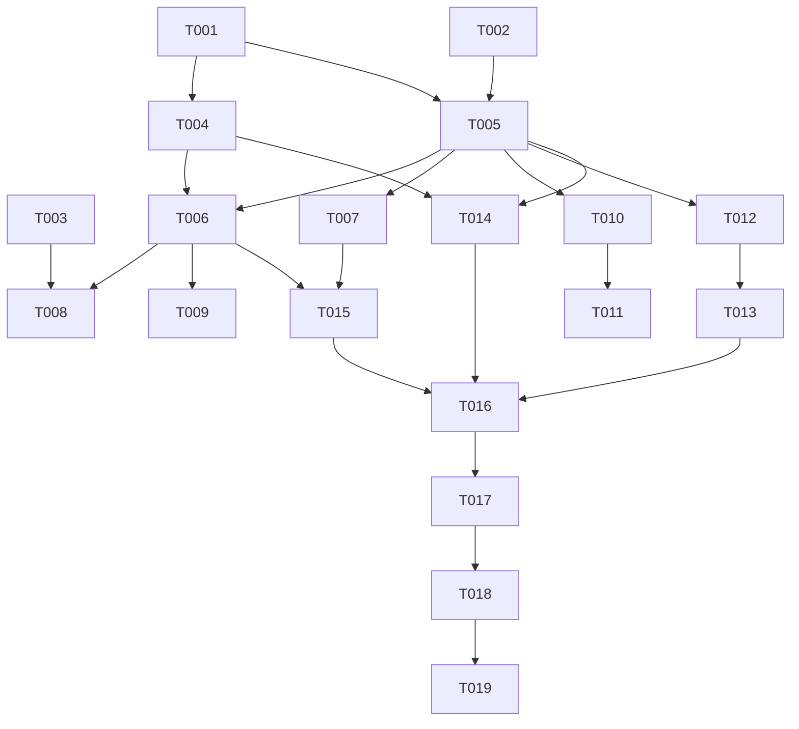
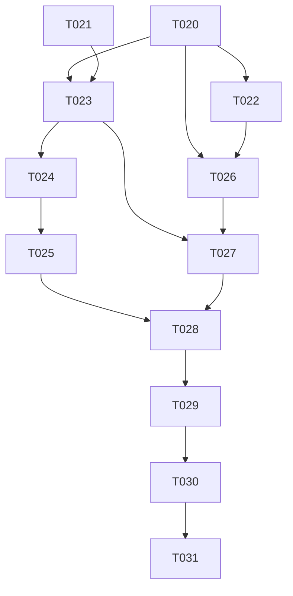

# Tasks: 多分P 视频播放支持（v0.4-fix-multi-part）

**Input**: Design documents from `spec/v0.4-fix-multi-part/`
**Prerequisites**: plan.md（required），spec.md（required）

**Tests**: 无测试套件，未约定 TDD，不生成测试任务。验证 = arkts_check + devecocli build（build-only，两轮均是）。

**Organization**: 两轮合并单文档——第一轮（US1~US5，T001~T019，已交付）+ 第二轮 UX 反馈轮（US6 历史归并 + US7 队列分组头，T020~T031）。

## Format: `[ID] [P?] [Story] Description`

- **[P]**: 可并行（不同文件、无未完成依赖）
- **[Story]**: 所属用户故事（US1~US7）
- 所有任务描述含精确文件路径

## Path Conventions

- 既有单模块 HarmonyOS 项目（仓库根 = PROJECT_ROOT）
- 源码根：`entry/src/main/ets/`（下分 `model/`、`service/`、`pages/`、`component/`）
- 本特性 spec 工件：`spec/v0.4-fix-multi-part/`（本文档所在目录）
- 任务中文件路径均相对仓库根书写

---

# 第一轮（已交付：T001~T018 完成，T019 部署欠账）

## Phase 1: Setup

无任务——既有项目增量改造，无项目初始化、无新依赖、无配置变更。

---

## Phase 2: Foundational (Blocking Prerequisites)

**Purpose**: 模型字段、复合键基础设施、view 接口分P 解析——所有用户故事的前置。

**⚠️ CRITICAL**: 本阶段完成前不得开始任何用户故事任务。

- [x] T001 [P] 扩展 `BiliVideo`：新增 `page`/`partTitle` 字段（`@Trace`，持久化），持久化加载默认值 + 归一（`page≤0 && cid>0` → 升格 `page=1`；`page≤0 && cid=0` 保持视频级占位）；新增静态方法 `composePartTitle`（D4 标题合成规则唯一实现点）、`itemKeyOf(bvid, page)`（D6 复合键 `bvid:page` 唯一合成点，page 归一化后拼接）— entry/src/main/ets/model/BiliVideo.ets
- [x] T002 [P] 扩展 `PlayHistoryItem`：新增 `page` 字段（`@Trace`，持久化），加载归一 `≤0 → 1`（历史条目恒为分P 粒度，旧条目即 P1）；`fromVideo` 透传 page — entry/src/main/ets/model/PlayHistoryItem.ets
- [x] T003 [P] 扩展 `LinkResolver`：`RecognizeResult` 新增 `page` 字段（≥1 指定分P，0 未指定）；`recognizeInput` 抽取 `?p=N`（BV URL / av URL / 短链逐跳解析目标 URL 均覆盖；正整数解析，非法置 0；既有六分支判定顺序与语义零变化，p 抽取不参与类型判定）— entry/src/main/ets/service/LinkResolver.ets
- [x] T004 实现 `fetchVideoDetail`：新增 `VideoDetail` 返回类型（`video` 视频级元数据 + `parts` 分P 条目数组，定义于 BiliService）；view 响应 `pages[]` 逐字段容错解析（cid/page/part/duration，分P 时长缺失回退视频时长），parts 条目继承视频级元数据、标题经 `composePartTitle` 合成（D4）；`pages` 缺失/为空回退视频级 cid（单P：恰 1 条）；`fetchVideoInfo` 降为薄包装返回 `VideoDetail.video`（签名不变，既有调用方零改动）— entry/src/main/ets/service/BiliService.ets（依赖 T001）
- [x] T005 `PlayerController` 身份键基础设施重构：`indexOfBvid` → `indexOfItem(bvid, page)`（复合键匹配，占位 `page 0 ≡ 1` 归一化比较）、`getResumeMsForBvid` → `getResumeMsFor(bvid, page)`、`indexOfPlayHistory` 复合键化、`loadPlaylistAndPlay` 去重键复合键化（调用点同步改 `itemKeyOf`，禁手拼）— entry/src/main/ets/service/PlayerController.ets（依赖 T001、T002）

**Checkpoint**: 复合键与分P 数据通道就绪，用户故事任务可开始。

---

## Phase 3: User Story 1 - 粘贴多P 视频链接全展开入队连播 (Priority: P1) 🎯 MVP

**Goal**: 粘贴多P 链接 → 全部分P 独立入队、从 P1 自动连播；单P 行为不变。

**Independent Test**: 粘贴已知多P 视频链接，队列出现与分P 数相同条目并从 P1 连播；单P 链接行为与改造前一致。

- [x] T006 [US1] `addSingleVideo` 扩参 `(bvid: string, page: number = 0)`：内部经 `fetchVideoDetail` 取 parts；page=0 时全部分P 经 `loadPlaylistAndPlay(parts, 0)` 展开入队（空队列起播、非空追加不打断，语义沿用现状）— entry/src/main/ets/service/PlayerController.ets（依赖 T004、T005）
- [x] T007 [US1] `playIndex` 按条目形态分叉：形态 A（`page≥1 && cid>0`）跳过 `fetchVideoInfo` 直接 `resolveAudioTrack(bvid, item.cid)`（修「永远只播 P1」根因）；形态 B（`page=0 && cid=0`）拉 view 后——单P 按现状直通回填，多P **就地展开**（P1 原位替换本条目保持 currentIndex 指向、P2..Pn 插入其后并按复合键跳过队列已有同页条目、`playlistVersion++` 并持久化，展开复用同一份 view 响应）后播 P1 — entry/src/main/ets/service/PlayerController.ets（依赖 T005）
- [x] T008 [US1] `AddSubscriptionSheet.dispatchRecognized` 透传 `parsed.page` → `playBv`/`playAv` 扩参 → `addSingleVideo(bvid, page)` — entry/src/main/ets/pages/AddSubscriptionSheet.ets（依赖 T003、T006）

**Checkpoint**: US1 完整可用——粘贴多P 链接展开 N 条目并自动连播（US2 的 p 透传链路已就位）。

---

## Phase 4: User Story 2 - 带 p 参数链接只入队指定分P (Priority: P1)

**Goal**: `?p=N` 链接只入队第 N 个分P；越界/非法兜底 P1。

**Independent Test**: 粘贴 `?p=3` 链接，队列仅新增 1 条且为 P3 内容。

- [x] T009 [US2] `addSingleVideo` page≥1 分支：只入队 parts 中该页分P 条目；p 越界（超出分P 数）或非法时兜底 P1 — entry/src/main/ets/service/PlayerController.ets（依赖 T006）

**Checkpoint**: US1+US2 构成识别层闭环（B 站复制链接天然带 p 参数场景覆盖）。

---

## Phase 5: User Story 3 - 每个分P 独立进度与去重 (Priority: P1)

**Goal**: 同视频各分P 互不干扰——独立续播进度、完播标记、历史条目；去重/随机轨迹/点选删除分P 粒度。

**Independent Test**: 同视频两个分P 各听到不同中途位置，重新入队后各自从原位置续播，历史面板出现两条独立记录。

- [x] T010 [US3] 历史读写复合键化：`recordOnPlaying` / `updateHistoryProgressForCurrent` / `markCurrentHistoryCompleted` / `backfillHistoryMeta` 全部按 `(bvid, page)` 读写，续播/完播互不覆盖 — entry/src/main/ets/service/PlayerController.ets（依赖 T005）
- [x] T011 [US3] 历史点播分P 粒度：`playDownloadedSong` 查找/插入按复合键；`HistorySheet.replayHistory` 构造条目透传 page/cid — entry/src/main/ets/service/PlayerController.ets、entry/src/main/ets/component/HistorySheet.ets（依赖 T010）
- [x] T012 [US3] 轨迹与删除复合键化：shuffle/forward 轨迹、`collectPlayedRemovable`、`clearAllWithExitDelay` 改存 `bvid:page` 复合键；`removePlayHistoryItem(bvid, page)` / `removeSelectedHistory(keys)` / `removeSelectedFromPlaylist(keys)` 入参复合键化 — entry/src/main/ets/service/PlayerController.ets（依赖 T005）
- [x] T013 [US3] `QueueSheet` / `HistorySheet` 多选 ID 复合键化（经 `BiliVideo.itemKeyOf` 合成，禁手拼）— entry/src/main/ets/component/QueueSheet.ets、entry/src/main/ets/component/HistorySheet.ets（依赖 T012）

**Checkpoint**: US3 完整可用——分P 粒度进度/去重/轨迹全链路闭环。

---

## Phase 6: User Story 4 - 订阅列表点播多P 视频展开入队 (Priority: P2)

**Goal**: 订阅详情页（SourcePage）点播多P 视频 → 展开全部入队不打断，从 P1 连播。

**Independent Test**: 订阅详情页点播已知多P 视频行，队列新增全部分P 且当前播放不被打断。

- [x] T014 [US4] `SourcePage` 单视频点播改为展开入队：点播路径从 `loadPlaylistAndPlay([episode], 0)` 改为 `fetchVideoDetail(bvid)` → `loadPlaylistAndPlay(detail.parts, 0)`（追加不打断语义保留，列表行保持视频级展示）；「播放全部」入口不动（形态 B 起播惰性展开兜底）— entry/src/main/ets/pages/SourcePage.ets（依赖 T004、T005）

**Checkpoint**: 订阅场景多P 视频可达——全部入口覆盖完成。

---

## Phase 7: User Story 5 - 全 UI 面分P 标题展示 (Priority: P2)

**Goal**: 分P 条目在队列面板、历史面板、播放页、迷你播放器、锁屏/控制中心显示分P 合成标题。

**Independent Test**: 展开多P 视频入队，队列面板各条目标题以分P 名区分；锁屏/控制中心显示当前分P 标题。

- [x] T015 [US5] 分P 标题展示面核查落定：确认展开入队（T006/T009/T014）与起播展开（T007）产出的条目标题均经 `composePartTitle` 合成，队列面板/历史面板条目列表直接展示 `item.title`；核查 `MiniPlayer`、`PlayerOverlay`、`MediaSession`（锁屏/控中心）展示链路消费 `item.title` 零改动即达标，若有硬编码标题路径则修正 — entry/src/main/ets/component/QueueSheet.ets、entry/src/main/ets/component/HistorySheet.ets、entry/src/main/ets/component/MiniPlayer.ets、entry/src/main/ets/pages/PlayerOverlay.ets、entry/src/main/ets/service/MediaSession.ets（依赖 T006、T007）

**Checkpoint**: 全部用户故事完成。

---

## Phase 8: Polish（第一轮）

**Purpose**: 跨故事收尾与项目规范符合性。

- [x] T016 规范自查：改动文件无裸数字硬编码（数值用 `Constants.TOKEN_*`）、无 `any`/`unknown`/`as` 断言、代码零注释（`ponytail:` 标注除外）、持久化新字段向后兼容（旧文件缺字段走默认值+归一，SC-005）— 本任务清单涉及的全部改动文件

---

## Phase 9: Verification（第一轮）

<!-- verification_scope: build-only -->

**Purpose**: 静态检查、构建、部署（UI 表现待真机抽测，不入本轮验证）。

- [x] T017 对全部改动 `.ets` 文件运行 arkts_check（一次性传入本清单涉及文件），修复报告的诊断项
- [x] T018 构建并修复编译错误（`devecocli build`，迭代修复直至 BUILD SUCCESSFUL）
- [x] T019 部署应用（`devecocli run --skip-build`）——被模拟器 hdc 通道故障阻断（Serial 恒 `-`，3 次重试达上限，环境问题非代码），欠账由第二轮 T031 一并销项

---

# 第二轮（UX 反馈轮：US6 历史归并 + US7 队列分组头）

## Phase 10: R2 Foundational（数据链）

**Purpose**: `videoTitle`/`partTitle` 数据链贯通——US6 归并主行与 US7 组头的数据源。

**⚠️ CRITICAL**: 本阶段完成前不得开始 US6/US7 用户故事任务。

- [x] T020 [P] `BiliVideo` 新增 `videoTitle` 字段：`@Trace`，持久化；语义 = 分P 条目存所属视频标题、视频级/占位条目等于 `title` 自身；旧数据加载缺省回退 `title`（D10）— entry/src/main/ets/model/BiliVideo.ets
- [x] T021 [P] `PlayHistoryItem` 新增 `videoTitle`/`partTitle` 字段：`@Trace`，持久化；`fromVideo` 透传（`videoTitle` 取 `video.videoTitle` 回退 `video.title`、`partTitle` 取 `video.partTitle`）；旧数据加载缺省回退（`videoTitle` → `title`、`partTitle` → 空串）（D10）— entry/src/main/ets/model/PlayHistoryItem.ets

**Checkpoint**: 新字段持久化/加载/回退链路就绪（SC-005/SC-007 兼容口径）。

---

## Phase 11: User Story 6 - 历史面板 B 站式归并 (Priority: P1) 🎯

**Goal**: 历史面板按视频归并行（主行 `videoTitle` + 副行「时间 · 看到Pn 分P名 · 剩余」），多选/删除 bvid 级；存储零变化（D9）。

**Independent Test**: 同视频 P1 已听完 + P2 听到一半 → 历史面板单行显示「视频标题 / 时间 · 看到P2 分P名 · 剩 mm:ss」；点行续播 P2；多选删除该行后同视频全部分P 历史消失。

- [x] T022 [P] [US6] `BiliService` parts 条目填充 `videoTitle`：`fetchVideoDetail` 的 parts 构造处（D5 既有「继承视频级元数据」点）补透传视频级标题至每条分P 条目的 `videoTitle` — entry/src/main/ets/service/BiliService.ets（依赖 T020）
- [x] T023 [US6] `PlayerController` 新增只读查询 `latestHistoryOf(bvid): PlayHistoryItem | null`（`playHistory` 按 bvid 过滤取 `viewAt` 最新，零写入、零装饰器，D11/D13）；历史写入透传新字段（`recordOnPlaying`/`backfillHistoryMeta` 构造 `PlayHistoryItem` 处经 `fromVideo` 自动透传，核查构造点全部走 `fromVideo`）— entry/src/main/ets/service/PlayerController.ets（依赖 T020、T021）
- [x] T024 [US6] `HistorySheet` 归并视图与行渲染：`syncFrom` 派生归并行数组（bvid 聚合、`viewAt` 最新分P 为代表、按代表 `viewAt` 倒序，D11），DataSource 换归并行；主行 `videoTitle`（回退 `title`），副行三段文案（D14：相对时间恒最前；中段 = 代表分P `page>1` 且 `partTitle` 非空时插「看到Pn 分P名」；尾段沿用既有「已听完/剩 mm:ss」规则）— entry/src/main/ets/component/HistorySheet.ets（依赖 T023）
- [x] T025 [US6] `HistorySheet` bvid 级交互映射（D11）：多选 ID/全选/计数 bvid 级；确认删除时 bvid 展开为该视频全部分P 复合键（`itemKeyOf` 合成）调既有 `removeSelectedHistory`；左滑单删同展开逐复合键调 `removePlayHistoryItem`；点行 `replayHistory`（代表分P）— entry/src/main/ets/component/HistorySheet.ets（依赖 T024）

**Checkpoint**: US6 完整可用——历史面板 B 站式归并 + bvid 级管理闭环（存储零变化）。

---

## Phase 12: User Story 7 - 队列分组头 (Priority: P1)

**Goal**: 队列面板同视频连续 ≥2 分P 条目显示组头（`videoTitle` 弱化样式）；组头点击两段判定跳播（D13）；随机打散/删至单条组头自然消失。

**Independent Test**: 展开多P 视频入队，组首条目上方显示组头；点组头从续播点播放；随机打散后组头消失；单P 条目无组头。

- [x] T026 [US7] `QueueSheet` 组头派生与渲染：`syncFrom` 派生每条目组头标志（同 bvid 相邻 ≥2 分P 条目的组首置位，D12），组首条目 ListItem 顶部条件渲染组头块（`videoTitle` 回退 `title`、弱化样式、独立 onClick，不参与多选/左滑/条目点击）— entry/src/main/ets/component/QueueSheet.ets（依赖 T020、T022）
- [x] T027 [US7] `QueueSheet` 组头点击两段判定（D13）：`latestHistoryOf(bvid)` 有历史 → 目标 = 最新 `viewAt` 分P；无历史 → 目标 = 组内最小 page 条目；目标在队列内（复合键匹配，占位 `0≡1`）复用既有跳播入口，队外（仅①可能）以该历史条目元数据构造分P 条目走 `playDownloadedSong` 插播 — entry/src/main/ets/component/QueueSheet.ets（依赖 T023、T026）

**Checkpoint**: US7 完整可用——组头渲染 + 点击续播闭环。

---

## Phase 13: R2 Polish

**Purpose**: 第二轮跨故事收尾与规范符合性。

- [x] T028 R2 规范自查：改动文件无裸数字硬编码（数值用 `Constants.TOKEN_*`）、无 `any`/`unknown`/`as` 断言、代码零注释（`ponytail:` 标注除外）、V2 装饰器正确（新字段 `@Trace`、组件内 `@Local`/`@Param`/`@Monitor`）；持久化向后兼容（旧文件缺新字段走回退，SC-005/SC-007）；FR-015 回归约束（controller 存储语义零变化、单P 视频无组头且副行无中段、归并/分组纯展示层不落盘）— entry/src/main/ets/model/BiliVideo.ets、entry/src/main/ets/model/PlayHistoryItem.ets、entry/src/main/ets/service/BiliService.ets、entry/src/main/ets/service/PlayerController.ets、entry/src/main/ets/component/HistorySheet.ets、entry/src/main/ets/component/QueueSheet.ets

---

## Phase 14: R2 Verification

<!-- verification_scope: build-only -->

**Purpose**: 静态检查、构建、部署（UI 表现待真机抽测，不入本轮验证）。

- [x] T029 对 R2 改动 `.ets` 文件运行 arkts_check（一次性传入 T028 所列 6 文件），修复报告的诊断项（SDK `@arkts.lang.d.ets` 噪音按第一轮口径豁免）
- [x] T030 构建并修复编译错误（`devecocli build`，迭代修复直至 BUILD SUCCESSFUL）
- [x] T031 部署应用（`devecocli run --skip-build`）；部署成功则第一轮 T019 欠账一并销项勾选

---

## Dependencies & Execution Order

### 第一轮依赖（已交付，存档）

- **Foundational (Phase 2)**: T001/T002/T003 并行；T004 依赖 T001；T005 依赖 T001+T002
- **User Stories (Phase 3~7)**: 依赖 T004/T005；故事内按序号执行
- **Polish (Phase 8)**: 依赖全部实现任务
- **Verification (Phase 9)**: T017→T018→T019 串行

### 第二轮依赖（活跃）

- **R2 Foundational (Phase 10)**: T020/T021 并行（互不相交文件）——**阻塞 US6/US7 全部任务**
- **US6 (Phase 11)**: T022 依赖 T020（与 T023 可并行，文件不相交）；T023 依赖 T020+T021；T024 依赖 T023；T025 依赖 T024（HistorySheet 单文件 2 任务，无并行收益）
- **US7 (Phase 12)**: T026 依赖 T020+T022；T027 依赖 T023+T026（QueueSheet 单文件 2 任务，无并行收益）
- **Polish (Phase 13)**: T028 依赖 T022~T027
- **Verification (Phase 14)**: T029→T030→T031 严格串行

### User Story Dependencies（第二轮）

- **US6 (P1)**: 依赖 T020/T021 数据链；T023 的 `latestHistoryOf` 同时是 US7 组头点击的前置
- **US7 (P1)**: 依赖 T020/T022（组头 `videoTitle` 数据源）+ T023（两段判定查询）；与 US6 无执行顺序约束（除共享前置），可交错

---

## 📊 Dependency Graph

### 第一轮依赖图（已交付，存档）



### 第二轮依赖图



---

## ⚡ Parallel Execution Guide

### 第一轮执行指南（已交付，存档）

| Phase | Tasks | Required Files | Execution Notes |
|------|------|----------------|-----------------|
| Foundational | T001, T002, T003 | model/BiliVideo.ets, model/PlayHistoryItem.ets, service/LinkResolver.ets | 三文件互不相交，可并行 |
| Foundational | T004 | service/BiliService.ets | 依赖 T001 |
| Foundational | T005 | service/PlayerController.ets | 依赖 T001+T002 |
| US1~US5 | T006→T015 | 见各任务 | 单代理顺序执行 |
| Polish | T016 | 全部改动文件 | 依赖全部实现任务 |
| Verification | T017→T018→T019 | — | 严格串行 |

### 第二轮执行指南

| Phase | Tasks | Required Files | Execution Notes |
|------|------|----------------|-----------------|
| R2 Foundational | T020, T021 | model/BiliVideo.ets, model/PlayHistoryItem.ets | 两文件互不相交，可并行 |
| US6 | T022 | service/BiliService.ets | 依赖 T020；与 T023 可并行（文件不相交） |
| US6 | T023 | service/PlayerController.ets | 依赖 T020+T021 |
| US6 | T024→T025 | component/HistorySheet.ets | 依赖 T023；单文件 2 任务顺序执行 |
| US7 | T026→T027 | component/QueueSheet.ets | 依赖 T020+T022（T027 另依赖 T023）；单文件 2 任务顺序执行 |
| R2 Polish | T028 | R2 全部改动 6 文件 | 依赖 T022~T027 |
| R2 Verification | T029→T030→T031 | — | 严格串行；T031 成功则同步勾选 T019 |

---

## Parallel Example: R2 Foundational

```text
# 两任务互不相交，可同时启动：
Task: T020 BiliVideo +videoTitle（model/BiliVideo.ets）
Task: T021 PlayHistoryItem +videoTitle/partTitle（model/PlayHistoryItem.ets）

# T020 完成后启动（T022/T023 文件不相交可并行）：
Task: T022 BiliService parts 填充 videoTitle（service/BiliService.ets）
# T020+T021 完成后启动：
Task: T023 PlayerController latestHistoryOf + 历史透传核查（service/PlayerController.ets）
```

---

## Implementation Strategy

### 第一轮策略（已交付，存档）

总量 19 任务（Foundational 5、US1 3、US2 1、US3 4、US4 1、US5 1、Polish 1、Verification 3），单轮实施完成（commit `4a81983`）。

### 第二轮策略

- **总任务数**: 12（R2 Foundational 2、US6 4、US7 2、R2 Polish 1、R2 Verification 3）
- **改动面**: 6 文件（2 model + 2 service + 2 component），页面层零改动
- **MVP 范围**: T020~T021 数据链 + US6（T022~T025）——历史归并闭环即最小可用增量；US7 组头独立可后置

### 实施轮次建议（第二轮）

**单轮实施**。12 任务总量小，HistorySheet/QueueSheet 各承载 2 任务但同轮内顺序执行无合并成本；纯展示层改造风险低（D9 存储零变化）。若实施中断，US6 Checkpoint（T025 完成）为天然断点。

---

## Notes

- [P] 任务 = 不同文件、无未完成依赖
- [Story] 标签映射到 spec.md 用户故事，保证可追溯
- 每任务完成即从清单勾选；实施遵循 AGENTS.md 无人值守模式（小问题轮末集中报告，大问题立即暂停）
- bugfix 记录：不走 SDD 的直接修复统一记入 `spec/v0.4-fix-multi-part/bugfix.md`
- 单P 回归约束（FR-009）为全任务隐性验收：任何任务不得改变单P 视频现状行为
- FR-015（第二轮）：归并/分组为纯展示层派生视图，controller 存储与播放/删除逻辑零变化
- 验证范围 build-only（两轮均是）：UI 表现（历史归并行、副行文案、组头渲染/点击、旧数据回退）待真机抽测，登记入 PROJECT_NOTES.md 待验清单
