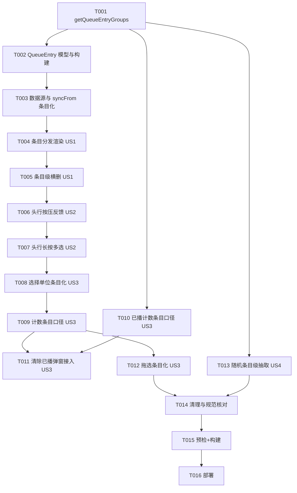

# Tasks: 队列多P 视频条目化重写（v0.4-queue-multi-p-item）

**Input**: Design documents from `spec/v0.4-queue-multi-p-item/`
**Prerequisites**: plan.md (required), spec.md (required for user stories)

**Tests**: 无测试套件（工程无测试文件），验证阶段为构建 + 部署（build-only）。

**Organization**: 任务按用户故事分组；故事任务全部集中在 `QueueSheet.ets`（同文件顺序执行），US3/US4 各含一个 `PlayerController.ets` 任务可与 QueueSheet 任务并行（依赖 T001 完成后）。

## Format: `[ID] [P?] [Story] Description`

- **[P]**: 可并行（不同文件、无未完成依赖）
- **[Story]**: 所属用户故事（US1–US4，映射 spec.md）

## Path Conventions

- 单模块工程，源码根：`entry/src/main/ets/`
- 组件：`entry/src/main/ets/component/`；服务：`entry/src/main/ets/service/`
- 本轮改动仅 2 文件：`QueueSheet.ets`、`PlayerController.ets`，零新文件

---

## Phase 1: Setup

无 Setup 任务：存量工程、零新文件、零配置变更。

---

## Phase 2: Foundational (Blocking Prerequisites)

**Purpose**: 条目模型与数据源地基——全部故事的前置。

- [X] T001 [P] PlayerController 新增条目分组单一来源方法 `getQueueEntryGroups(): number[][]`：扁平播放列表的连续下标游程（同 bvid 且页号≥1 的相邻条目合并为一游程；覆盖全部下标、有序连续；纯只读派生、不广播无副作用）— entry/src/main/ets/service/PlayerController.ets
- [X] T002 QueueSheet 文件域新增 `QueueEntry` 展示条目模型（isGroup/videos/startIndex/key `g:{bvid}`|`s:{itemKey}`/估算高度）与条目构建派生：消费 `getQueueEntryGroups()` 由扁平 `BiliVideo[]` 构建 `QueueEntry[]`，组内扁平下标 = startIndex+偏移 — entry/src/main/ets/component/QueueSheet.ets
- [X] T003 `PlaylistDataSource` 数据源从 `BiliVideo[]` 改为 `QueueEntry[]`（setItems/notifyDataDelete/notifyDataChange 契约不变，条目级）；`syncFrom` 条目化：重建条目后与旧条目按 key 序列做纯删除 diff——纯删除走增量 notifyDataDelete（高到低）+ 从最低删除位到末尾 notifyDataChange 强制重绑（bugfix #1 机制保留），其余（增长/重排/组分裂/组缩减）回退整表 reload；选中集按现存条目键收敛 — entry/src/main/ets/component/QueueSheet.ets

**Checkpoint**: 条目模型与数据源就绪，故事实施可开始。

---

## Phase 3: User Story 1 - 组条目一体渲染与整组横划 (Priority: P1) MVP

**Goal**: 队列以条目为渲染单位，组条目（头行+分P 窄行）一体滑动横删，单条目整行保持。
**Independent Test**: 队列含 10P 视频全部条目：左滑其任意行整组滑出、确认整组移除；单P 条目左滑与改造前一致。

- [X] T004 [US1] LazyForEach 生成器按条目分发渲染：组条目 `Column{ 视频头行 + ForEach(分P 窄行) }`（外层键=条目键、组内键=`bvid:page`），单条目沿用整行 `queueFullRow`；分P 窄行点击切播、当前播放高亮、已播 ✓（bvid 级口径）按 startIndex+偏移恢复扁平下标；**删除全部渲染期派生函数族**（hasGroupHeader/isGroupedPart/groupStartIndex/groupKeys/groupPartCount/isGroupFullySelected/toggleGroupSelect/minGroupPage，由条目模型吸收）— entry/src/main/ets/component/QueueSheet.ets
- [X] T005 [US1] `swipeAction` 挂条目级 ListItem：组条目 → 整组移除确认弹窗（`DIALOG_REMOVE_QUEUE_GROUP_MSG`，N=组分P 数），单条目 → 单删确认（`DIALOG_DELETE_QUEUE_ITEM_*`）；删除按钮点击与滑过阈值（onAction）双触发保持；多选态不挂横划；取消/外围点击经 `closeAllSwipeActions` 复位 — entry/src/main/ets/component/QueueSheet.ets

**Checkpoint**: US1 可独立验收——整组横划滑出与移除路径完整。

---

## Phase 4: User Story 2 - 头行交互补全 (Priority: P1)

**Goal**: 头行具备按压反馈与长按多选入口，点击续播语义保持。
**Independent Test**: 按下头行高亮、抬起恢复；长按头行进多选且整组选中；非多选点头行按两段判定续播。

- [X] T006 [US2] 视频头行挂 `onTouch` 按压高亮：pressedKey 记条目键（与单条目整行同构），Down 高亮、Up/Cancel 恢复 — entry/src/main/ets/component/QueueSheet.ets
- [X] T007 [US2] 头行挂 `GestureGroup(LongPress + Pan)` 手势组：长按进多选并选中本组条目键、置拖选起点；非多选点击保持两段判定（`latestHistoryOf` 最新历史分P → 条目内最小页兜底，队列内跳播/队外插播既有路径）；多选态点击整组切换 — entry/src/main/ets/component/QueueSheet.ets

**Checkpoint**: US2 可独立验收——bug ①（头行无按压反馈、长按不进多选）消除。

---

## Phase 5: User Story 3 - 组级选择与条目级计数 (Priority: P1)

**Goal**: 多选以条目为单位，五处计数面统一条目口径。
**Independent Test**: 10P 组+4 单曲队列：标题 (5)、勾组徽标 1、全选=5、移除仅删组内分P。

- [X] T008 [US3] 选择单位条目化：`selectedEntryKeys` 持条目键；头行 Checkbox 选中态=条目键∈选中集、onChange 整组切换；确认移除时把选中条目键展开为该条目全部分P 复合键，走既有 `removeSelectedFromPlaylist`（自动切播/索引修正/持久化零改动）— entry/src/main/ets/component/QueueSheet.ets
- [X] T009 [US3] 计数面条目口径：标题「播放队列 (N)」= 条目数、多选徽标 = 选中条目键数、全选/全选判定按条目键、清空确认「全部 N 首」= 条目数 — entry/src/main/ets/component/QueueSheet.ets
- [X] T010 [P] [US3] PlayerController `playedRemovableCount()`/`hasPlayedItems()` 改条目口径：计数 = bvid 已播完（`isPlayed`）且该条目游程不含当前播放条目的条目数；`collectPlayedRemovable`/`clearPlayedItems` 删除键集合逻辑不动 — entry/src/main/ets/service/PlayerController.ets
- [X] T011 [US3] QueueSheet 清除已播弹窗接入条目口径计数（`DIALOG_CLEAR_PLAYED_COUNT_MSG` 的 N=条目数；无可清 toast 保持）— entry/src/main/ets/component/QueueSheet.ets
- [X] T012 [US3] 拖选条目化：`selectRange` 按条目区间整条目选中（组键/单键）；长按后 Pan 的 offsetY 从起始条目按条目估算高度累积换算目标条目下标（取代定值 ITEM_HEIGHT 换算）；宽屏禁用拖选保持 — entry/src/main/ets/component/QueueSheet.ets

**Checkpoint**: US3 可独立验收——bug ②（多选中被计为多条）消除。

---

## Phase 6: User Story 4 - 随机播放视频级抽取 (Priority: P1)

**Goal**: 随机抽取单位 = 条目，组内连播优先，专辑不拆散。
**Independent Test**: 随机模式 10P 组+4 单曲：组内 P1→Pn 顺序连播，组播完抽 5 个条目之一；上一曲回溯分P 粒度正常。

- [X] T013 [P] [US4] PlayerController `next()` 随机分支重写，优先级 = forward 重放 > 组内连播（当前条目页号≥1 且下一条目同 bvid 且页号≥1 → `playIndex(currentIndex+1)`）> 条目级随机（`getQueueEntryGroups()` 派生非当前条目集合等概率抽取，抽中条目取其**最小页**下标起播）> 无可抽条目回退重播当前条目起点；`randomIndex()` 内部重写为条目级；`prev()` 随机回溯、shuffle/forward 轨迹键、`isPreparing` 守卫全部不动 — entry/src/main/ets/service/PlayerController.ets

**Checkpoint**: US4 可独立验收——随机不拆散多P 组。

---

## Phase 7: Polish & Cross-Cutting Concerns

**Purpose**: 跨故事收尾。

- [X] T014 清理与规范核对：确认旧派生函数族零残留引用；估算高度等文件内局部常量集中 `QueueSheet.ets` 文件头（仅本文件使用的常量不进 Constants）；色彩/数值令牌规范核对（`$r('app.color.*')`/`Constants.TOKEN_*`）；PlayerController 新增方法零装饰器广播模式合规（字段+emitUi，无观测装饰器）— entry/src/main/ets/component/QueueSheet.ets、entry/src/main/ets/service/PlayerController.ets

---

## Phase 8: Verification

<!-- verification_scope: build-only -->

**Purpose**: 构建与部署验证（UI 表现留真机自查，待验事项在轮次总结集中输出）。

- [X] T015 静态预检与构建：`arkts_check` 一次性传入本轮改动的 `.ets` 文件（QueueSheet.ets、PlayerController.ets），通过后 `devecocli build`；编译错误按 fix → build 循环修复至通过（验证结论：PASS——arkts_check 两文件零错误，BUILD SUCCESSFUL）
- [X] T016 部署：`devecocli run --skip-build` 部署到设备/模拟器，确认安装启动成功（SKIPPED：用户指示跳过模拟部署测试，安装/启动留真机自查）

---

## 📊 Dependency Graph



## ⚡ Parallel Execution Guide

| Phase | Tasks | Required Files | Execution Notes |
|-------|-------|----------------|-----------------|
| Foundational | T001 | PlayerController.ets | 先行完成，解锁全部后续 |
| US1/US2/US3 主链 | T002→T003→T004→T005→T006→T007→T008→T009 | QueueSheet.ets | 同文件严格顺序 |
| US3 并行支 | T010 | PlayerController.ets | T001 后即可并行，完成汇入 T011 |
| US4 并行支 | T013 | PlayerController.ets | T001 后即可并行，完成汇入 T014 |
| Polish | T014 | 两文件 | 串行收尾 |
| Verification | T015→T016 | — | build-only，UI 留真机自查 |

## Dependencies & Execution Order

### Phase Dependencies

- **Setup (Phase 1)**: 无任务
- **Foundational (Phase 2)**: T001→T002→T003 串行，阻塞全部故事
- **User Stories (Phase 3–6)**: 全部依赖 Foundational 完成；QueueSheet 主链同文件严格顺序（T004→…→T012），T010/T013 可与主链并行
- **Polish (Phase 7)**: 依赖全部故事任务完成
- **Verification (Phase 8)**: 依赖 Polish 完成

### User Story Dependencies

- **US1 (P1)**: Foundational 后即可开始——条目化渲染地基，MVP
- **US2 (P1)**: 依赖 US1 的条目分发渲染（头行是组条目内的一行）
- **US3 (P1)**: 依赖 US2 的头行手势（拖选起点/Checkbox 挂头行）；T010 仅依赖 T001
- **US4 (P1)**: 仅依赖 T001（PlayerController 侧独立），可与 QueueSheet 主链并行

### Within Each User Story

- 模型/数据源先行，渲染次之，交互手势最后
- 同文件任务串行，避免编辑冲突
- 每个 Checkpoint 处故事可独立验收

### Parallel Opportunities

- T010、T013 与 QueueSheet 主链并行（不同文件，T001 完成后）
- 单人执行时按 T001→T013/T010→主链→T011→T014 顺序亦可，无强制并行需求

## Parallel Example

```text
# T001 完成后，三线并行（多代理场景）：
Agent A（QueueSheet 主链）: T002 → T003 → T004 → T005 → T006 → T007 → T008 → T009 → T011 → T012
Agent B（PlayerController US3 支）: T010（完成后汇入 T011 由 Agent A 接续）
Agent C（PlayerController US4 支）: T013（完成后汇入 T014）

# 单代理推荐顺序：T001 → T002 → T003 → T004 → T005 → T006 → T007 → T008 → T009 → T010 → T011 → T012 → T013 → T014
```

## Implementation Strategy

### MVP First (User Story 1 Only)

1. 完成 Foundational（T001–T003）
2. 完成 US1（T004–T005）
3. **STOP and VALIDATE**: 独立验收 US1——整组横划滑出与移除

### Incremental Delivery

1. Foundational → 条目地基就绪
2. US1 → 整组横删可用（bug ③ 消除）
3. US2 → 头行交互补全（bug ① 消除）
4. US3 → 选择与计数条目化（bug ② 消除）
5. US4 → 随机条目级抽取
6. Polish + Verification → 收尾交付

### 实施轮次建议

一批执行：改动集中两文件、任务链短，无分批收益。Phase 4/5 连续执行（实施→验证不暂停）。

## Notes

- [P] 任务 = 不同文件、无未完成依赖
- [Story] 标签映射 spec.md 用户故事，可追溯
- 每个故事可独立完成与验收（Checkpoint）
- 验证范围 build-only：UI 表现由用户真机自查，待验事项在轮次总结集中输出，不写入 PROJECT_NOTES.md
- bugfix.md（`spec/v0.4-queue-multi-p-item/bugfix.md`）：实施中直接修复的非 SDD bug 按发生顺序登记
