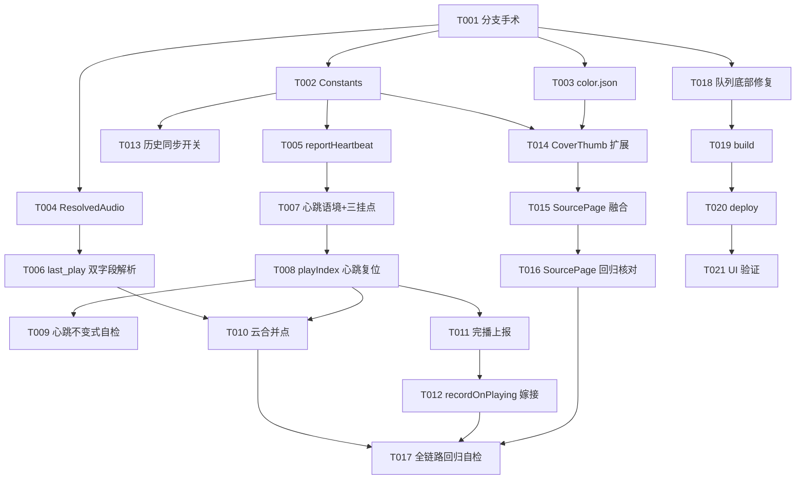

# Tasks: v0.5 功能多P 适配（v0.5-part1-multi-part-adapt）

**Input**: Design documents from `spec/v0.5-part1-multi-part-adapt/`  
**Prerequisites**: plan.md（D1-D8 决策 + G1-G10 落点）、spec.md（US1-US6）  
**Tests**: 无测试套件（项目现状），验证走构建 + 部署 smoke + 代码级不变式自检；需真机自查的事项在轮次结束总结中集中输出

## Format: `[ID] [P?] [Story] Description`

- **[P]**: 可并行（不同文件、无未完成依赖）
- **[Story]**: 归属 User Story

## Path Conventions

- 单模块项目：源码 `entry/src/main/ets/`；资源 `entry/src/main/resources/`
- 本特性改动：`model/AudioQuality.ets`、`service/Constants.ets`、`service/BiliService.ets`、`service/PlayerController.ets`、`pages/SettingsPage.ets`、`pages/SourcePage.ets`、`component/CoverThumb.ets`、`component/GlassSheet.ets`、`component/QueueSheet.ets`、`resources/base/element/color.json`

---

## Phase 1: Setup (Shared Infrastructure)

**Purpose**: 分支准备

- [X] T001 分支手术：旧 Pre-update（1b06f14，v0.5 移植源）改名 Pre-update-legacy 归档；自 master（9c62bd8）切出新分支 Pre-update 并切换到该分支；确认工作区干净

**Checkpoint**: 新 Pre-update 基于 master 多P 基线，Pre-update-legacy 保留完整移植源

---

## Phase 2: Foundational (Blocking Prerequisites)

**Purpose**: 服务层基础（token/模型/端点/解析），全部用户故事依赖  
**⚠️ 本阶段完成前禁止开始任何 User Story**

- [X] T002 Constants 追加：心跳域四键（KEY_HISTORY_SYNC 默认开 / BILI_HEARTBEAT_URL / HEARTBEAT_FAIL_FUSE=3 / HEARTBEAT_MIN_GAP_SEC=2）+ 详情页缩略 token（EPISODE_THUMB_W/H、EPISODE_THUMB_REQ_W/H）；实施时核对 master 版 Constants 无重名——`entry/src/main/ets/service/Constants.ets`
- [X] T003 [P] color.json 追加 duration_badge_scrim（#99000000）——`entry/src/main/resources/base/element/color.json`
- [X] T004 [P] ResolvedAudio 扩展 lastPlayTimeMs / lastPlayCid（构造末位默认参数，master 既有调用点零改动）——`entry/src/main/ets/model/AudioQuality.ets`
- [X] T005 BiliService.reportHeartbeat(bvid, cid, playedTimeSec)：form POST web heartbeat（type=3 + csrf + 端点要求 UA），成功/失败布尔返回——`entry/src/main/ets/service/BiliService.ets`（依赖 T002）
- [X] T006 BiliService 取流解析：DASH/DURL 两条链路响应同时提取 last_play_time 与 last_play_cid，汇聚进 ResolvedAudio 对应字段（零新增请求）——`entry/src/main/ets/service/BiliService.ets`（依赖 T004）

**Checkpoint**: 心跳端点可用、云端双字段可解析，用户故事实施可开始

---

## Phase 3: User Story 1 - 心跳上报按分P 归属 (Priority: P1) 🎯 MVP

**Goal**: 心跳上行（5s 节拍/补报/切分P flush）cid 归属正确，切分P 复位心跳语境，熔断 best-effort  
**Independent Test**: 登录态连续播放 P1→P2，心跳上报 cid 分别属于 P1/P2 且进度各自独立累计（代码级不变式自检 + 需真机自查项轮末总结输出）

- [X] T007 [US1] PlayerController 心跳语境字段（水位/连败计数/熔断标志，零装饰器普通字段 + emitUi 按需）+ reportHeartbeatIfAdvanced(minGapSec)（gate: isHistorySyncEnabled；发送时刻 bvid/cid/进度快照；熔断短路）+ 三挂点（5s 进度节拍 / paused 补报 / 切分P flush）——`entry/src/main/ets/service/PlayerController.ets`（依赖 T005）
- [X] T008 [US1] playIndex 起播复位块挂心跳复位：切分P = 新心跳语境，水位/连败计数/熔断标志统一复位（master playIndex 音质复位邻域）——`entry/src/main/ets/service/PlayerController.ets`（依赖 T007）
- [X] T009 [US1] 心跳不变式自检（复核型，发现回归才改码）：切分P 必复位；快照必含 cid；未登录/开关关零上报请求；慢响应不回写状态——`entry/src/main/ets/service/PlayerController.ets`（依赖 T008）

**Checkpoint**: US1 独立可测——多P 心跳归属正确

---

## Phase 4: User Story 2 - 云端续播严格匹配分P (Priority: P1)

**Goal**: 起播时云端进度仅在 last_play_cid 与起播分P cid 一致时参与合并  
**Independent Test**: 云端看到 P3 一半时：点 P1 不跳（忽略云端）、点 P3 从 max(本地, 云端) 续播（代码级合并点复核 + 需真机自查项轮末总结输出）

- [X] T010 [US2] playIndex 云端续播合并点（master 懒展开/形态分叉取流完成后、起播 seek 前，唯一合并点）：本地断点取 master 分P 粒度查询（getResumeMsFor(bvid,page) 族）；云端参与条件 lastPlayCid === 起播分P cid 且 lastPlayTimeMs > 0；合并 = max(本地, 云端)；云端 ≥ 分P 时长 95% 从头、本地 -1 已听完从头（防护语义保留）；云端 cid 无效/不匹配回退纯本地——`entry/src/main/ets/service/PlayerController.ets`（依赖 T006、T008）

**Checkpoint**: US2 独立可测——云端书签只对匹配分P 生效

---

## Phase 5: User Story 3 - 分P 完播同步 (Priority: P2)

**Goal**: 分P 完播（自然完播 + 95% 阈值）按该分P cid 上报 -1；重播 -1→0 复位；其他分P 不受影响  
**Independent Test**: 听完 P1 网页端显示已看完；重播 P1 从头且水位复位，P2/P3 状态不变

- [X] T011 [US3] reportHeartbeatCompleted()：完播上行（played_time=-1，当前分P cid）挂 markCurrentHistoryCompleted 判定点（自然完播 + 95% 阈值）——`entry/src/main/ets/service/PlayerController.ets`（依赖 T008）
- [X] T012 [US3] recordOnPlaying 嫁接：master 复合键 upsert 原样保留（分P 历史不吞并），嫁接 -1→0 重播重置与心跳水位归零——`entry/src/main/ets/service/PlayerController.ets`（依赖 T011）

**Checkpoint**: US3 独立可测——完播标记分P 隔离

---

## Phase 6: User Story 4 - 历史同步开关 (Priority: P2)

**Goal**: 设置页开关行控制全部上行与云端读取  
**Independent Test**: 关开关后播放多P 视频零上报请求且续播纯本地；开恢复

- [X] T013 [US4] SettingsPage「历史同步」开关行：登录条目下方、未登录隐藏、SettingsRow + KEY_HISTORY_SYNC（Pre-update-legacy 版干净套用，master 未触碰该文件）——`entry/src/main/ets/pages/SettingsPage.ets`（依赖 T002）

**Checkpoint**: US4 独立可测——开关 gate 覆盖心跳/完播/云读

---

## Phase 7: User Story 5 - 详情页剧集行视觉与分P 展开融合 (Priority: P2)

**Goal**: 剧集行取 Pre-update-legacy 视觉（16:9 封面 + 时长角标 + 收敛文字区），点播/播放全部行为取 master 分P 展开  
**Independent Test**: 含多P 视频的订阅详情页：剧集行新视觉；点播展开全部分P 不打断；播放全部按 master 语义

- [X] T014 [US5] CoverThumb 宽高分离扩展：thumbWidth/thumbHeight 普通成员，双 >0 走 16:9 档（定尺寸 + sized 缩略请求），否则回退 thumbSize 方形；套用后复核 master 侧全部调用点零改动——`entry/src/main/ets/component/CoverThumb.ets`（依赖 T002、T003）
- [X] T015 [US5] SourcePage 剧集行手工融合：视觉块取 Pre-update-legacy 结构（Row + Stack(BottomEnd) CoverThumb 16:9 + duration_badge 角标 + 标题≤2行/日期/NEW/已播收敛文字区），行为函数全保 master（fetchVideoDetail 分P 展开/addSingleVideo/四类触底翻页/退订/空态/按压态）；头部 56vp 封面行/路由/数据流零改动；触底加载行/空态辅助行不套用新视觉——`entry/src/main/ets/pages/SourcePage.ets`（依赖 T014）
- [X] T016 [US5] SourcePage 回归核对（复核型，发现回归才改码）：A 轮八项清单（NEW/已播/播放全部/刷新/四类翻页/退订/空态/按压态）+ master 分P 展开行为逐项复检——`entry/src/main/ets/pages/SourcePage.ets`（依赖 T015）

**Checkpoint**: US5 独立可测——视觉新、行为旧、零回归

---

## Phase 8: User Story 6 - 单P 与旧数据全链路回归 (Priority: P1)

**Goal**: 单P 视频与旧持久化数据全链路行为与移植前 master 一致；v0.5 bvid 粒度实现零残留  
**Independent Test**: 单P 视频完整收听流程行为不变；旧历史/队列数据按 P1 处理不崩溃；代码检索无 bvid 粒度历史实现残留

- [X] T017 [US6] 全链路回归自检（复核型，发现回归才改码）：① recordOnPlaying/isPlayed/shuffle 栈/清除已播/多选删除全为 master 复合键版，getResumeMsForBvid/bvid-splice upsert 等 v0.5 实现零进入；② 单P 路径（起播/续播/完播/重播）行为不变；③ 旧持久化数据（无 page/cid 字段）按 P1 兜底；④ 心跳/云合并对单P 视频语义与 v0.5 原实现一致——`entry/src/main/ets/service/PlayerController.ets` 等（依赖 T010、T012、T016）

**Checkpoint**: US6 达成——回归红线守住

---

## Phase 9: Polish & Cross-Cutting Concerns

**Purpose**: 顺道修复（跟 SDD 走，任务槽自承载记录，不进 bugfix.md）

- [X] T018 [P] 队列面板最底部条目显示不清修复：疑点 GlassSheet 底部渐隐带（SHEET_FADE_HEIGHT 渐变叠加罩住列表末几条）或 QueueSheet 列表底部内边距不足，实施时先确诊根因再修；GlassSheet 为队列/历史共用容器，若历史面板同根因一并修——`entry/src/main/ets/component/GlassSheet.ets`、`entry/src/main/ets/component/QueueSheet.ets`（依赖 T001）

**Checkpoint**: 队列面板滚到底末条完整可见，历史面板无回归

---

## Phase 10: Verification

<!-- verification_scope: build+ui -->

**Purpose**: 构建 + 部署 + UI 验证（用户显式提出 build+ui；UI 验证覆盖本轮用户故事核心交互 + 队列底部修复验证（面板滚到底末条完整可见），并顺带回归多P 第二轮 UI——历史面板归并行（一视频一行/看到Pn/点行续播/删除按视频）与队列分组头（相邻≥2/点击续播点/不参与多选）；登录态相关项模拟器无登录态时跳过，需真机自查的事项在轮次结束总结中集中输出）

- [X] T019 Build project and fix any compilation errors (invoke `devecocli build`; iterate fix → build until success)
- [X] T020 Deploy application to device/emulator (invoke `devecocli run --skip-build`)
- [ ] T021 UI 验证：US1 已验 PASS（模拟器多P 切P 不中断）；US2-US6 及顺带回归移交用户实测，登录态项真机自查（用户决策）

---

## Dependencies & Execution Order

### Phase Dependencies

- **Setup（Phase 1）**: 分支手术先行，唯一入口
- **Foundational（Phase 2）**: 依赖 Setup；**阻塞全部 User Story**（token/模型/端点/解析是心跳与云合并的前提）
- **User Stories（Phase 3-8）**: 按编号顺序执行（播放层 T007-T012 一条线；UI 层 T013-T016 可与播放层并行）
- **Polish（Phase 9）**: 顺道修复（T018），仅依赖 Setup，可与 User Story 并行
- **Verification（Phase 10）**: 依赖 Polish

### Dependency Graph

## Parallel Example

| Phase | Tasks | Required Files | Execution Notes |
|---|---|---|---|
| Foundational | T003 ∥ T004 | color.json / AudioQuality.ets | 不同文件零依赖，可与 T002 并行 |
| Foundational | T005 → T006 | BiliService.ets | 同文件顺序执行 |
| US4 | T013 | SettingsPage.ets | 仅依赖 T002，可与播放层任务并行 |
| US5 | T014 | CoverThumb.ets | 仅依赖 T002/T003，可与播放层任务并行 |
| Polish | T018 | GlassSheet.ets / QueueSheet.ets | 顺道修复，独立文件，可与任何 User Story 任务并行 |

## Implementation Strategy

### MVP First（US1+US2 同为 P1 构成同步链路）

1. 完成 Phase 1-2（分支手术 + 服务层基础）
2. 完成 US1（T007-T009 心跳多P 归属）→ US2（T010 云续播严格匹配）→ **上行下行同步闭环**
3. US3/US4（完播 + 开关）补全同步面 → US5（详情页融合）→ US6（回归红线）→ Polish → 验证

### 实施轮次建议

- **单轮完成**：T001-T018 实施 + T019-T021 验证（Phase 4/5 连续执行不暂停，用户既定决策）
- 播放层（PlayerController）为核心融合高风险区，实施顺序内置于任务编号；UI 层可穿插但不抢先于 T010

## Notes

- [P] 任务=不同文件、无未完成依赖
- [Story] 标签映射 spec.md User Story，可独立实现/验证
- 每 Task 或逻辑组完成后提交；任一 Checkpoint 可停下独立验证
- 身份体系红线：历史/队列/续播/已播/shuffle 全保 master 复合键（bvid+page），v0.5 bvid 粒度实现零进入
- 上报/云读全程 best-effort 静默（熔断连败 3 次本分P），禁弹窗禁重试
- 令牌规范：色值 `$r('app.color.*')`、数值 `Constants.TOKEN_*`，禁裸数字硬编码
- 分支红线：实施期间 master 与 Pre-update-legacy 不动；新 Pre-update 是否合回 master 验证后由用户拍板
- 需真机自查的事项（如有）在轮次结束总结中集中输出，不写 PROJECT_NOTES

## Summary Report

- **Total**: 21 tasks（实施 T001-T018 + 验证 T019-T021，build+ui）
- **Per-story**: US1×3（T007-T009）/ US2×1（T010）/ US3×2（T011-T012）/ US4×1（T013）/ US5×3（T014-T016）/ US6×1（T017）/ Setup×1（T001）/ Foundational×5（T002-T006）/ Polish×1（T018 队列底部顺道修复）/ Verification×3（T019-T021）
- **MVP scope**: T001-T009（心跳多P 归属闭环）；T010 云续播紧随构成完整同步链路
- **关键路径**: T001 → T002/T004 → T005/T006 → T007 → T008 → T010 → T017 → T019 → T020 → T021
- **实施轮次**: 单轮完成（见 Implementation Strategy）
