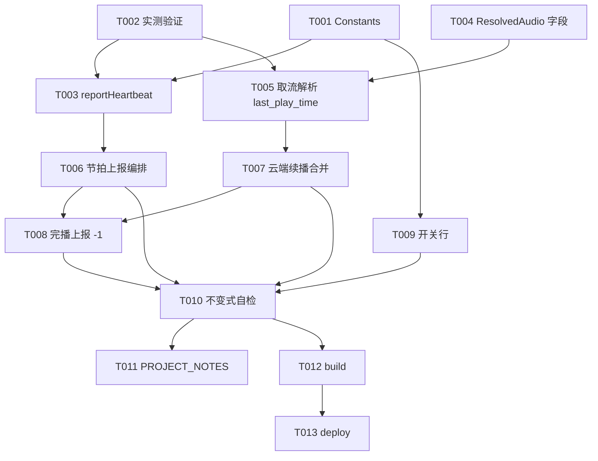

# Tasks: 播放进度云端同步（v0.5）

**Input**: Design documents from `spec/v0.5-part1-play-history-sync/`  
**Prerequisites**: plan.md（R1-R8 决策）、spec.md（US1-US4）  
**Tests**: 无测试套件（项目现状），验证走构建 + 真机（VR 项登记 PROJECT_NOTES.md）

## Format: `[ID] [P?] [Story] Description`

- **[P]**: 可并行（不同文件、无未完成依赖）
- **[Story]**: 归属 User Story

## Path Conventions

- 单模块项目：源码 `entry/src/main/ets/`（service/pages/model/component 分层，依赖单向）
- 本特性全部为既有文件增量修改，无新文件

---

## Phase 1: Setup (Shared Infrastructure)

- [ ] T001 Constants 登记同步基础设施：`KEY_HISTORY_SYNC`（默认 1=开）、`BILI_HEARTBEAT_URL`、`HEARTBEAT_FAIL_FUSE=3`、`HEARTBEAT_MIN_GAP_SEC=2`——`entry/src/main/ets/service/Constants.ets`

---

## Phase 2: Foundational (Blocking Prerequisites)

**⚠️ 本阶段完成前禁止开始任何 User Story**

- [ ] T002 [P] 实测验证（plan R8 三项，实施轮首任务）：① `/x/player/playurl`（带 cookie）响应是否含 `last_play_time` → 定 R3 端点路径（不返回则切 `/x/player/wbi/playurl`，WbiSigner 现成）；② heartbeat 端点 `type=3`+cookie 响应形态；③ 云端已看完视频的 `last_play_time` 返回值（0/整段/-1）→ 确认 R4 完播防护必要性。结论记入本任务提交说明与 `PROJECT_NOTES.md`——可用临时日志或抓包手段，测完清理临时代码
- [ ] T003 `BiliService.reportHeartbeat(bvid, cid, playedTimeSec): Promise<void>` 静态方法：R1 端点 form POST（bvid/cid/played_time/type=3/csrf=biliJct），请求头复用 `buildHeaders()`，失败抛错（调用方熔断计数），成功静默——`entry/src/main/ets/service/BiliService.ets`（依赖 T001、T002）
- [ ] T004 [P] `ResolvedAudio` 新增 `lastPlayTimeMs: number = 0` 字段（取流响应 `last_play_time` 毫秒；0=无/未登录/未返回）——`entry/src/main/ets/model/AudioQuality.ets`
- [ ] T005 `fetchDashAudioTracks`/`fetchDurlCandidates` 响应解析 `last_play_time`，经 `resolveAudioTrack` 汇聚进 `ResolvedAudio.lastPlayTimeMs`（签名微调限于 BiliService 内部 2 个调用点；T002 若定切 wbi 端点则本任务一并切换并接 WbiSigner）——`entry/src/main/ets/service/BiliService.ets`（依赖 T002、T004）

**Checkpoint**: 心跳 API 与云端进度透出就绪，可开始 User Story 编排

---

## Phase 3: User Story 1 - 播放中进度上报云端 (Priority: P1) 🎯 MVP

**Goal**: 播放中周期上报进度到 B 站云端，网页/APP 端可见，失败静默熔断  
**Independent Test**: 登录后播放任意内容 ≥10s，B 站网页版历史记录中该内容进度更新

- [ ] T006 [US1] PlayerController 同步编排：挂 `persistProgress()` 5s 节拍上报（gate=已登录+开关开+前进 ≥5s+未熔断）；暂停/切歌补报（前进 ≥`HEARTBEAT_MIN_GAP_SEC`）；失败计数连续 ≥`HEARTBEAT_FAIL_FUSE` 熔断本集上报，切歌/重新起播复位；上报取发送时刻的 bvid/cid/currentTime（防快速切歌串台）；零装饰器模式不变——`entry/src/main/ets/service/PlayerController.ets`（依赖 T003）

**Checkpoint**: US1 独立可测（网页版历史记录核对）

---

## Phase 4: User Story 2 - 起播云端续播 (Priority: P1) 🎯 MVP

**Goal**: 本地无记录/落后时从云端进度续播，本地较新不被回退  
**Independent Test**: B 站网页观看某视频至中途，本 app 播放同一 bvid，起播位置=云端进度（误差 ≤5s）

- [ ] T007 [US2] `playIndex` 云端续播合并（plan R4 规则）：新起播（seekMs<=0）路径取流拿到 `ResolvedAudio.lastPlayTimeMs` 后——本地 progress=-1 → 从头（忽略云端）；否则起点=max(本地续播 ms, 云端 ms)；防护：云端 ms ≥ duration×`PLAY_COMPLETE_RATIO` → 视为云端已看完从头；云端 0/缺失/解析失败 → 纯本地（现状）；`KEY_LAST_INDEX/KEY_LAST_POS_MS` 全局断点路径零改动——`entry/src/main/ets/service/PlayerController.ets`（依赖 T005）

**Checkpoint**: US1+US2 构成进度同步 MVP 闭环

---

## Phase 5: User Story 3 - 完播状态同步 (Priority: P2)

**Goal**: 本 app 听完 → 云端标已看完；云端已看完 → 本 app 重播从头  
**Independent Test**: 完播某内容后网页版显示已看完；再次播放从头开始

- [ ] T008 [US3] 完播上报 `played_time=-1`：挂 `markCurrentHistoryCompleted` 覆盖自然完播与 95% 阈值两判定点（上报经 T006 熔断 gate）；「云端已看完 → 重播从头」由 T007 防护规则承接（本任务核对其覆盖 US3 场景 2）——`entry/src/main/ets/service/PlayerController.ets`（依赖 T006、T007）

**Checkpoint**: 完播语义双向一致

---

## Phase 6: User Story 4 - 同步开关 (Priority: P2)

**Goal**: 设置页登录条目下方开关（默认开，未登录隐藏），关闭后全停用  
**Independent Test**: 关闭后播放期间无上报请求；杀进程重启状态保持

- [ ] T009 [P] [US4] SettingsPage 登录状态条目正下方新增「历史同步」`SettingsRow` 开关行：读写 `KEY_HISTORY_SYNC`（默认开）；未登录时隐藏该行；开关关闭时 T006-T008 上报与云端读取全部停用（gate 生效复核）——`entry/src/main/ets/pages/SettingsPage.ets`（依赖 T001）

**Checkpoint**: 全部 User Story 完成

---

## Phase 7: Polish & Cross-Cutting Concerns

- [ ] T010 不变式自检：① `KEY_LAST_INDEX`/`KEY_LAST_POS_MS` 全局断点读写路径零改动复核；② 未登录/开关关路径代码检索确认零上报请求、零云端读取；③ 快速切歌上报不串台复核；④ `HistoryMapper`/`BiliHistoryRecord` 零改动确认；⑤ 关键路径（节拍上报/熔断/续播合并/完播上报）hilog 覆盖且不含 cookie/token 明文——涉及 `entry/src/main/ets/service/PlayerController.ets`、`entry/src/main/ets/service/BiliService.ets`（依赖 T006-T009）
- [ ] T011 [P] 更新项目备忘：PROJECT_NOTES.md §五登记真机验证项（VR：心跳上报后网页版进度可见性、跨设备云端续播精度、完播 -1 云端显示、熔断后恢复上报）；T002 实测结论如有残留标注一并固化——`PROJECT_NOTES.md`（依赖 T010）

---

## Phase 8: Verification

<!-- verification_scope: build-only -->

**Purpose**: 构建 + 部署验证（UI/功能验证按 PROJECT_NOTES VR 项另行真机执行）

- [ ] T012 Build project and fix any compilation errors (invoke `devecocli build`; iterate fix → build until success)
- [ ] T013 Deploy application to device/emulator (invoke `devecocli run --skip-build`)

---

## Dependencies & Execution Order

### Phase Dependencies

- **Setup（Phase 1）**: 无依赖，即始；登记 Constants 键/端点
- **Foundational（Phase 2）**: 依赖 Setup；**阻塞全部 User Story**（T002 实测定端点路径、T003/T005 建上行/下行通道）
- **User Stories（Phase 3-6）**: 依赖 Foundational；US1→US3 有编排链依赖，US2 独立于 US1，US4 全程可并行
- **Polish（Phase 7）**: 依赖全部 User Story 完成
- **Verification（Phase 8）**: 依赖 Polish

### Dependency Graph

## Parallel Example

| Phase | Tasks | Required Files | Execution Notes |
|---|---|---|---|
| Foundational | T002 ∥ T004 | （实测）/ AudioQuality.ets | 实测与模型字段互不依赖，可并行 |
| Foundational | T003、T005 | BiliService.ets | 同文件串行：T003 → T005 |
| US4 | T009 | SettingsPage.ets | 与 US1-US3 全程可并行 |
| Polish | T011 | PROJECT_NOTES.md | 与 T012 可并行 |

## Implementation Strategy

### MVP First（US1+US2）

1. 完成 Phase 1-2（含 T002 实测）
2. 完成 US1（T006）+ US2（T007）→ **进度同步 MVP 闭环**
3. 停下真机验证（心跳可见性 + 跨设备续播，VR 项）
4. 增量补 US3（T008 完播）/ US4（T009 开关）/ Polish

### 实施轮次建议

- **轮次 1（MVP）**：T001-T007 + T012/T013 构建部署
- **轮次 2**：T008-T011 + 构建部署
- 与 `v0.5-part1-source-page-redesign` 轮文件交集仅 `Constants.ets`（T001 vs B 轮 T001）——两轮并行须错开该文件提交，建议同轮先后执行（先 A 后 B）

## Notes

- [P] 任务=不同文件、无未完成依赖
- [Story] 标签映射 spec.md User Story，可独立实现/验证
- 每 Task 或逻辑组完成后提交；任一 Checkpoint 可停下独立验证
- 上报/读取全程 best-effort：失败静默 hilog + 熔断，禁弹窗禁重试循环
- `HistoryMapper`/`PlayHistoryItem` 零改动（plan R7）；`PlayerController` 零装饰器模式不变
- 规划轮产出：本 tasks.md 为实施路线图，本轮不实施

## Summary Report

- **Total**: 13 tasks（实施 11 + 验证 2）
- **Per-story**: US1×1（T006）/ US2×1（T007）/ US3×1（T008）/ US4×1（T009）/ 基础设施 4（T001-T005）/ Polish 2（T010-T011）
- **MVP scope**: T001-T007（进度上报 + 云端续播闭环）
- **关键路径**: T002 实测 → T003/T005 → T006/T007 → T010 → 构建

