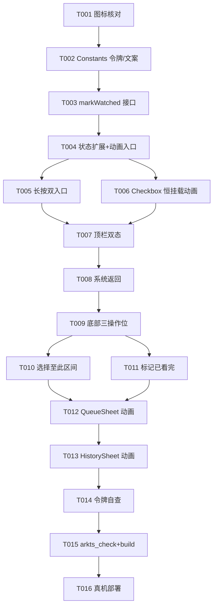

# Tasks: 多选交互重构（订阅源 + 全局多选进出动画）

**Input**: Design documents from `spec/v0.5-part2-multiselect-rework/`
**Prerequisites**: plan.md (required), spec.md (required)

**Tests**: 无测试套件，不生成测试任务；验证走 arkts_check + devecocli build + 真机部署（UI 目检由用户执行）。

**Organization**: US1（订阅源重构，P1）集中在 `SourcePage.ets` 单文件顺序执行；US2（队列/历史动画，P2）两文件可并行。

## Format: `[ID] [P?] [Story] Description`

- **[P]**: Can run in parallel (different files, no dependencies)
- **[Story]**: US1 / US2（映射 spec.md 用户故事）
- 含精确文件路径

## Path Conventions

- 单项目：源码在 `entry/src/main/ets/`（pages / component / service）
- 本轮零新建文件，改动集中在 5 个既有文件：`pages/SourcePage.ets`、`component/QueueSheet.ets`、`component/HistorySheet.ets`、`service/PlayerController.ets`、`service/Constants.ets`

---

## Phase 1: Setup（前置核对）

**Purpose**: 实施前资源核对，避免图标名幻觉

- [X] T001 核对顶栏/底部按钮候选 Symbol 图标存在性：`sys.symbol.xmark`（取消）、`sys.symbol.list_checkmark`（多选入口，页头现用图标迁移）及备选，读本机 SDK `D:\Program Files\Huawei\DevEco Studio\sdk\default\openharmony\ets\build-tools\ets-loader\sysResource.js` 确认；不可用时换现有 sys.symbol 条目

---

## Phase 2: Foundational（阻塞前置）

**Purpose**: 两个故事共同依赖的令牌与批量接口

**⚠️ CRITICAL**: 本阶段完成前不开工任何 user story

- [X] T002 `entry/src/main/ets/service/Constants.ets` 新增多选动效令牌与文案常量：`TOKEN_SELECT_ANIM_MS = 300`（Curve.EaseOut 档）；`DIALOG_MARK_WATCHED_TITLE`（「标记已看完」）、`DIALOG_MARK_WATCHED_MSG`（「确定标记 N 集为已看完吗？」，N 运行时替换）、`TOAST_MARK_WATCHED`（「已标记 N 集为已看完」，N 运行时替换）；Checkbox 容器宽度复用既有「多选行首 Checkbox 尺寸」常量
- [X] T003 `entry/src/main/ets/service/PlayerController.ets` 新增 `markWatched(items: BiliVideo[]): void`（零装饰器广播模式，plan D5）：`isPlayed(bvid)` 命中跳过（幂等）；未命中查 `bvid:page` 复合键历史条目——有则置 `progress = -1`，无则 `PlayHistoryItem.fromVideo(video, resolveSourceType(video), now)` 新建置 -1 并 unshift；批量只落一次盘（`HISTORY_MAX` 截断 → `savePlayHistoryFile` → `playHistoryVersion++` → `emitUi()`）；不向 B 站云端上报

**Checkpoint**: 令牌与接口就绪，两故事可开工

---

## Phase 3: User Story 1 - 订阅源多选交互重构 (Priority: P1) 🎯 MVP

**Goal**: 长按+顶栏按钮双入口、多选态顶栏、底部三操作位（标记已看完/选择至此/加入队列）、全链路进出动画

**Independent Test**: 长按与顶栏按钮双入口进入多选；锚点→「选择至此」→终点行区间选中；「加入队列 (N)」核对队列内容与 toast；进出多选观察动画与反向性

### Implementation for User Story 1（同文件顺序执行，勿并行）

- [X] T004 [US1] `entry/src/main/ets/pages/SourcePage.ets` 多选会话状态扩展 + 统一动画入口：新增 `@Local rangeSelecting: boolean` 与 `@Local anchorBvid: string`；`enterSelectMode`/`exitSelectMode` 统一 `animateTo({ duration: TOKEN_SELECT_ANIM_MS, curve: Curve.EaseOut })` 包裹 `selectMode` 翻转（进出同入口天然互逆）；进入/退出/入队完成/标记完成时全部重置区间选择态与锚点
- [X] T005 [US1] `entry/src/main/ets/pages/SourcePage.ets` 剧集行长按双入口：剧集行并行挂 `LongPressGesture`（默认 500ms，长按进多选并预选该行）与既有 `onClick`（多选态切勾选/常规态播放，语义不变）；`episodeCount === 0` 时不进入多选（Edge Case：多选与空列表）
- [X] T006 [US1] `entry/src/main/ets/pages/SourcePage.ets` 行首 Checkbox 恒挂载容器动画（plan D3-1）：Checkbox 容器恒挂载，宽度 `0 ↔ Checkbox 尺寸常量` + opacity `0 ↔ 1` 动画，行内容随容器宽度自然右移让位/回位（真实布局变化，非 translate 位移）；选中态与 NEW/已播标记并存时行布局稳定（Edge Case）
- [X] T007 [US1] `entry/src/main/ets/pages/SourcePage.ets` 顶栏重构（plan D2）：页头多选按钮移除；`sourceTitleBuilder` 内按 `selectMode` 条件渲染双态——常规态（返回卡 + 标题 + 多选图标卡（T001 核对图标，`episodeCount === 0` 不渲染）+ ··· 卡）↔ 多选态（取消卡（xmark，替换返回位）+ 居中「已选 N 项」+ 右侧无元素），两态切换包 animateTo + `TransitionEffect`（opacity 组合）；多选态 ···/刷新/退订不可达（FR-002）；取消卡与返回卡 onClick 均走 `exitSelectMode` 分支
- [X] T008 [US1] `entry/src/main/ets/pages/SourcePage.ets` 系统返回接入：多选态系统返回等同取消（`exitSelectMode` 不退页面），退出多选后恢复既有页面返回链（核对 `BackHandler` 既有逐层关闭链路，SourcePage 多选态优先于页面 pop）
- [X] T009 [US1] `entry/src/main/ets/pages/SourcePage.ets` 底部操作条替换（plan D6）：现 `selectActionBar`（全选/加入队列/取消）整体替换为单容器 Row（card 背景，`margin.bottom` 沿用 MiniPlayer + navBar 避让计算）三操作位 spaceBetween——左「标记已看完」/ 中「选择至此」/ 右「加入队列 (N)」；`selectedKeys.size === 0` 时三按钮共享禁用态（opacity 降档 + enabled false）；整条条件渲染 + `TransitionEffect.move(TransitionEdge.BOTTOM).combineOpacity()` 滑入滑出；全选/取消全选移除；加入队列复用既有批量入队语义（空队列起播/非空追加不打断/去重，toast 反馈后退出多选，FR-004）
- [X] T010 [US1] `entry/src/main/ets/pages/SourcePage.ets` 「选择至此」区间选择（plan D4 状态机）：`toggleSelect` 勾上时更新 `anchorBvid`（取消勾选不动锚点）；点按钮 `rangeSelecting = true`（按钮高亮，无选中禁用），再点退出区间选择态（已选集不变）；`rangeSelecting` 中点行仅指定终点（不切换勾选）——按 bvid 动态查找 anchor 与终点 index，`min↔max` 区间内全部 bvid 并入 `selectedKeys`（新建 Set 整体换引用），退出区间选择态，`anchorBvid` 更新为终点行；区间只覆盖已加载剧集，新载入行可作终点（Edge Case：多选与加载更早）
- [X] T011 [US1] `entry/src/main/ets/pages/SourcePage.ets` 「标记已看完」（plan D7）：点按钮弹二次确认（沿用项目既有 AlertDialog 二次确认模式，`DIALOG_MARK_WATCHED_TITLE`/`DIALOG_MARK_WATCHED_MSG`，N 运行时替换）；确认后调 `PlayerController.markWatched(选中剧集数组)` → toast（`TOAST_MARK_WATCHED`）→ `exitSelectMode`；行上已播标记经 `playHistoryVersion` 感知立即可见；取消确认留在多选态无副作用

**Checkpoint**: US1 全链路可用——双入口进入 → 区间/逐集选择 → 标记已看完/入队 → 动画退出

---

## Phase 4: User Story 2 - 队列/历史多选进出动画 (Priority: P2)

**Goal**: QueueSheet/HistorySheet 补齐与订阅源同款进出过渡动画，交互语义零变化

**Independent Test**: 队列/历史面板分别以头部按钮与长按进入多选再退出，观察勾选框淡入淡出、行内容让位/回位、头部切换过渡与反向性

### Implementation for User Story 2（两文件不同，可并行）

- [X] T012 [P] [US2] `entry/src/main/ets/component/QueueSheet.ets` 行首 Checkbox 由条件渲染改为恒挂载容器（宽度 `0↔W` + opacity 动画，模式同 T006）；头部常规行 ↔ 多选操作行切换包 `animateTo(TOKEN_SELECT_ANIM_MS, EaseOut)` + `TransitionEffect`；既有交互语义零变化（长按进入、全选/移除、面板关闭退多选、多选态不挂左滑、BackHandler 返回链全部不动）；动画中断终态以 `selectMode` 状态为准（Edge Case）
- [X] T013 [P] [US2] `entry/src/main/ets/component/HistorySheet.ets` 同 T006/T012 模式：行首 Checkbox 恒挂载动画 + 头部切换过渡；既有交互语义零变化（长按进入、全选/删除、面板关闭退多选、多选态不挂左滑）

**Checkpoint**: 三处多选动画一致且互逆

---

## Phase 5: Polish（跨故事收尾）

**Purpose**: 令牌合规与跨文件一致性

- [X] T014 令牌与一致性自查：本轮新增代码数值/色值全部 Constants 令牌化（禁裸数字硬编码，豁免需登记）；三处多选动画时长/曲线统一走 `TOKEN_SELECT_ANIM_MS`；`entry/src/main/ets/pages/SourcePage.ets`、`entry/src/main/ets/component/QueueSheet.ets`、`entry/src/main/ets/component/HistorySheet.ets` 交叉核对

---

## Phase 6: Verification

<!-- verification_scope: build-only -->
<!-- UI 目检由用户真机执行（用户决策：仅构建验证 + 真机部署，UI 验证交给用户） -->

**Purpose**: 静态检查、构建与真机部署

- [x] T015 静态检查 + 构建修复循环：`arkts_check` 传入本轮全部改动 `.ets` 文件（SourcePage/QueueSheet/HistorySheet/PlayerController/Constants），通过后 `devecocli build`，编译错误修复后重跑直至成功
- [x] T016 真机部署：`devecocli run --skip-build` 部署到真机（Mate 70 Pro+）；部署成功即本阶段完成，UI 目检（双入口/区间选择/标记已看完/三处动画互逆）由用户执行

---

## Phase 7: 追加轮——真机目检修复 + 共享逻辑抽取 (US3)

**Input**: spec 追加 US3 / FR-008~012，plan 追加 D9-D12（首轮真机目检 5 项反馈，用户确认范围「抽共享逻辑」）

**Goal**: 修复 5 项目检反馈（系统返回动画退选/长按守卫/层序/已播标记即时可见）+ 多选共享逻辑抽取与命名统一

**Independent Test**: 队列长按不拖动松手预选保持；队列/历史系统返回退多选有动画；订阅源+队列多选同开系统返回先退队列多选；标记已看完行上 ✓ 立即可见；三处多选代码模式/样式一致

### Implementation（追加）

- [X] T017 [P] [US3] 新建 `entry/src/main/ets/service/SelectLogic.ets`：`toggle`（Set 引用替换勾选切换）+ `LongPressGuard` 纯类（置位/查询消费/重置）（plan D10/D11）
- [X] T018 [P] [US3] 新建 `entry/src/main/ets/component/SelectCheckbox.ets` 共用组件（@ComponentV2）：恒挂载容器宽度 `0↔SELECT_CHECKBOX_W` + opacity `0↔1`、Checkbox 统一样式（accent 内部 connectStr 自取）、`@Param active/selected` + `@Event onChange`（plan D11）
- [X] T019 [P] [US3] `entry/src/main/ets/service/BackHandler.ets` 新增 `registerQueueSelectExit`/`registerHistorySelectExit` 句柄注册（对齐 closeHandle 模式）；`dismissOverlaysForBack` 队列/历史多选分支优先调句柄（动画退出），无句柄回退直翻（plan D9）
- [X] T020 [US3] `entry/src/main/ets/component/QueueSheet.ets`：aboutToAppear 注册动画退选句柄、aboutToDisappear 注销；三处长按站点（组头行/分P 窄行/单条目行）挂 LongPressGuard（onClick 消费、onTouch Down 重置）；selectedEntryKeys 数组→`Set<string>` 引用替换并改名 selectedKeys；行首 Checkbox 挂载点换 SelectCheckbox；拖选（Sequence+Pan+下标换算）保持不回归（plan D10/D11）
- [X] T021 [US3] `entry/src/main/ets/component/HistorySheet.ets`：同 T020（句柄注册/守卫/Set 化/SelectCheckbox 替换）；命名对齐（enterHistorySelectMode→enterSelectMode、exitHistorySelectModeAnimated→exitSelectModeAnimated、toggleHistorySelect→toggleSelect、selectedHistoryIds→selectedKeys）；左滑删除/删除所选 bvid 展开语义不动
- [X] T022 [US3] `entry/src/main/ets/pages/SourcePage.ets`：`onBackPressed` 调序——先 `dismissOverlaysForBack()`，返回 false 再动画退自身多选，最后放行默认 pop（plan D12-①）；`loadPlayedSet` 改读 `controller.playHistory`（plan D12-②）；长按挂 LongPressGuard；行首 Checkbox 挂载点换 SelectCheckbox；toggleSelect 接 SelectLogic
- [X] T023 [US3] 令牌与一致性自查：新增代码数值/色值 Constants 令牌化；三处多选动画/守卫/命名/Set 模式交叉核对；队列拖选、订阅源区间选择、历史左滑删除能力不回归
- [X] T024 [US3] arkts_check（本轮全部改动 .ets：SelectLogic/SelectCheckbox/BackHandler/QueueSheet/HistorySheet/SourcePage）+ `devecocli build` 修复循环直至成功 — 通过（arkts_check 零诊断，build 一次通过零修复）
- [X] T025 [US3] 部署 + UI 实测：真机全程离线，改模拟器部署（Mate 90 Pro）；spec-verify UI 实测 7 用例 7 PASS——用例 6（标记已看完行上标记即时可见）初验 FAIL，现场修复：`SourcePage.playedSet` 为未装饰普通字段、V2 不观测原地变更，改 `@Local` + loadPlayedSet 整体引用替换，修复后重建重部署全量复验全过；真机动画流畅度目检留用户

**Checkpoint**: 5 项修复全过 + 三处多选共享组件/助手统一

---

## Phase 8: 追加2——二轮真机目检改进 (US4)

**Input**: spec 追加2 US4 / FR-013~018，plan 追加2 D13-D21

**Goal**: 复选框区方向性拖选（三场景统一 + 边缘自动滚动）取代「选择至此」；多选底部拆独立悬浮按钮；MiniPlayer 悬浮化（内容下穿、末条完整露出）；勾选框间距对称；封面禁拖

**Independent Test**: 三处多选勾选框区按下拖动完成扫选（起点未选=加扫/起点已选=减扫/同次锁定不反转/常规滚动不被劫持）；拖到边缘列表自动滚动、到已加载尽头即止、订阅源触底照常加载更早；「选择至此」及其状态机无残留；多选底部两枚独立悬浮按钮（N=0 禁用/避让胶囊/滑入滑出互逆）；首页+详情页内容从胶囊下穿过、滚到底末条完整露出；三处勾选框两侧空白对称；全应用封面长按不唤起系统拖拽

### Setup（前置核对）

- [X] T026 核对 `contentEndOffset` 在本机 SDK 可用性：读本机 SDK Scrollable 通用属性 `.d.ts`（`D:\Program Files\Huawei\DevEco Studio\sdk\default\openharmony\ets\` 下声明文件），确认 List 继承链上存在（API 12+）；不存在或签名不符则标记 T034 走「尾部透明占位 ListItem」等价回退（plan D19）

### Implementation（追加2，顺序执行）

- [X] T027 [P] [US4] `entry/src/main/ets/service/Constants.ets` 新增扫选令牌三枚（plan D21，FR-018 参数承载）：`SELECT_SWEEP_EDGE_ZONE = 48`（上下边缘带高度 vp）、`SELECT_SWEEP_SPEED = 10`（每 tick 滚动 vp）、`SELECT_SWEEP_TICK_MS = 16`（滚动时钟周期 ms）；等高步长不新增常量（由既有令牌在使用处推导）
- [X] T028 [US4] `entry/src/main/ets/service/SelectLogic.ets` 新增两个零装饰器纯类（plan D14/D16）：`SweepSession`（拖选会话——按下采样锁定加扫/减扫模式、起点行 index/globalY/scrollOffset、位移增量计算）+ `EdgeAutoScroller`（边缘自动滚动器——`start(scroller, 方向, 每帧回调)` / `stop()` 幂等，内部 setInterval(T027 令牌) 驱动 `scroller.scrollBy` 后回调场景重算扫选）
- [X] T029 [US4] `entry/src/main/ets/component/SelectCheckbox.ets` gap 参数化（plan D13，FR-013）：新增普通成员 `gap: number`（默认 `TOKEN_SPACE_S` 向后兼容），容器宽 `active ? SELECT_CHECKBOX_SIZE + gap : 0`；三处调用点按行左内边距注入——`entry/src/main/ets/pages/SourcePage.ets` 传 `TOKEN_SPACE_M`、`entry/src/main/ets/component/QueueSheet.ets` 与 `entry/src/main/ets/component/HistorySheet.ets` 传 `TOKEN_SPACE_L`；让位动画不回归
- [X] T030 [US4] `entry/src/main/ets/pages/SourcePage.ets` 拖选接入 + 「选择至此」移除（plan D14/D15/D17，FR-014）：剧集行 SelectCheckbox 挂纵向 PanGesture（多选态生效，点按切勾不冲突）；`SweepSession` 驱动扫选——按下锁定模式并应用到起点行，update 按等高步长（`EPISODE_THUMB_H + 2×TOKEN_SPACE_10 + TOKEN_SPACE_XS` 派生）换算目标 index，起点→目标区间按锁定模式整体 Set 换引用；`EdgeAutoScroller` 边缘自动滚动（触底照常触发加载更早）；整体删除 `rangeSelecting`/`anchorBvid` 字段、`toggleRangeSelecting()`/`completeRangeSelection()` 方法及 4 处区间态重置语句；长按双入口/单行点击/入队/标记已看完零回归
- [X] T031 [P] [US4] `entry/src/main/ets/component/QueueSheet.ets` 拖选接入（plan D14/D15）：组头行与单条目行 SelectCheckbox 挂同款纵向扫选手势，换算复用既有 `targetEntryIndex` estHeight 累积（分P 窄行按所属 entry 命中）；既有长按+Pan 拖选并存零回归；EdgeAutoScroller 接入同 T030
- [X] T032 [P] [US4] `entry/src/main/ets/component/HistorySheet.ets` 拖选接入（plan D14/D15）：行 SelectCheckbox 挂同款纵向扫选手势，等高步长换算（`COVER_THUMB 行高 44 + 2×TOKEN_SPACE_10` 派生）；EdgeAutoScroller 接入同 T030；长按进入/左滑删除零回归
- [X] T033 [US4] `entry/src/main/ets/pages/SourcePage.ets` 多选底部拆独立悬浮按钮（plan D18，FR-016）：现 `selectActionBar` 整条卡片替换为不可见全宽 Row（spaceBetween）内两枚独立胶囊——左「标记已看完」（card 底 + text_primary）、右「加入队列 (N)」（accent 底 + fg_on_dark，主按钮）；共享 `TOKEN_RADIUS_XXL` + 既有阴影档 + 页边距 `TOKEN_SPACE_M` + `margin.bottom = MINI_PLAYER_CLEARANCE + navBarHeight`；`selectedKeys.size === 0` 共享禁用（opacity 降档 + enabled false）；各自 `TransitionEffect.move(BOTTOM).combineOpacity()` 随 selectMode 同一 animateTo 滑入滑出互逆；标记已看完/入队行为语义不变
- [X] T034 [US4] `entry/src/main/ets/pages/HomePage.ets` 与 `entry/src/main/ets/pages/SourcePage.ets` MiniPlayer 悬浮化（plan D19，FR-015，按 T026 结论二选一）：列表 `padding.bottom`（`MINI_PLAYER_CLEARANCE + navBarHeight`）移除改挂 `.contentEndOffset(同值)`（回退：尾部透明占位 ListItem 高度=同值）；左右/顶部 padding 保留；设置页不动；SourcePage 多选悬浮按钮避让值不变（T033 联动核对）
- [X] T035 [P] [US4] `entry/src/main/ets/component/CoverThumb.ets` 封面禁拖（plan D20，FR-017）：图片分支 `Image` 挂 `.draggable(false)`（占位分支无需处理）；行长按进多选等既有手势零回归
- [X] T036 [US4] 令牌与一致性自查：本轮新增代码数值/色值全部 Constants 令牌化（禁裸数字，豁免需登记）；三处扫选手势/换算/边缘滚动模式交叉核对；三处 gap 注入与行左内边距一致；既有交互（队列长按拖选/历史左滑/三处进出动画）零回归清单过一遍

### Verification（用户指令：停到模拟器/真机前——仅构建，不部署）

<!-- verification_scope: build-only -->
<!-- 部署与 UI 目检由用户执行（用户决策 2026 追加2 轮：spec-verify 不跑 devecocli run，工作流停在构建通过） -->

- [X] T037 arkts_check + 构建修复循环：`arkts_check` 传入本轮全部改动 `.ets` 文件（Constants/SelectLogic/SelectCheckbox/SourcePage/QueueSheet/HistorySheet/HomePage/CoverThumb），通过后 `devecocli build`，编译错误修复后重跑直至成功；**不执行 `devecocli run`**——构建通过即本阶段完成，部署与真机目检（拖选/悬浮化/独立按钮/封面禁拖/间距对称）由用户执行
- [X] T038 令牌化收尾（纯机械替换、全程数值不变）：`Constants.ets` 新增 `TOKEN_DISABLED_OPACITY = 0.4`（GLASS_ICON_BTN_* 区）与 `LIST_THUMB_SIZE = 44`（缩略图区，机制备注：CoverThumb 默认值、队列/历史扫选步长推导引用）；SourcePage×2 + PlayerOverlay×6 + QueueSheet×1 + HistorySheet×1 共 10 处禁用态 `0.4` → token；SourcePage×6 + PlayerOverlay×4 + QueueSheet×11 共 21 处裸 `36` 图标按钮尺寸 → `GLASS_ICON_BTN_SIZE`；QueueSheet estHeight 估算常量（68/64）与 HistorySheet `HISTORY_SWEEP_STEP` 推导中的 `44` → `LIST_THUMB_SIZE`；MiniPlayer 删两处显式 `thumbSize: 44` 走 CoverThumb 默认值，CoverThumb 默认值令牌化；HomePage/AddSubscriptionSheet/LogPage/SettingsPage 不动；arkts_check 零诊断 + build 一次通过
- [X] T039 令牌收尾清理（纯机械替换为主、数值不变 + 一处暗色泄漏修复）：PlayerOverlay 控制键 44 收编 CONTROL_BTN_SIZE（上一首/回退15秒/快进15秒/下一首/队列键 5 节点 ×2 行共 10 处裸 44；收起键 908/909 已用令牌不动）；`GLASS_ICON_BTN_BLUR` 改名 `GLASS_BLUR`（值 20 与位置不动，HistorySheet×4 引用跟改），PlayerOverlay×12 + QueueSheet×6 + SettingsPage×2 + GlassSheet×1 共 21 处裸 `.backdropBlur(20)` 收编 `Constants.GLASS_BLUR`；MiniPlayer 投影暗色泄漏修复（唯一观感变化点，仅暗色模式变深）：两处 `.shadow({ radius: 12, color: '#33000000', offsetX: 0, offsetY: 2 })` 镜像 SourcePage 悬浮按钮既有写法——数值 `TOKEN_FLOATING_SHADOW_RADIUS`/`TOKEN_FLOATING_SHADOW_OFFSET_Y`、color 换 `shadow_ball` 资源（暗色 #73000000）；MiniPlayer 两处 `.backdropBlur(24)` 按用户决议维持裸 24 不动；arkts_check 零诊断 + build 一次通过

**Checkpoint**: 构建通过即追加2 工作流收口；用户自行部署真机目检，反馈进 bugfix.md 或下轮追加

**追加2 依赖说明**（沿用追加轮先例不并入 Mermaid 图）：T026 → T034（SDK 结论定悬浮化二选一）；T027 → T028 →（T030/T031/T032 扫选接入）；T029 →（T030/T031/T032 间距前置）；T030 → T033 → T034（SourcePage 同文件顺序链）；T035 全程独立可并行；T036 依赖 T027-T035 全部；T037 收尾。

## 📊 Dependency Graph



**说明**: US1 各任务同文件（SourcePage.ets）原则上顺序执行；T005/T006 改动区域不同（手势 vs 行内布局）可并行但建议顺序。T012/T013 两文件独立，理论可并行，实际由单代理顺序执行（T012 先行定型模式，T013 复制）。

## Dependencies & Execution Order

### Phase Dependencies

- **Setup (Phase 1)**: T001 最先——图标名决定 T007 实施细节
- **Foundational (Phase 2)**: T002 → T003 顺序；BLOCKS 全部 user story
- **US1 (Phase 3)**: 依赖 Phase 2；T004 → T005/T006 → T007 → T008 → T009 → T010/T011 同文件链式
- **US2 (Phase 4)**: 依赖 T002（令牌）；动画模式对齐 T006（模式参考，非代码依赖）
- **Polish (Phase 5)**: 依赖 US1+US2 全部完成
- **Verification (Phase 6)**: 依赖 Polish 完成

### Within Each User Story

- 状态与动画入口（T004）先行——后续任务全部在其上叠加
- 布局结构（T006/T007/T009）先于行为逻辑（T008/T010/T011）
- US2 在 US1 后执行：T006 定型的恒挂载模式直接复制到 T012/T013

## ⚡ Parallel Execution Guide

| Phase | Tasks | Required Files | Execution Notes |
|-------|-------|----------------|-----------------|
| Setup | T001 | sysResource.js（只读） | 独立，最先执行 |
| Foundational | T002 → T003 | Constants.ets → PlayerController.ets | 顺序：文案/令牌先行 |
| US1 | T004-T011 | SourcePage.ets | 同文件顺序执行，勿并行 |
| US2 | T012, T013 | QueueSheet.ets / HistorySheet.ets | 两文件可并行 [P]；单代理顺序执行（T012 先定型） |
| Polish | T014 | 三 .ets 交叉 | 依赖 US1+US2 完成 |
| Verification | T015 → T016 | 全部改动文件 | build 通过后部署 |

## Parallel Example: User Story 2

```bash
# 两文件互不依赖，可并行（若多代理实施）：
Task: T012 QueueSheet.ets 恒挂载动画 + 头部切换过渡
Task: T013 HistorySheet.ets 恒挂载动画 + 头部切换过渡

# 单代理时顺序执行：T012 先行定型模式 → T013 复制
```

## Implementation Strategy

### MVP First (User Story 1 Only)

1. Complete Phase 1: Setup（T001 图标核对）
2. Complete Phase 2: Foundational（T002-T003）
3. Complete Phase 3: US1（T004-T011）
4. **STOP and VALIDATE**: 真机部署目检 US1 独立验收（双入口/区间选择/标记已看完/入队/动画）
5. US2（T012-T013）与 Polish（T014）随后补齐

### Incremental Delivery

1. T001-T003 → 令牌与 markWatched 接口就绪
2. T004-T011 → US1 全链路（可独立验收的 MVP）
3. T012-T014 → 三处动画一致 + 令牌合规
4. T015-T016 → 构建通过 + 真机部署

### 实施轮次建议

单轮全量：16 任务体量适中，US1/US2 耦合于同一动画模式（恒挂载宽度动画），拆轮无收益；一次实施一次验证。

---

## Notes

- [P] 任务 = 不同文件、无依赖；同文件任务一律顺序
- [USx] 标签映射 spec.md 用户故事，可追溯
- 每 story 可独立完成与验收（Independent Test 见各 Phase）
- 提交策略：实施+验证完成后随多选轮一次性提交（含 spec/feature.json 与本 spec 目录），提交信息按 AGENTS.md git 规范
- UI 目检清单（用户真机执行）：双入口进入（长按预选/顶栏按钮）、区间选择（锚点→选择至此→终点）、标记已看完（二次确认/已播标记即时可见/幂等）、加入队列（N 计数/去重/toast）、三处多选进出动画互逆、多选中 ··· 不可达、MiniPlayer 避让
- UI 目检清单·追加2（用户真机执行，替代上条已划线项）：三处拖选（加扫/减扫/模式锁定/常规滚动不劫持/边缘自动滚动/订阅源触底加载联动）、「选择至此」已移除无残留、独立悬浮按钮（位置/N=0 禁用/避让/滑入滑出互逆）、悬浮化（内容穿胶囊/滚到底末条完整露出/加载指示不被遮）、勾选框两侧空白对称、封面长按不唤起系统拖拽

## Summary Report

- **总任务数**: 16（Setup 1 / Foundational 2 / US1 8 / US2 2 / Polish 1 / Verification 2）
- **追加轮（Phase 7）**: 9（共享基建 3 [T017-T019，可并行] / 三组件接入 3 [T020-T022] / 自查 1 [T023] / 验证 2 [T024-T025]）
- **追加2 轮（Phase 8）**: 12（前置核对 1 [T026] / 实施 9 [T027-T035，其中 T027/T031/T032/T035 可并行] / 自查 1 [T036] / 验证 1 [T037，仅构建不部署——用户指令停到模拟器/真机前]）
- **每故事任务数**: US1 = 8（T004-T011），US2 = 2（T012-T013），US4 = 11（T027-T036 + T037）
- **并行机会**: T012 ↔ T013（不同文件）；T005 ↔ T006（同文件不同区域，可选）；追加2：T027 / T031 ↔ T032 / T035（不同文件）
- **验证范围（追加2）**: build-only 且不部署（用户决策：spec-verify 止于 devecocli build，部署+真机目检由用户执行）
- **独立测试标准**: 每 story 的 Independent Test 见各 Phase 头
- **MVP 范围**: T001-T011 + T015（构建通过即可真机验收 US1；T012-T014 随后补齐）
- **验证范围**: build-only（用户决策：仅构建验证 + 真机部署，UI 验证交给用户）
