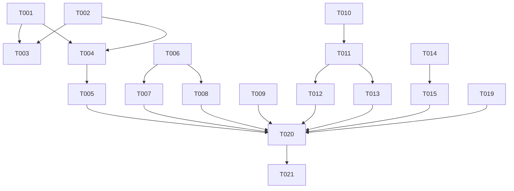

# Tasks: v0.5-part3（订阅详情交互打磨 + 反馈完善与登记）

**Input**: Design documents from `spec/v0.5-part3-registry/`（spec.md / plan.md / spec/charging-archive.md）
**Prerequisites**: plan.md（required）、spec.md（required）——均已在位
**Tests**: 未要求测试任务，不含。

## Format

[ID] [P?] [Story] Description

- **[P]**: 可并行（不同文件、无未完成依赖）
- **[Story]**: 用户故事映射（US1-US8，对应 spec.md）
- 每条任务含确切文件路径；复选框 `- [ ]` 起始，ID 顺序 T001 起

## Path Conventions

- 单项目：仓库根 `entry/src/main/ets/`（pages/component/service/model 分层）
- 资源：`entry/src/main/resources/base|dark/element/color.json`
- 全部路径相对仓库根；零新增文件

## Phase 1: Setup

无需任务——既有工程零新增文件/配置，直接进入用户故事实施。

## Phase 2: US1 - 历史/订阅源整行拖选（双向）与边缘滚动 (Priority: P1) 🎯 MVP

**Goal**: 历史/订阅源长按+拖动多选——双向画笔（拖回取消）、边缘滚动到尽头即止、订阅源触底续载
**Independent Test**: 历史面板与订阅源各做一轮不抬指拖选（含边缘滚动、订阅源触底续载）

- [X] T001 [US1] SelectLogic 新增 RowDragSession（画笔模型+拖前快照：长按翻转起点行锁定加减扫方向、区间涂刷、脱离区间恢复快照）— entry/src/main/ets/service/SelectLogic.ets
- [X] T002 [US1] EdgeAutoScroller 增加可选尽头查询回调（tick 前检查、到顶/到底停滚清理；缺省不注入时行为不变）— entry/src/main/ets/service/SelectLogic.ets
- [X] T003 [P] [US1] HistorySheet 整行 Sequence(长按→拖) 拖选接入（行定位取 estHeight 累积或统一行高除法、边缘滚动接线尽头回调、与复选框扫选/列表滑动共存）— entry/src/main/ets/component/HistorySheet.ets
- [X] T004 [P] [US1] SourcePage 剧集行整行拖选接入（含多选态内长按已选行起拖的减扫路径，与 T003 同构）— entry/src/main/ets/pages/SourcePage.ets
- [X] T005 [US1] SourcePage 拖选中触底加载更早不被 selectMode 门禁（核查 onReachEnd/加载路径，FR-004）— entry/src/main/ets/pages/SourcePage.ets

**Checkpoint**: 三场景拖选一致（历史/订阅源双向、队列维持现状单向）

## Phase 3: US4 - 合集标题「合集·」前缀剥除 (Priority: P2)

**Goal**: 合集订阅标题展示层剥除「合集·」前缀，全展示位生效，存储不动
**Independent Test**: 带「合集·」前缀的合集在导航标题/页头/订阅列表条目三处均无前缀

- [X] T006 [P] [US4] Subscription 增 displayTitle() 实例方法（合集类型且以「合集·」起头剥前缀，剥后为空返回原 title）— entry/src/main/ets/model/Subscription.ets
- [X] T007 [US4] 展示位接入 displayTitle（SourcePage 导航标题、AddSubscriptionSheet 条目标题）— entry/src/main/ets/pages/SourcePage.ets、entry/src/main/ets/pages/AddSubscriptionSheet.ets

**Checkpoint**: 旧订阅免迁移即生效

## Phase 4: US3 - 订阅详情页头信息改造 (Priority: P2)

**Goal**: 页头封面左缘与剧集行对齐、名称大字、合集/系列显 UP 主、收藏夹不显、类型标签胶囊
**Independent Test**: 四类订阅详情分别打开，核对对齐/名称/UP 规则/类型标签

- [X] T008 [US3] 页头重排：页头与剧集行统一水平 padding 令牌对齐封面左缘；名称大字（sub.title 经 displayTitle，字号取现有 TOKEN_FONT_20/TOKEN_FONT_TITLE_L 档）；合集/系列显示 upperName、收藏夹不渲染 UP 行；类型标签内联胶囊替换现 typeLabel 文案行 — entry/src/main/ets/pages/SourcePage.ets

**Checkpoint**: 页头信息密度与对齐达 spec FR-008/009/010

## Phase 5: US5 - 剧集行时长角标加大 (Priority: P3)

- [X] T009 [US5] 时长角标字号 TOKEN_FONT_AUX→TOKEN_FONT_BODY（11→13，复用现成令牌零新增）— entry/src/main/ets/pages/SourcePage.ets

## Phase 6: US6 - 播放出错提醒与日志 (Priority: P2)

**Goal**: 播放错误用户可见（toast）+ 日志可追溯（hilog）+ 吞错点清零
**Independent Test**: 构造播放失败（断网取流），验证 toast 与日志

- [X] T010 [US6] Constants 增错误 toast 文案组与去重窗口令牌 — entry/src/main/ets/service/Constants.ets
- [X] T011 [US6] PlayerController 增 playbackError(stage, code, bvid) 统一入口（hilog 记录 + bvid+stage 时间窗去重 + 广播快照新增错误字段与 errorTick 版本计数）— entry/src/main/ets/service/PlayerController.ets
- [X] T012 [US6] 吞错点全量梳理接线（AudioPlayer 错误回调、BiliService 取流 catch、播控切换/准备 catch → playbackError；FR-015 全覆盖）— entry/src/main/ets/service/AudioPlayer.ets、entry/src/main/ets/service/BiliService.ets、entry/src/main/ets/service/PlayerController.ets
- [X] T013 [US6] Index syncFrom 消费 errorTick 变化 → promptAction.showToast（Constants 文案）— entry/src/main/ets/pages/Index.ets

**Checkpoint**: 错误路径抽样 100% 有提醒有日志

## Phase 7: US7 - 历史容量 300 与列表尾提示 (Priority: P3)

- [X] T014 [P] [US7] Constants HISTORY_MAX 200→300（共享常量一升俱升，不拆分）— entry/src/main/ets/service/Constants.ets
- [X] T015 [US7] HistorySheet 列表尾容量提示行（居中小字「仅保留最近 N 条播放记录」N 动态引用 HISTORY_MAX；不可交互、空态不渲染、多选/删除后仍居队尾、位于面板底部渐隐带之上）— entry/src/main/ets/component/HistorySheet.ets

## Phase 8: US8 - 充电视频 (Priority: P3，探针门控组)（已移出：见 spec/charging-archive.md）

## Phase 9: Polish（跨故事清账）

- [X] T019 FR-020 QueueSheet 行拖门禁审查：isWideScreen 分支属 lanes 遗骸则摘除改 `!selectMode`（保留多选态滚动保护，手机行为不变）；若审查发现实际手势冲突职责则保留并在报告登记原因 — entry/src/main/ets/component/QueueSheet.ets

## Phase 10: Verification

<!-- verification_scope: build-only -->

- [x] T020 Build：arkts_check 预检本轮全部改动 .ets 后 devecocli build，编译错误修复循环直至成功
- [x] T021 Deploy：devecocli run --skip-build（设备未连接时跳过并报告——长期指令：停到设备前）——设备未连接跳过

---

## 📊 Dependency Graph



## ⚡ Parallel Execution Guide

| Phase | Tasks | Required Files | Execution Notes |
| --- | --- | --- | --- |
| US1 核心 | T001→T002 | SelectLogic.ets | 顺序执行（同文件），两宿主接入的前提 |
| US1 接入 | T003 ∥ T004 | HistorySheet.ets ∥ SourcePage.ets | 不同文件可并行；完成后 T005 收尾 SourcePage |
| US4/US7 令牌与模型 | T006 ∥ T014 | Subscription.ets ∥ Constants.ets | 跨故事不同文件可并行 |
| US3/US5 页面组 | T007→T008→T009 | SourcePage.ets（+AddSubscriptionSheet.ets） | 同文件顺序执行：displayTitle 先行供页头使用 |
| US6 错误链 | T010→T011→T012∥T013 | Constants→PlayerController→(AudioPlayer/BiliService)∥Index | 入口先行，接线与消费可并行 |
| 验证 | T020→T021 | — | build-only |

## Dependencies & Execution Order

### Phase Dependencies

- **Setup（Phase 1）**: 无任务，直接开始
- **US1（Phase 2）**: SelectLogic 核心（T001/T002）先行，双宿主接入（T003/T004）依赖核心完成
- **US4（Phase 3）**: displayTitle 模型方法先行，展示位接入随后；US3 页头名称复用其方法
- **US3/US5（Phase 4/5）**: 依赖 T006 的 displayTitle；同文件（SourcePage）任务顺序执行
- **US6（Phase 6）**: Constants 令牌 → PlayerController 入口 → 接线与消费
- **US7（Phase 7）**: 容量常量先行，尾注行随后
- **Polish（Phase 9）**: 独立清账项，验证前完成
- **Verification（Phase 10）**: 全部实施任务完成后执行

### User Story Dependencies

- **US1 (P1)**: 无跨故事依赖，MVP 独立可交付
- **US3 (P2)**: 复用 US4 的 displayTitle（T006）——方法级依赖，非交付依赖
- **US4/US5/US6/US7**: 相互独立

## Parallel Example: 双宿主接入

```text
# US1 核心完成后，两宿主接入并行：
Task: "T003 HistorySheet 整行拖选接入 — entry/src/main/ets/component/HistorySheet.ets"
Task: "T004 SourcePage 剧集行拖选接入 — entry/src/main/ets/pages/SourcePage.ets"

# US6 入口完成后，接线与消费并行：
Task: "T012 吞错点接线 — AudioPlayer.ets / BiliService.ets / PlayerController.ets"
Task: "T013 Index toast 消费 — entry/src/main/ets/pages/Index.ets"
```

## Implementation Strategy

### MVP First（US1 Only）

1. 完成 T001-T002（SelectLogic 核心）
2. 完成 T003-T005（双宿主接入）
3. 停点验证：三场景拖选独立可测

### Incremental Delivery

1. US1（MVP）→ US4 → US3 → US5 → US6 → US7 → Polish → 验证
2. 每故事完成即独立可测，不破坏前序故事

### 单轮全量建议

21 任务、13 文件、零新增文件，规模适中——建议 Phase 4 单轮全量实施（US8 跳过），验证走 build-only（部署遇设备未连接即跳过报告）。

## Notes

- [P] 任务 = 不同文件、无未完成依赖；同文件任务一律顺序执行
- [USx] 标签映射 spec.md 用户故事，可独立验收
- 令牌纪律：本轮所有新数值/文案只入 Constants；字号复用现有令牌阶梯（TOKEN_FONT_BODY/TOKEN_FONT_20/TOKEN_FONT_TITLE_L）
- 任务统计：21 条（US1×5、US4×2、US3×1、US5×1、US6×4、US7×2、US8×3、Polish×1、验证×2）；并行机会：T003∥T004、T006∥T014、T012∥T013
- 格式自检：全部任务 `- [ ]` + 顺序 ID + 文件路径 ✓；故事任务带 [USx]，Polish/验证无标签 ✓
