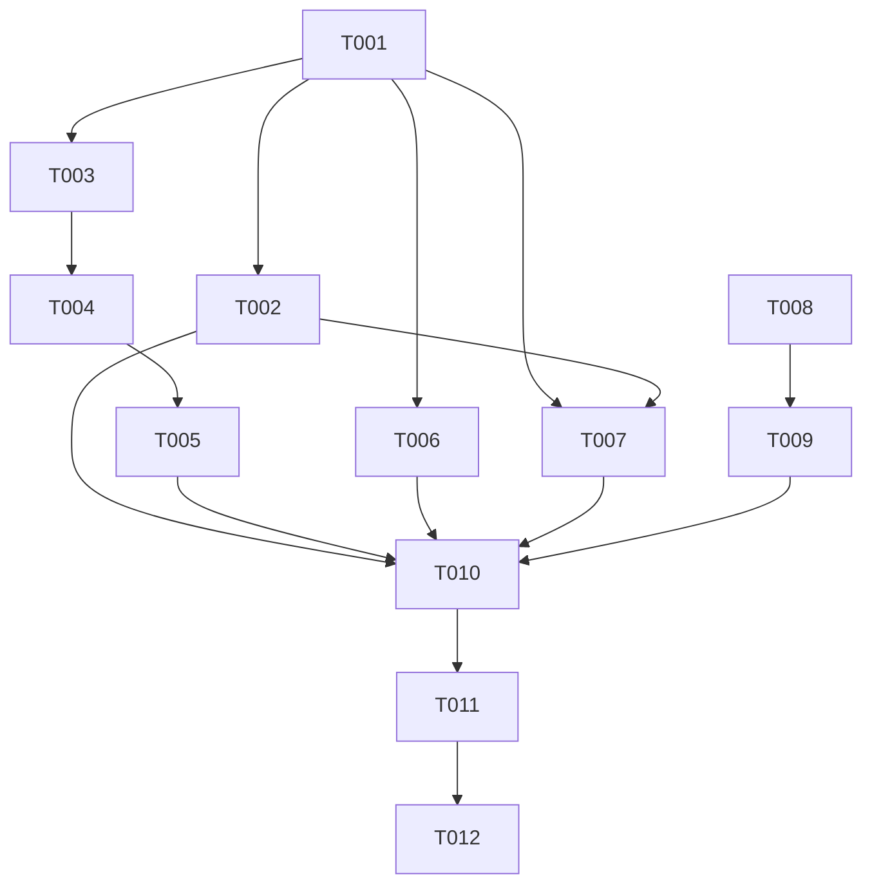

# Tasks: v0.5-part4（风控对抗：刷新止血 + 过墙实验 + 刷新反馈）

**Input**: Design documents from `spec/v0.5-part4-risk-control/`（spec.md / plan.md）
**Prerequisites**: plan.md（required）、spec.md（required）——均已在位
**Tests**: 未要求测试任务，不含。

## Format

[ID] [P?] [Story] Description

- **[P]**: 可并行（不同文件、无未完成依赖）
- **[Story]**: 用户故事映射（US1-US4，对应 spec.md）
- 每条任务含确切文件路径；复选框 `- [ ]` 起始，ID 顺序 T001 起

## Path Conventions

- 单项目：仓库根 `entry/src/main/ets/`（pages/component/service/model 分层）
- 全部路径相对仓库根；零新增文件

## Phase 1: Setup

无需任务——既有工程零新增文件/配置，直接进入用户故事实施。

## Phase 2: Foundational（令牌先行，阻塞全部故事）

- [X] T001 新增 Constants 令牌与持久键：HOME_SILENT_REFRESH_CD_MS（15min 档）、WEB_CHAIN_COOLDOWN_MS（10min 档）、TOAST_REFRESHED、TOAST_SILENT_REFRESH_FAIL（含 N 占位）、SILENT_REFRESH_FAIL_DEDUP_MS、KEY_LAST_SILENT_REFRESH_AT — entry/src/main/ets/service/Constants.ets

**Checkpoint**: 令牌就绪，四个故事可并行推进

## Phase 3: US1 - 首页刷新冷却 (Priority: P1) 🎯 MVP

**Goal**: 冷启动静默刷新跨启动持久化 CD；CD 内启动零订阅网络刷新；手动刷新不受限
**Independent Test**: 刷新成功后杀进程重开，CD 内启动无任何刷新请求、缓存数据正常渲染

- [X] T002 [US1] HomePage silentRefresh 加 CD 门：入口读 KEY_LAST_SILENT_REFRESH_AT 判定（D9 回拨规则：`now - last` 为负视为过期放行；CD 内直接 return 零提示）；refreshAll 完成后写时间戳 — entry/src/main/ets/pages/HomePage.ets

**Checkpoint**: 反复开关 app 不再触发刷新风暴（手动刷新路径 refreshSource 不经此门，天然满足 FR-002）

## Phase 4: US2 - Web 链失败止血 (Priority: P1)

**Goal**: 被风控拦截后 Web 补稠进程级冷却只走 APP 链；重试不换 buvid、不空 buvid；单源单轮失败请求封顶 2 次
**Independent Test**: 被拦状态下连续刷新，失败请求从 6 次/轮降为 2 次/轮（首轮）+0 次/轮（冷却期）

- [X] T003 [US2] BiliService 新增 isRiskControlError 风控类判定（-352/-412/-403/-799/非 JSON 风控页特征）与 Web 链进程级冷却状态（模块字段：截止时间戳、置位、查询、到期自恢复）— entry/src/main/ets/service/BiliService.ets
- [X] T004 [US2] fetchUpVideosViaWeb 重构：入口冷却检查（冷却中直接抛错零请求）+ 入口 hasBuvid 保底 ensureBuvid（FR-004 空位兜底）+ 单轮 WBI+plain 双风控败即置位冷却并立即抛当轮真实错误 + 网络类失败仍 3 轮退避 + 移除重试轮 resetBuvid 调用（原 L893）— entry/src/main/ets/service/BiliService.ets
- [X] T005 [US2] fetchUpInfo 移除重试轮 resetBuvid 调用（原 L1040，3 轮 acc/info→card 降级结构不变）；BiliSession.resetBuvid 方法此时零引用，删除 — entry/src/main/ets/service/BiliService.ets、entry/src/main/ets/service/BiliSession.ets

**Checkpoint**: UP 源被拦时主链 APP 签名链供数如常（FR-009），Web 补稠一次置位静默让位

## Phase 5: US3 - 刷新结果通知 (Priority: P2)

**Goal**: 手动刷新成功有 toast（失败 toast 已在）；首页静默刷新失败聚合 toast；CD 跳过零提示
**Independent Test**: 手动刷新一次看成/败 toast；断网冷启动看静默失败 toast；连续失败只弹一次

- [X] T006 [P] [US3] SourcePage refreshSource 成功路径补 toast（TOAST_REFRESHED；失败 toast 与 refreshing 防抖既有不动）— entry/src/main/ets/pages/SourcePage.ets
- [X] T007 [P] [US3] HomePage silentRefresh 失败聚合通知：onOneDone 回调 ok=false 计数，refreshAll 完成后 failCount>0 弹 TOAST_SILENT_REFRESH_FAIL（N 替换；去重窗 SILENT_REFRESH_FAIL_DEDUP_MS 内只弹一次；CD 跳过路径零提示）— entry/src/main/ets/pages/HomePage.ets

**Checkpoint**: 全部刷新路径结果可感知（FR-005/006 达成）

## Phase 6: US4 - 过墙实验 (Priority: P2，单方案门控组)

**Goal**: rcp 传输栈实验验证客户端层拦截假设；实验终态登记收尾
**Independent Test**: 前置检查结论 + （异构时）换栈真机 hilog 判 WBI 轮结果

- [X] T008 [US4] rcp 前置检查：查本机 SDK rcp 实现（`sdk/default/openharmony/ets/` 下 .d.ts）与官方说明，判定 rcp 与 @ohos.net.http 是否同 TLS 栈；结论与依据登记 BILI_API.md §3；同栈→跳过 T009，US4 按失败分支收尾（FR-007）— BILI_API.md
- [ ] T009 [US4] fetchUpVideosOnce 换 rcp 传输（rcp.Session/Request/Configuration，复用 LinkResolver 模式；请求头与参数零变化、超时取现令牌；仅 WBI arc/search 与 plain 空间投稿两端点，mixinKey/nav 维持现栈——T008 判同栈则本任务跳过）— entry/src/main/ets/service/BiliService.ets

**Checkpoint**: 实验段实施完成或按门控登记跳过；真机终态判定移交 Verification

## Phase 7: Verification

<!-- verification_scope: build-only -->

- [X] T010 Build：arkts_check 预检本轮全部改动 .ets 后 devecocli build，编译错误修复循环直至成功（一次通过，零错误）
- [ ] T011 Deploy：devecocli run --skip-build --device 192.168.11.122:43719（真机无线调试；设备未连接时跳过并报告）（跳过：设备离线，devecocli device list 空 + hdc tconn 连接失败）
- [ ] T012 hilog 判定与终态登记：真机开调试模式后触发刷新（冷启动或手动），hdc 拉 hilog 判 WBI 轮结果——判据：`[net] UP投稿列表 | 第N轮WBI成功`（过墙）vs `第N轮WBI失败 ... Bili API error -403`（仍拦截）；按结果登记：成功→回写 spec/charging-archive.md 终态；失败/同栈跳过→补录 BILI_API.md §3 实验终态（hdc 路径：`D:\Program Files\Huawei\DevEco Studio\sdk\default\openharmony\toolchains\hdc.exe`）（跳过：依赖 T011 部署，设备离线 hilog 不可得；BILI_API.md §3.4 登记维持前置检查结论，真机观测待设备可达后补）

---

## 📊 Dependency Graph



## ⚡ Parallel Execution Guide

| Phase | Tasks | Required Files | Execution Notes |
| --- | --- | --- | --- |
| 令牌先行 | T001 | Constants.ets | 全部故事前置 |
| US1 | T002 | HomePage.ets | T007 同文件后行 |
| US2 链 | T003→T004→T005 | BiliService.ets→BiliSession.ets | 同文件顺序：判定→重构→清理 |
| US3 接入 | T006 ∥ T007 | SourcePage.ets ∥ HomePage.ets | 不同文件可并行；T007 依赖 T002 完成 |
| US4 门控组 | T008→T009 | BILI_API.md→BiliService.ets | 前置检查先行；同栈则 T009 跳过 |
| 验证 | T010→T011→T012 | — | build-only：构建→真机部署→hilog 判定登记 |

## Dependencies & Execution Order

### Phase Dependencies

- **Foundational（Phase 2）**: T001 令牌阻塞全部故事
- **US1/US2（Phase 3/4）**: 互相独立可并行（不同文件）；US2 内 T003→T004→T005 同文件顺序
- **US3（Phase 5）**: T006 独立；T007 依赖 T002（同文件 HomePage，CD 门先就位）
- **US4（Phase 6）**: T008 前置检查独立可先行；T009 门控于 T008 结论
- **Verification（Phase 7）**: 全部实施任务完成后顺序执行

### User Story Dependencies

- **US1 (P1)**: 无跨故事依赖，MVP 独立可交付（CD 本身即止血主收益）
- **US2 (P1)**: 独立于 US1；与 US4 有弱耦合——T009 换栈若实施，冷却门禁逻辑复用（T004 先行保证门禁在位）
- **US3 (P2)**: T007 复用 US1 的 silentRefresh 结构（T002 先行）
- **US4 (P2)**: 门控组；T008 同栈结论时整组以登记收尾，不阻塞任何故事

## Parallel Example: US3 双页面通知接入

```text
# T001/T002 就绪后，两页面通知接入并行：
Task: "T006 SourcePage 手动刷新成功 toast — entry/src/main/ets/pages/SourcePage.ets"
Task: "T007 HomePage 静默刷新失败聚合 toast — entry/src/main/ets/pages/HomePage.ets"

# US4 前置检查先行（与 US1/US2/US3 实施无文件冲突）：
Task: "T008 rcp 前置检查与结论登记 — BILI_API.md"
```

## Implementation Strategy

### MVP First（US1 Only）

1. T001 令牌 → T002 CD 门
2. 停点验证：反复冷启动零刷新风暴（止血主收益即达）

### Incremental Delivery

1. US1（MVP）→ US2（止血完整体）→ US3（反馈）→ US4（过墙门控组）→ 验证
2. US4 同栈跳过时：止血+反馈成果完整保留，实验登记收尾

### 单轮全量建议

12 任务、5 文件、零新增文件，规模小——建议 Phase 4 单轮全量实施，验证走 build-only（真机部署 + hilog 判定 + 用户目检闭环）。

## Notes

- [P] 任务 = 不同文件、无未完成依赖；同文件任务一律顺序执行
- [USx] 标签映射 spec.md 用户故事，可独立验收
- US4 门控：T008 前置检查结论「同栈」时 T009 跳过并在 T012 登记收尾（FR-007/008）
- 令牌纪律：本轮所有新数值/文案/键只入 Constants（T001 集中定义）
- 文档补录契约：T012 完成前 BILI_API.md §3 须含本轮实验终态（AGENTS.md 收尾门）
- 任务统计：12 条（Foundational×1、US1×1、US2×3、US3×2、US4×2、验证×3）；并行机会：T006∥T007
- 格式自检：全部任务 `- [ ]` + 顺序 ID + 文件路径 ✓；故事任务带 [USx]，验证无标签 ✓
