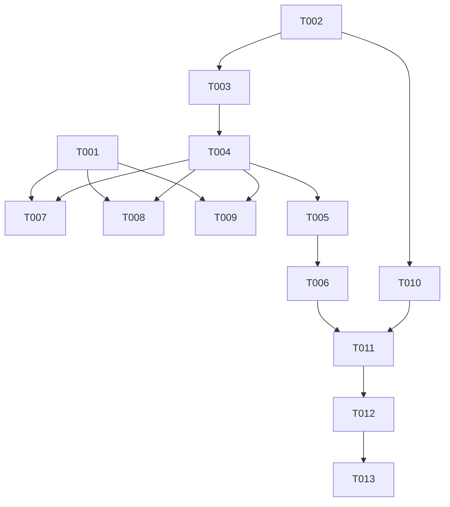

# Tasks: v0.5-part5 播放态数据源异常标记

**Input**: Design documents from `spec/v0.5-part5-play-anomaly/`
**Prerequisites**: plan.md（已批准，含 D4 修订：跳过 toast 提醒 + 日志登记）, spec.md（已批准，本轮修订：去互动视频，仅时长判定）
**Verification scope**: build-only（用户已选；真机不在旁，检测阈值校准待设备返回）

## Format: `[ID] [P?] [Story] Description`

- **[P]**: 可并行（不同文件、无未完成依赖）
- **[Story]**: 归属用户故事（US1 检测与跳过 P1 / US2 显示与持久化 P2 / US3 设置项 P2）

## Path Conventions

- 源码根：`entry/src/main/ets/`（单模块 HarmonyOS NEXT 应用，无测试目录）
- 实施工件：`spec/v0.5-part5-play-anomaly/`（本目录）

---

## Phase 1: Setup

- [X] T001 校验 `sys.symbol.xmark` 在本机 sysResource.js（`D:\Program Files\Huawei\DevEco Studio\sdk\default\openharmony\ets\build-tools\ets-loader\sysResource.js`）中存在；不存在则改用存在的 X 类图标并在实施报告中登记换用项（只读检查，不改 SDK）

---

## Phase 2: Foundational（阻塞全部故事）

- [X] T002 Constants.ets 新增 token：`KEY_ANOMALY_SKIP`（0/1 默认 1）、`KEY_ANOMALY_BVIDS`（JSON 数组字符串）、`ANOMALY_DURATION_RATIO`（0.5）、`TOAST_ANOMALY_SKIP`、`TOAST_ANOMALY_TRIAL`（`entry/src/main/ets/service/Constants.ets`）

---

## Phase 3: User Story 1 - 播放态充电视频检测与跳过 (Priority: P1) 🎯 MVP

**Goal**: prepared 后流时长 vs 元数据时长判定，标 X 持久化，按设置跳过/续播，完播 ✓ 防护，复检摘标，全链路日志
**Independent Test**: 构建通过后真机播放队列存量充电稿，观察标 X + 跳过连播 + toast + 日志（设备返回后执行）

- [X] T003 [US1] PlayerController 新增 `anomalySet: Set<string>` 公开字段：init 从 `KEY_ANOMALY_BVIDS` 加载，变更时序列化持久化并 emitUi 版本推进；新增 `hasAnomaly(bvid): boolean` 公开查询（`entry/src/main/ets/service/PlayerController.ets`）
- [X] T004 [US1] prepared 处理内（`this.duration = this.player.duration` 赋值点之后）加判定：item.duration>0 且流时长>0 且流时长 < 元数据×`ANOMALY_DURATION_RATIO` → 标 X（D2/D3）；bvid 已在集且流时长匹配 → 摘 X 持久化（D6）；判定结果、标 X、摘 X 均以 `Logger.log('player', ...)` 登记（含 bvid/流时长/元数据时长）（`entry/src/main/ets/service/PlayerController.ets`）
- [X] T005 [US1] 判定异常后的设置分流：现读 `KEY_ANOMALY_SKIP`（默认 1）——开=toast（`TOAST_ANOMALY_SKIP`，沿 `PLAYBACK_ERROR_DEDUP_MS` 去重窗模式）+ `Logger.log` 登记跳过推进（含目标 index）+ 线性推进 `playIndex(currentIndex+1)`（队尾即停，不取模回绕，D4）；关=toast（`TOAST_ANOMALY_TRIAL`）+ 日志登记照常续播 + 续播试听流（`entry/src/main/ets/service/PlayerController.ets`）
- [X] T006 [US1] 完播 ✓ 防护：completed 态与进度≥时长×完播阈值两条自动写 progress=-1 的路径，在当前条目 bvid 命中 `anomalySet` 时跳过写 -1 并 `Logger.log` 登记防护触发；手动「标记已看完」路径不拦截（D5）（`entry/src/main/ets/service/PlayerController.ets`）

**Checkpoint**: 检测、标 X、跳过、防护全链路可用（无 UI 显示，日志可验证判定分支）

---

## Phase 4: User Story 2 - X 标记显示与持久化 (Priority: P2)

**Goal**: 三处行尾 X 显示（源页剧集行/队列条目/历史行尾），✓/X 可共存
**Independent Test**: 标 X 后重启，三处界面 X 仍在（设备返回后执行；本轮构建验证）

- [X] T007 [P] [US2] SourcePage 剧集行 X：`@Local anomalySet` 随 `playedSet` 同点加载（`loadPlayedSet` 流程并行加载 controller.anomalySet），状态区渲染 X 图标（T001 校验结果），✓/X 共存（`entry/src/main/ets/pages/SourcePage.ets`）
- [X] T008 [P] [US2] QueueSheet 条目行尾 X：`controller.hasAnomaly(bvid)` 直查（对齐 L865/L989 isPlayed 模式），行尾 X 图标与 ✓ 视觉对齐（`entry/src/main/ets/component/QueueSheet.ets`）
- [X] T009 [P] [US2] HistorySheet 行尾 X：controller 直查渲染行尾 X 图标（`entry/src/main/ets/component/HistorySheet.ets`）

**Checkpoint**: 三处显示点全部可见 X，与 ✓ 共存不冲突

---

## Phase 5: User Story 3 - 「异常源自动跳过」设置项 (Priority: P2)

**Goal**: 设置页播放分组新增 toggle，默认开，切换即时生效
**Independent Test**: 切换后播放行为随之变化，重启保持（设备返回后执行；本轮构建验证）

- [X] T010 [P] [US3] SettingsPage 播放分组（自动播放/中断续播旁）新增 SettingsRow：`showToggle: true`，标题「异常源自动跳过」+ 描述文案，读 `AppStore.getNumber(KEY_ANOMALY_SKIP, 1)`，切换写 `putNumber`（0/1）（`entry/src/main/ets/pages/SettingsPage.ets`）

**Checkpoint**: 设置项读写闭环，播放链路现读即时生效

---

## Phase 6: Verification

<!-- verification_scope: build-only -->

- [X] T011 对本轮全部改动 `.ets` 文件运行 arkts_check 预检，修复报错（以 build 为权威，SDK 误报除外）
- [X] T012 `devecocli build` 迭代修复直至构建成功
- [x] T013 设备返回后 `devecocli run --skip-build` 部署（已完成：无线重连 192.168.11.122:43719，安装+启动成功，Smoke PASS）

---

## Phase 7: 追加轮（US4 X 视觉统一与队列清理）

**Goal**: X 图标带圆圈对齐 ✓ 视觉档；「清除已播」纳入 X 条目（判定/计数/移除三处同口径）
**Independent Test**: 触发异常标记后三处见带圈红 X；队列含 X 条目点「清除已播」一并移除且计数正确

- [x] T014 [US4] 三处显示点 X 图标 `sys.symbol.xmark` → `sys.symbol.xmark_circle`：SourcePage 剧集行（`entry/src/main/ets/pages/SourcePage.ets`）、QueueSheet 两处行尾（`entry/src/main/ets/component/QueueSheet.ets`）、HistorySheet 行尾（`entry/src/main/ets/component/HistorySheet.ets`）
- [x] T015 [US4] 「清除已播」判定扩展：`collectPlayedRemovable`/`playedRemovableCount` 判定加 `hasAnomaly`（当前播放条目保留语义不变）（`entry/src/main/ets/service/PlayerController.ets`）
- [x] T016 arkts_check 预检 + `devecocli build` + 真机部署（`devecocli run --skip-build`）

---

## Dependencies & Execution Order

### Phase Dependencies

- T001（图标校验）→ 阻塞 T007/T008/T009 的图标 token 选择
- T002（Constants token）→ 阻塞 T003 起全部任务
- T003 → T004 → T005 → T006（同文件 PlayerController，严格串行）
- T007/T008/T009/T010 可并行（互不同文件），前置：T003/T004 完成后 T007/T008/T009 可开工；T010 仅前置 T002
- T011/T012 前置：T003-T010 全部完成；T013 前置 T012

### 📊 Dependency Graph



### ⚡ Parallel Execution Guide

| Phase | Tasks | Required Files | Execution Notes |
|-------|-------|----------------|-----------------|
| US2+US3 并行窗 | T007 / T008 / T009 / T010 | SourcePage / QueueSheet / HistorySheet / SettingsPage | 四文件互不冲突，T003-T004 完成后可同时开工 |
| 串行核 | T003→T004→T005→T006 | PlayerController.ets | 同文件严格顺序，检测链路一体 |
| 验证 | T011→T012→T013 | — | build-only；T013 延后不阻塞收尾 |

## Parallel Example

```text
T003/T004 完成后并行开工（不同文件，无依赖）：
Task: T007 SourcePage 剧集行 X（pages/SourcePage.ets）
Task: T008 QueueSheet 条目行尾 X（component/QueueSheet.ets）
Task: T009 HistorySheet 行尾 X（component/HistorySheet.ets）
Task: T010 SettingsPage 设置行（pages/SettingsPage.ets）
```

## Implementation Strategy

### MVP First（US1 only）

1. T001 → T002（图标校验 + token）
2. T003 → T004 → T005 → T006（检测核）
3. T011 → T012（构建验证）
4. **STOP and VALIDATE**: US1 独立成立——标 X 与跳过可用（日志可证），无显示也有完整避雷行为

### Incremental Delivery

1. Setup + Foundational → 检测核（US1, MVP）
2. + US2 三处显示 → 标记可见
3. + US3 设置行 → 用户可控
4. 真机校准与部署（T013，设备返回后）

### 实施轮次

改动集中 6 个既有文件、总量小（检测核 + 三显示点 + 一设置行），不分批，单轮全量实施后构建验证。

## Notes

- [P] 任务 = 不同文件无依赖；[Story] 标签映射 spec.md 用户故事
- 本轮验证范围 build-only：检测阈值（0.5）与试听流 duration 可得性需真机实听校准，与 T013 部署合并到设备返回后执行
- 全链路日志（D4 日志契约）：判定/标 X/摘 X/跳过推进/照常续播/完播防护六类事件留痕，真机验证时以日志核对判定分支
- X 集仅本地持久化，不云同步；跳过条目不写新历史

## Summary Report

- **总任务数**: 13（实施 10 + 验证 3）
- **按故事**: US1=4（T003-T006，MVP 核）/ US2=3（T007-T009）/ US3=1（T010）/ Setup=1 / Foundational=1 / Verification=3
- **并行机会**: T007/T008/T009/T010 四任务并行窗
- **独立测试标准**: 每故事可独立构建验证；US1 完成即 MVP（无显示也有标 X 与跳过，日志可证）
- **MVP 范围**: T001-T006 + T011-T012
