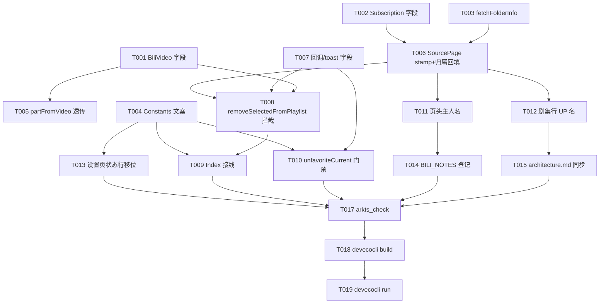

# Tasks: v0.6-part1 收藏夹归属显示与队列联动取消收藏

**Input**: Design documents from `spec/v0.6-part1-fav-unfavorite/`
**Prerequisites**: plan.md (required), spec.md (required for user stories)

**Tests**: 无测试套件（项目现状），不生成测试任务；新非平凡逻辑的验证由 Verification 阶段构建 + 真机自查承载。

**Organization**: 按用户故事分组，每故事可独立交付验证。

## Format: `[ID] [P?] [Story] Description`

- **[P]**: 可并行（不同文件、无未完成依赖）
- **[Story]**: 所属用户故事（US1/US2/US3）

## Path Conventions

- 单项目仓库根：`entry/src/main/ets/`（源码）、`docs/`（活文档）、仓库根 `BILI_NOTES.md`
- 路径均相对仓库根，与 plan.md 一致

## Phase 1: Setup

无新增 Setup 任务——单模块既有项目，无结构初始化。

## Phase 2: Foundational（阻塞前置）

**Purpose**: 数据模型与归属数据链路，全部用户故事的前置。

- [X] T001 [P] `BiliVideo` 新增 `folderOwnerMid: number = 0` 字段（@Trace + `toRecord`/`fromRecord` 序列化，默认 0 = 未知）— entry/src/main/ets/model/BiliVideo.ets
- [X] T002 [P] `Subscription` 新增 `folderOwnerMid: number = 0` 与 `folderOwnerName: string = ''` 字段（@Trace + `toRecord`/`fromRecord` 序列化）— entry/src/main/ets/model/Subscription.ets
- [X] T003 [P] `BiliService` 新增 `fetchFolderInfo(mediaId: number): Promise<FolderInfo>`：GET `x/v3/fav/resource/list?media_id={mediaId}&pn=1&ps=1`，防御式解析 `info.mid`/`info.upper.name`/`info.title`/`info.media_count`（undefined/null 跳过置默认，`info.mid` 缺失返回 ownerMid=0 视为失败）；`FolderInfo` 为 service 内命名类（ownerMid/ownerName/title/mediaCount）；`upper.name` 缺失时调用方降级（T006），本方法不内嵌降级 — entry/src/main/ets/service/BiliService.ets
- [X] T004 [P] `Constants` 新增本轮全部文案令牌：取消收藏确认弹窗标题/文案（N 占位）、结果 toast（成功 N 首/部分失败 M）、`unfavoriteCurrent` 非本人门禁 statusMsg——命名沿用 `DIALOG_*`/`TOAST_*` 既有惯例，禁裸字符串 — entry/src/main/ets/service/Constants.ets
- [X] T005 `BiliService.partFromVideo` 透传 `folderOwnerMid`（占位条目就地展开链路不丢归属）— entry/src/main/ets/service/BiliService.ets

**Checkpoint**: 模型与服务层就绪，用户故事可开始。

## Phase 3: User Story 1 - 队列移除联动取消收藏 (Priority: P1) 🎯 MVP

**Goal**: 五条队列移除路径命中本人收藏夹来源条目时聚合二次询问，确认后云端取消收藏，失败不阻塞本地移除。

**Independent Test**: 构建通过后真机自查：登录 → 本人收藏夹详情页入队 → 队列清除已播/多选移除/左滑移除 → 弹「同时取消收藏 N 个」→ 确认 → 队列移除且收藏夹刷新后条目消失。

### Implementation for User Story 1

- [X] T006 [US1] `SourcePage` 入队 stamp 漏斗：`sub.type === TYPE_FAV` 时在 `enqueueSelected` 与 `enqueueAndToast` 调用 `loadPlaylistAndPlay` 前对每条目置 `folderIds = [sub.sourceId]`（仅当原为空）与 `folderOwnerMid = sub.folderOwnerMid`；归属回填（复用既有 upperName 回填模式）：进入 fav 订阅且 `sub.folderOwnerMid === 0` 时调 `fetchFolderInfo`，`ownerMid > 0` 持久化 `folderOwnerMid`，`ownerName === ''` 且 `ownerMid > 0` 时降级 `BiliService.fetchUpInfo(ownerMid)` 取名，回填后持久化订阅 — entry/src/main/ets/pages/SourcePage.ets
- [X] T007 [US1] `PlayerController` 新增 `confirmUnfavoriteRemoval: ((count: number) => Promise<boolean>) | null = null` 回调字段与 `unfavToastTick: number = 0`/`unfavToastMsg: string = ''` toast 广播字段（零装饰器广播模式，不加任何观测装饰器）— entry/src/main/ets/service/PlayerController.ets
- [X] T008 [US1] `PlayerController.removeSelectedFromPlaylist` 拦截：移除前映射 keys→playlist 条目，命中集 = `folderIds 非空 && folderOwnerMid === session.mid && isLogged()`（aid 去重计数）；命中且回调已设 → `await confirmUnfavoriteRemoval(count)`；确认后先执行既有移除，再按命中条目串行 `BiliService.unfavorite(item.aid, item.folderIds)`（执行前重新校验条目仍在队列，已移出则跳过），全成/部分败聚合写 `unfavToastMsg` + tick++；拒绝/无命中/回调未设 → 纯移除（现状语义零变化）— entry/src/main/ets/service/PlayerController.ets
- [X] T009 [US1] `Index.ets` 接线：`aboutToAppear` 设置 `controller.confirmUnfavoriteRemoval` 回调（AlertDialog：T004 文案，「同时取消收藏」primary/「仅移除」secondary，autoCancel 视为仅移除）；既有 `errorTick` 订阅处扩展 `unfavToastTick` 比对 toast — entry/src/main/ets/pages/Index.ets
- [X] T010 [US1] `PlayerController.unfavoriteCurrent` 归属门禁：`folderIds` 非空判定后追加「`folderOwnerMid !== 0 && folderOwnerMid !== session.mid` → statusMsg 置 T004 门禁文案并返回」（0 视为未知放行，兼容旧数据）— entry/src/main/ets/service/PlayerController.ets

**Checkpoint**: 五条移除路径（多选/左滑单条/左滑组/清除已播/清空队列）经单点拦截全覆盖，QueueSheet 零改动。

## Phase 4: User Story 2 - 收藏夹详情页归属化显示 (Priority: P2)

**Goal**: 本人夹页头无主人名+剧集行显示来源 UP；非本人夹（含未登录）页头显示主人名+剧集行不显示来源 UP；换账号动态重判。

**Independent Test**: 构建通过后真机自查：登录账号 A 分别进自己的收藏夹与 B 的公开收藏夹详情页核对两处显示；换登 B 重进核对切换。

### Implementation for User Story 2

- [X] T011 [US2] `SourcePage.headerRow` 标签行：fav 订阅且 `folderOwnerMid !== session.mid` 且 `folderOwnerName !== ''` 时在类型胶囊后追加主人名 Text（样式令牌同合集/系列 upperName 位）— entry/src/main/ets/pages/SourcePage.ets
- [X] T012 [US2] `SourcePage` 剧集行 meta 行：fav 订阅且 `folderOwnerMid === session.mid` 时日期 Text 后追加「· ownerName」（`item.ownerName`，text_secondary，BODY_S 字号，空字符串不渲染；非 fav 订阅与本人夹以外的场景零渲染变化；不破坏剧集行 68 等高契约）— entry/src/main/ets/pages/SourcePage.ets

**Checkpoint**: US1+US2 共用 T006 的归属回填，显示规则纯本地判定零新增请求。

## Phase 5: User Story 3 - 设置页登录状态行移位 (Priority: P3)

**Goal**: 登录/登出状态提示从设置页底部移到账号设置组下方，即时可见。

**Independent Test**: 登录/登出操作后状态文本渲染于账号组下方而非列表底部。

### Implementation for User Story 3

- [X] T013 [P] [US3] `SettingsPage` 将 `statusMsg` 渲染块（现位于通用 SettingsGroup 之后）移至账号设置组末尾；覆盖式更新逻辑不动 — entry/src/main/ets/pages/SettingsPage.ets

**Checkpoint**: 三故事全部可独立验证。

## Phase 6: Polish & Cross-Cutting Concerns

**Purpose**: 文档同步与登记。

- [X] T014 [P] `BILI_NOTES.md` §3 新增实测登记条目：`fav/resource/list` `info` 字段（`mid`/`upper.name` 存在性）——标注「待真机实测确认，PiliPlus `FavFolderInfo` 模型旁证」；真机验证后由验证方补录结论 — BILI_NOTES.md
- [X] T015 [P] `docs/architecture.md` 同步：`BiliVideo`/`Subscription` 新字段职责、`PlayerController` 移除拦截与确认回调职责、`SourcePage` stamp/归属回填职责——只改对应表与相关章节，历史 spec 引用不动 — docs/architecture.md
- [ ] T016 真机自查事项输出（不写入任何文件）：本人夹剧集行 UP 名显示、非本人夹页头主人名、五条移除路径二次询问、取消收藏后收藏夹刷新消失、`info` 字段实测补录——由主代理在轮次总结集中输出

## Phase 7: Verification

<!-- verification_scope: build-only -->

**Purpose**: 构建与部署验证（用户选择：仅构建验证）。

- [X] T017 对本轮全部改动 `.ets` 文件跑 `arkts_check` 静态预检并修复报告问题 — entry/src/main/ets/
- [X] T018 `devecocli build` 构建并修复编译错误（失败→修复→重建，同一目标最多 3 次后暂停报告）
- [X] T019 `devecocli run --skip-build` 部署到设备/模拟器确认可安装启动

## Phase 8: 追加 - 清除已播含当前已看完条目 (US4)（追加）

**Goal**: 清除已播不再保留命中的当前在播条目，移除后沿用既有自动切播/空队列重置语义。

**Independent Test**: 重播一条已看完条目 → 清除已播 → 当前条目移除并自动切播；仅剩该条时清除 → 队列清空停播。

### Implementation for User Story 4

- [X] T020 [US4] `PlayerController.collectPlayedRemovable` 去除 `key !== currentKey` 排除（命中即收，含当前条目），`playedRemovableCount` 同步去除 `containsCurrent` 跳过，`clearPlayedItems`/`collectPlayedRemovable`/`playedRemovableCount` 注释口径更新 — entry/src/main/ets/service/PlayerController.ets
- [X] T021 [US4] 追加改动 `arkts_check` 静态预检 + `devecocli build` 构建验证 — entry/src/main/ets/service/PlayerController.ets

**Checkpoint**: 清除已播与计数口径一致（含当前条目），移除当前链路复用零改动。

---

## Dependencies & Execution Order

### Phase Dependencies

- Phase 2（T001-T005）阻塞全部用户故事
- US1（T006-T010）依赖 Phase 2 全部；T008 依赖 T007；T009 依赖 T007+T004
- US2（T011-T012）依赖 T002+T006（归属回填同源）
- US3（T013）仅依赖 T004（文案），与用户故事并行
- Polish（T014-T016）在实现任务后
- Verification（T017-T019）最后

### User Story Dependencies

- US1 与 US2 共用 T006 的归属回填链路，US2 在 US1 实施后进行最省上下文，但显示规则（T011/T012）技术上仅依赖 T002+T006
- US3 完全独立

### Within Each User Story

- 模型先于服务，服务先于 UI 接线
- T008（拦截核心）先于 T009（UI 接线）与 T010（门禁）

## 📊 Dependency Graph



## ⚡ Parallel Execution Guide

| Phase | Tasks | Required Files | Execution Notes |
|-------|-------|----------------|-----------------|
| Phase 2 | T001/T002/T003/T004 | BiliVideo.ets / Subscription.ets / BiliService.ets / Constants.ets | 四任务不同文件可并行；T005 与 T003 同文件（BiliService.ets）串行 |
| Phase 3 | T006 → T007 → T008 → T009/T010 | SourcePage.ets / PlayerController.ets / Index.ets | T009 与 T010 可并行（不同文件区域）；T008 前必须完成 T006/T007 |
| Phase 4 | T011/T012 | SourcePage.ets | 同文件串行；依赖 T006 完成 |
| Phase 5 | T013 | SettingsPage.ets | 与 Phase 3/4 并行（不同文件） |
| Polish | T014/T015 | BILI_NOTES.md / docs/architecture.md | 可并行；T016 由主代理收尾输出 |
| Verification | T017 → T018 → T019 | 全部改动文件 | 严格串行 |

## Parallel Example: Phase 2

```bash
# 四个 Foundational 任务并行启动（不同文件）：
Task: "T001 BiliVideo +folderOwnerMid 字段与序列化"
Task: "T002 Subscription +folderOwnerMid/folderOwnerName 字段与序列化"
Task: "T003 BiliService.fetchFolderInfo 防御式解析"
Task: "T004 Constants 文案令牌"
# 同文件任务串行（BiliService.ets）：
Task: "T005 partFromVideo 透传 folderOwnerMid"  # T003 之后
```

## Implementation Strategy

### MVP First (Phase 2 + Phase 3)

1. 完成 Phase 2 Foundational（T001-T005）
2. 完成 Phase 3 US1（T006-T010）
3. 构建验证——stamp 修复 + 队列联动取消收藏即最小可用增量

### Incremental Delivery

1. Foundational → US1（MVP）→ 构建验证
2. US2 归属化显示 → 构建验证
3. US3 状态行移位 → 构建验证
4. Polish 文档同步 → Verification 全量

## Notes

- **总任务数**: 21（T001-T021）
- **分故事计数**: Foundational 5（T001-T005）｜US1 5（T006-T010）｜US2 2（T011-T012）｜US3 1（T013）｜Polish 3（T014-T016）｜Verification 3（T017-T019）｜追加 US4 2（T020-T021）
- **独立验证标准**: 每故事 Checkpoint 均可单独构建验证；US1 真机链路见 Phase 3 Independent Test
- **MVP 范围**: Phase 2 + Phase 3（US1）
- **实施轮次建议**: 单轮全量（19 任务均为小中型改动，无跨轮风险点；US3/Polish 可与 US1/US2 无缝穿插）
- 验证范围：仅构建验证（`<!-- verification_scope: build-only -->`，用户选择）；UI 效果真机自查
- [P] 任务 = 不同文件无依赖；[Story] 标签映射 spec.md 用户故事；避免跨故事依赖破坏独立性
