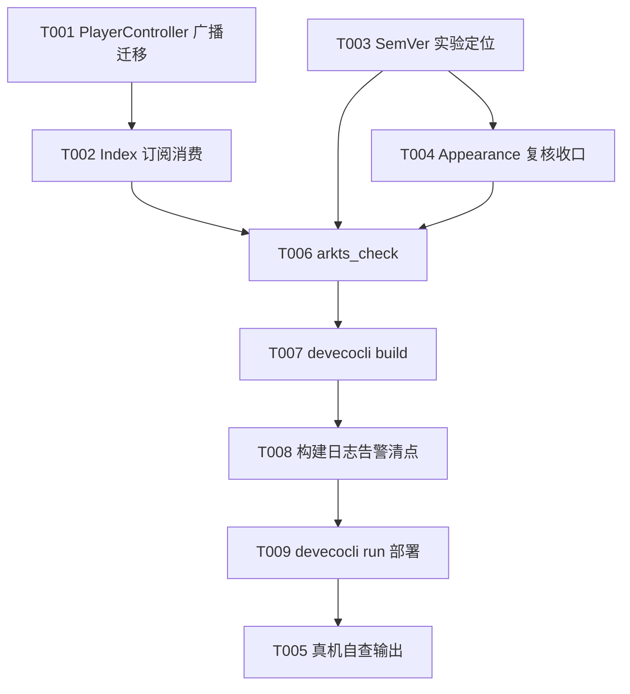

# Tasks: v0.6-part2 构建告警技术债清理

**Input**: Design documents from `spec/v0.6-part2-debt-cleanup/`
**Prerequisites**: plan.md (required), spec.md (required for user stories)

**Tests**: 无测试套件（项目现状），不生成测试任务；本轮验收核心是构建日志告警清点（SC-001/SC-004），由 Verification 阶段承载；toast/深浅色行为留真机自查。

**Organization**: 按用户故事分组，每故事可独立交付验证。

## Format: `[ID] [P?] [Story] Description`

- **[P]**: 可并行（不同文件、无未完成依赖）
- **[Story]**: 所属用户故事（US1/US2/US3）

## Path Conventions

- 单项目仓库根：`entry/src/main/ets/`（源码）、`docs/`（活文档）、仓库根 `oh-package.json5`
- 路径均相对仓库根，与 plan.md 一致

## Phase 1: Setup

无新增 Setup 任务——单模块既有项目，无结构初始化。

## Phase 2: User Story 1 - 废弃 toast API 迁移 (Priority: P1) 🎯 MVP

**Goal**: `showAnomalyToast` 迁移到零装饰器广播（anomalyToastMsg/anomalyToastTick + Index 订阅消费），去重窗/日志/触发点行为零变化，构建日志 deprecated 告警消失。

**Independent Test**: 迁移后构建通过且 `PlayerController:301 'showToast' has been deprecated` 告警消失；全代码检索无 `promptAction` 直接调用残留。

### Implementation for User Story 1

- [X] T001 [US1] `PlayerController` 迁移：删除 `promptAction` import（:14）；新增公开快照字段 `anomalyToastMsg: string = ''` + `anomalyToastTick: number = 0`（零装饰器广播模式，紧邻既有 anomaly 块 anomalyToastLastAt 旁，注释口径同 errorTick/unfavToastTick 块）；`showAnomalyToast` 改为「去重窗内 return（现状不变）→ 通过则更新 anomalyToastLastAt 水位、写 anomalyToastMsg、anomalyToastTick++、emitUi()」；`handleAnomalyOnPrepared` 内 3 处调用点（:325/:331/:338）与 Logger 日志行零改动 — entry/src/main/ets/service/PlayerController.ets
- [X] T002 [US1] `Index.ets` 消费接线：新增 `private lastAnomalyToastTick: number = 0` 字段（:36 旁，同款私有普通字段）；既有订阅块在 subscribe 之前捕获 `this.lastAnomalyToastTick = controller.anomalyToastTick`（:98-:99 旁，须在 `controller.init()` 之前，冷启动续播早期异常不漏）；订阅回调追加第三组 tick 比对，弹出经 `this.getUIContext().getPromptAction().showToast({ message: controller.anomalyToastMsg })`（与 errorTick/unfavToastTick 分支同款）— entry/src/main/ets/pages/Index.ets

**Checkpoint**: 异常 toast 经广播链路弹出，去重窗语义（PLAYBACK_ERROR_DEDUP_MS、窗内只弹一次、日志恒记）与现状逐项一致。

## Phase 3: User Story 2 - oh-package SemVer 告警修复 (Priority: P2)

**Goal**: SemVer 告警触发源实测定位，最小改动消除，安装升级行为不受影响。

**Independent Test**: 修改后构建，`The version number of the 'entry' module does not comply with the SemVer specification` 告警消失。

### Implementation for User Story 2

- [X] T003 [P] [US2] SemVer 触发源实验定位（plan.md R3 矩阵）：① `devecocli build` 基线构建确认告警存在并留存完整构建日志 → ② 候选 A：根 `oh-package.json5` 补 `"version"`（值与 entry 现值 `0.1.0` 一致）→ 重建，告警消失即定位 → ③ 候选 B（A 不中）：回滚 A，`entry/oh-package.json5` version 换非 0.x 主版本（如 `1.0.0`）→ 重建，判定 hvigor 对 0.x 的判定 → ④ 以最小改动固化结论，回滚不必要的实验改动；全程不动包名（name）与 AppScope versionCode — oh-package.json5 / entry/oh-package.json5

**Checkpoint**: SemVer 告警消除，根/entry 版本策略一致（单一真相源）。

## Phase 4: User Story 3 - Appearance 设备可用性告警查证 (Priority: P3)

**Goal**: Appearance:148 告警定性误报登记在案（查证已完成于 plan.md R4），构建复核无新增同类告警，深浅色零回归。

**Independent Test**: 复核 T003 构建日志：`Appearance.ets` 告警仍为既有一处（预期内，非回归）；无代码改动。

### Implementation for User Story 3

- [X] T004 [US3] Appearance 误报定性收口：复核 T003 任一次构建日志，确认 `This API is unavailable to phone, tablet` 告警仍仅出现在 `Appearance.ets` 的 `setWindowBackgroundColor` 一处、无新增同类告警；查证证据与误报结论以 plan.md R4 为登记处（SDK `@ohos.window.d.ts:6427` 无设备限制标注、crossplatform since 10、真机行为已验证），代码维持现状零改动 — entry/src/main/ets/service/Appearance.ets（零改动）

**Checkpoint**: 三故事全部收口；US3 与存档项（FR-004）均维持不改，构建仍现同款提示为预期内。

## Phase 5: Polish & Cross-Cutting Concerns

**Purpose**: 本轮无源码结构变化（无文件增删、无职责变更），architecture.md 无需同步；真机自查收口。

- [X] T005 真机自查事项输出（不写入任何文件）：断网/失效源触发异常 toast 弹出且去重窗内连续异常只弹一次、oh-package 版本调整后覆盖安装升级正常、深浅色切换窗口背景与系统栏配色零回归——由主代理在轮次总结集中输出

## Phase 6: Verification

<!-- verification_scope: build-only -->

**Purpose**: 构建与部署验证（用户选择：仅构建验证）+ 本轮验收核心的构建日志告警清点。

- [X] T006 对本轮全部改动 `.ets` 文件跑 `arkts_check` 静态预检并修复报告问题 — entry/src/main/ets/
- [X] T007 `devecocli build` 构建并修复编译错误（失败→修复→重建，同一目标最多 3 次后暂停报告）
- [X] T008 全量构建日志告警清点（SC-001/SC-004 验收）：US1 `showToast has been deprecated` 告警消失 + 全代码检索无 `promptAction` 直接调用残留；US2 SemVer 告警消失；US3 Appearance 告警与三项存档项（SaveButton 权限误报/@throws 例行提示/syscap 提示）同款提示仍在（预期内非回归）
- [ ] T009 `devecocli run --skip-build` 部署到设备/模拟器确认可安装启动

---

## Dependencies & Execution Order

### Phase Dependencies

- US1（T001→T002）内部串行：Index 消费依赖 PlayerController 新字段
- US2（T003）与 US1 完全并行（不同文件）
- US3（T004）依赖 T003（复用其构建日志）
- Polish（T005）在实现任务后
- Verification（T006-T009）最后，严格串行

### User Story Dependencies

- 三故事相互独立；US3 唯一依赖是 US2 的构建日志产出，零代码改动

## 📊 Dependency Graph



## ⚡ Parallel Execution Guide

| Phase | Tasks | Required Files | Execution Notes |
|-------|-------|----------------|-----------------|
| US1 | T001 → T002 | PlayerController.ets / Index.ets | 串行（消费依赖）；可与 T003 并行 |
| US2 | T003 | oh-package.json5 / entry/oh-package.json5 | 与 US1 并行；含 2-3 次实验构建 |
| US3 | T004 | （零改动，读构建日志） | T003 之后 |
| Polish | T005 | （不写文件） | 主代理收尾输出 |
| Verification | T006 → T007 → T008 → T009 | 全部改动文件 | 严格串行 |

## Parallel Example: US1 与 US2

```bash
# 两条独立线并行（不同文件、零交集）：
Task: "T001 PlayerController anomaly toast 广播迁移"        # → 完成后 T002 Index 接线
Task: "T003 oh-package SemVer 触发源实验定位"               # → 完成后 T004 Appearance 复核收口
```

## Implementation Strategy

### MVP First (Phase 2 + Phase 3)

1. US1 toast 迁移（T001-T002）——播放关键链路唯一功能债
2. US2 SemVer 定位修复（T003）——可与 US1 并行
3. US3 复核收口（T004）→ Verification 全量

## Notes

- **总任务数**: 9（T001-T009）
- **分故事计数**: US1 2（T001-T002）｜US2 1（T003）｜US3 1（T004）｜Polish 1（T005）｜Verification 4（T006-T009）
- **独立验证标准**: 每故事 Checkpoint 均可单独构建验证；验收核心为 T008 构建日志告警清点
- **MVP 范围**: US1 + US2（可执行债项主体）
- **实施轮次建议**: 单轮全量（9 任务均为小型改动或零改动复核，无跨轮风险点）
- 验证范围：仅构建验证（`<!-- verification_scope: build-only -->`，用户选择）；toast/深浅色行为真机自查
- [P] 任务 = 不同文件无依赖；[Story] 标签映射 spec.md 用户故事；避免跨故事依赖破坏独立性
