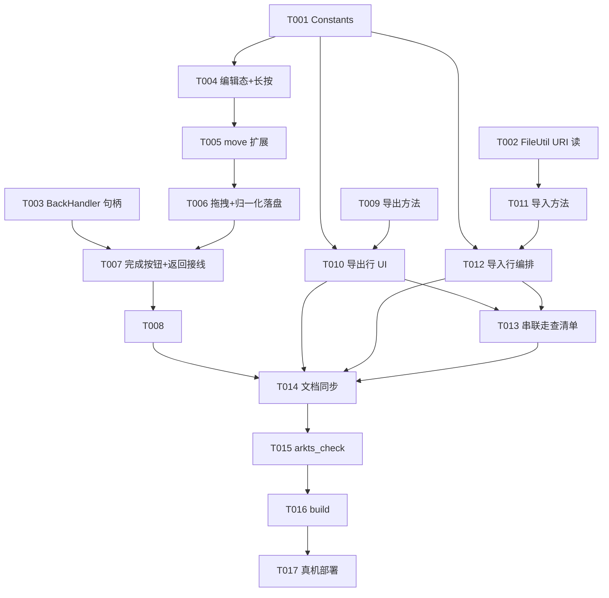

# Tasks: 订阅源管理三件套（v0.6-part3）

**Input**: Design documents from `spec/v0.6-part3-sub-manage/`
**Prerequisites**: plan.md (required), spec.md (required for user stories)

**Tests**: 无测试套件（项目现状），不生成测试任务；UI/交互验收按项目默认以真机自查事项形式随实施轮总结输出（`docs/agents/verifying.md`）。

**Organization**: 按用户故事分组，故事内任务同文件顺序执行，每故事可独立交付验收。

## Format: `[ID] [P?] [Story] Description`

- **[P]**: 可并行（不同文件、无未完成依赖）
- **[Story]**: 所属用户故事（US1–US9）

## Path Conventions

- 单模块既有项目：源码 `entry/src/main/ets/`、活文档 `docs/`
- 路径均相对仓库根，与 plan.md 一致；无新增文件，全部改动落在既有 6 文件

## Phase 1: Setup

无新增 Setup 任务——单模块既有项目，无结构初始化。

## Phase 2: Foundational（阻塞前置）

**Purpose**: 三条故事共同依赖的基础设施；三任务不同文件可并行

- [X] T001 [P] Constants 新增：导出文件名、UTD 类型串（首选 `general.json`、备选 `general.file`）、空列表/导入结果/导入导出失败 toast 文案、编辑态动画令牌（如需）——entry/src/main/ets/service/Constants.ets
- [X] T002 [P] FileUtil 新增按用户文件 URI 读文本静态方法（`fs.openSync(uri, READ_ONLY)` 得 fd 后按 fd 读取 + utf-8 解码，异常上抛由调用方兜底；不动既有 `readTextFile`）——entry/src/main/ets/service/FileUtil.ets
- [X] T003 [P] BackHandler 新增首页编辑态退出句柄注册/注销函数（对齐 `registerSettingsBack` 模式），`dismissOverlaysForBack` 增加编辑态最前消费分支——entry/src/main/ets/service/BackHandler.ets

**Checkpoint**: 基础就绪，三条故事可开始（三条文件线可交错并行）。

## Phase 3: User Story 1 - 列表编辑态拖拽排序 (Priority: P1) 🎯 MVP

**Goal**: 经长按菜单「排序」进入整页编辑态，行拖拽调序松手落盘，「完成」/系统返回退出，原失效 bindContextMenu 菜单废弃。

**Independent Test**: 真机长按弹菜单点「排序」进编辑态→拖拽调序→杀进程重启顺序保持→完成退出回正常态；左滑删除/点击导航零回归。

### Implementation for User Story 1

- [X] T004 [US1] HomePage 编辑态基础：新增编辑态状态位；移除 `bindContextMenu`/`subRowMenu`/`pinToTop`（sortOrder 稀疏值策略随废弃）；行挂 `LongPressGesture` 进入编辑态（若实施中发现与 `swipeAction`/`onTouch` 竞争不可用，按 plan D2 备选改首页标题栏显式编辑入口）——entry/src/main/ets/pages/HomePage.ets
- [X] T005 [US1] SubDataSource 扩展 `move(from, to)`：数组元素移动 + 遍历 listener 调 `onDataMove(from, to)`——entry/src/main/ets/pages/HomePage.ets
- [X] T006 [US1] 编辑态 List 分支（与正常态分离渲染，正常态不绑拖拽回调）：编辑态绑定 `onItemDragStart`（返回拖拽预览 CustomBuilder）/`onItemDragMove`/`onItemDrop`；落子后 subs 数组重排、sortOrder 全量归一化（0..n-1）、`saveSubscriptions` 落盘、`provider.move` 通知——entry/src/main/ets/pages/HomePage.ets
- [X] T007 [US1] 退出通道双轨：标题栏「完成」按钮（编辑态替换「＋/⋯」区）；统一退出函数（复位编辑态 + 句柄注销）；编辑态进入时注册 BackHandler 句柄、返回消费走同一退出函数——entry/src/main/ets/pages/HomePage.ets、entry/src/main/ets/service/BackHandler.ets
- [X] T008 [US1] rebuild 编辑态挂起/恢复：静默刷新回调（`persistRefreshedSub`）与 `homeRefreshTick` 触发的 rebuild 在编辑态置脏挂起，退出编辑态后补一次 rebuild——entry/src/main/ets/pages/HomePage.ets

**Checkpoint**: US1 独立可用（真机自查：长按/拖拽/完成/返回/重启保序/左滑删除/点击导航）。

## Phase 4: User Story 2 - 订阅列表导出 (Priority: P2)

**Goal**: 设置页「导出订阅」→ 全量订阅 JSON 写 cacheDir → 经 systemShare 分享面板发出。

**Independent Test**: 设置页点导出，分享面板拉起，选任一目标文件送达；JSON 与 subscriptions.json 同构。

### Implementation for User Story 2

- [X] T009 [P] [US2] SubscriptionStore 新增导出静态方法：全量订阅 `toRecord` 序列化为 `{items:[...]}` 写 cacheDir 固定文件（每次覆盖写，文件名取 Constants），返回沙箱路径；无订阅返回空串——entry/src/main/ets/service/SubscriptionStore.ets
- [X] T010 [US2] SettingsPage 新增「订阅管理」SettingsGroup 与「导出订阅」SettingsRow：空列表 toast 拦截（T001 文案）；否则调导出方法得路径 → `fileUri.getUriFromPath` 转 URI → `new systemShare.SharedData({utd, uri, title, description})` → `new ShareController(data).show(UIAbilityContext, {selectionMode: SINGLE})`；异常 catch toast（T001 文案）——entry/src/main/ets/pages/SettingsPage.ets

**Checkpoint**: US2 独立可用（真机自查：分享面板拉起/发送/保存到文件）。

## Phase 5: User Story 3 - 订阅列表导入（去重合并） (Priority: P3)

**Goal**: 设置页「导入订阅」→ DocumentViewPicker 选 JSON → 校验去重合并 → 提示新增/跳过 → 新源自动刷新。

**Independent Test**: 导出文件二次导入全部跳过；导入含新源文件后新源出现在列表末尾并刷新出封面剧集。

### Implementation for User Story 3

- [X] T011 [P] [US3] SubscriptionStore 新增导入静态方法：入参用户文件 URI → FileUtil 新方法读文本 → 校验（JSON 可解析/含 items/条目含 id+type，非法抛错且现有订阅零改动）→ 逐条 `Subscription.fromRecord` 容错 → 按 id 去重（已有计入 skipped）→ 新源 sortOrder 自 max+1 递增追加 → `saveSubscriptions` → 返回 `{added, skipped}`——entry/src/main/ets/service/SubscriptionStore.ets
- [X] T012 [US3] SettingsPage「导入订阅」行编排：`DocumentViewPicker.select()` 单选 → 调导入方法 → 结果 toast「新增 N 个，跳过 M 个」（T001 文案）→ 新源经 `refreshAll(force)` 串行刷新（失败不阻塞）→ bump `AS_HOME_REFRESH_TICK` 令 HomePage 重建；异常 catch toast——entry/src/main/ets/pages/SettingsPage.ets

**Checkpoint**: US3 独立可用（真机自查：选文件导入/重复导入幂等/新源刷新）。

## Phase 6: User Story 4 - 跨设备分享同步串联验收 (Priority: P3)

**Goal**: US2+US3 端到端串联，零代码改动。

**Independent Test**: 双真机：A 导出→华为分享/微信发送→B 导入→列表对齐（数量/顺序）→逐源进详情可刷新播放。

### Implementation for User Story 4

- [X] T013 [US4] 整理双设备串联走查清单（导出→分享→对端导入→列表对齐→逐源刷新播放五步，含 UTD 匹配与 cacheDir URI 跨设备可达性两项风险观察点，plan D7/D11），作为实施轮真机自查事项随总结输出——spec/v0.6-part3-sub-manage/（无代码改动）

**Checkpoint**: US4 走查清单就绪，随实施轮总结输出。

## Phase 7: Polish & Cross-Cutting Concerns

**Purpose**: 活文档随代码同步（AGENTS「活文档随代码同步」）。

- [X] T014 [P] docs/architecture.md 同步：HomePage（编辑态/拖拽）、SettingsPage（订阅管理分组）、SubscriptionStore（导入导出）、FileUtil（URI 读取）、BackHandler（编辑态句柄）职责描述更新——docs/architecture.md

## Phase 8: Verification

<!-- verification_scope: build-only -->

**Purpose**: 构建 + 真机部署验证（build-only，用户选择：仅构建验证 + 真机部署；UI/交互走查不在本阶段，按 AGENTS 以真机自查事项形式随实施轮总结输出）。

- [X] T015 对本轮全部改动 `.ets` 文件跑 `arkts_check` 静态预检并修复报告问题——entry/src/main/ets/
- [X] T016 `devecocli build` 构建并修复编译错误（失败→修复→重建，同一目标最多 3 次后暂停报告）
- [X] T017 `devecocli run --skip-build` 部署到**真机**确认可安装启动（不用模拟器）

## Phase 9: User Story 5 - 长按行弹菜单（置顶/排序/删除） (Priority: P1)

**Goal**: 长按行改弹菜单（置顶/排序/删除）；拖拽落子即时刷新修复；进出编辑态转场动画。

**Independent Test**: 真机长按抬手弹菜单→三项各自生效→编辑态拖拽落子即时更新可继续拖→进出编辑态有淡入淡出。

### Implementation for User Story 5

- [X] T018 [US5] applyDragOrder 改静默重排（FR-014）：SubDataSource 增静默移动方法（数组 splice 不通知 listener），applyDragOrder 落盘后静默同步 provider 数组，去掉 `provider.move` 的 onDataMove 通知（plan D12）——entry/src/main/ets/pages/HomePage.ets
- [X] T019 [US5] 长按改弹菜单（FR-012/013）：LongPressGesture 改 `onActionEnd`（抬手弹菜单）；行挂受控 `bindMenu(isShow, CustomBuilder, MenuOptions)`，builder 内 Menu + 三 MenuItem——置顶（subs unshift + sortOrder 归一化 + 落盘 + rebuild，幂等）/ 排序（enterEditMode）/ 删除（confirmRemoveSub）；菜单项点击后关菜单、`onDisappear` 复位状态；文案/令牌入 Constants（plan D13）——entry/src/main/ets/pages/HomePage.ets、entry/src/main/ets/service/Constants.ets
- [X] T020 [US5] 进出编辑态转场（FR-015）：编辑态/正常态分支容器与标题区（标题文字、按钮组）加 `.transition(TransitionEffect.OPACITY)`（plan D14）——entry/src/main/ets/pages/HomePage.ets
- [X] T021 构建验证：T018–T020 改动文件 `arkts_check` + `devecocli build`（失败→修复→重建，同一目标最多 3 次）
- [X] T022 真机部署：`devecocli run --skip-build`（不用模拟器）

## Phase 10: User Story 6 - 长按即时菜单与编辑态动画修正 (Priority: P1)

**Goal**: 长按按压达成即弹菜单（行缩放强调、菜单从上方展开）；编辑态进出转场可见；拖拽把手加大。

**Independent Test**: 真机按住行至长按达成菜单即弹且行缩放、菜单从上方展开；进出编辑态可见淡入淡出；把手明显变大。

### Implementation for User Story 6

- [X] T023 [US6] 编辑态转场修正（FR-017）：既有 7 处 `.transition(TransitionEffect.OPACITY)` 补 `.animation({ duration: 令牌 })`（时长令牌入 Constants，plan D16）——entry/src/main/ets/pages/HomePage.ets、entry/src/main/ets/service/Constants.ets
- [X] T024 [US6] 长按即时菜单与行强调（FR-016/019）：LongPressGesture `onActionEnd` 改 `onAction`（按压达成即触发）；行 `.scale()` 绑定 menuKey 命中缩至 ~0.97（+属性动画平滑，scale/时长令牌入 Constants）；bindMenu options 补 `placement: Placement.Top`（plan D15）；按压行（pressedKey 态）加浮起阴影（复用 TOKEN_FLOATING_SHADOW_* + shadow_ball，按压中显现松开消失，plan D15 修正）——entry/src/main/ets/pages/HomePage.ets、entry/src/main/ets/service/Constants.ets
- [X] T025 [US6] 拖拽把手加大（FR-018）：editRowItem 把手 SymbolGlyph 字号上调至大号令牌 + 占位加大（plan D17）——entry/src/main/ets/pages/HomePage.ets、entry/src/main/ets/service/Constants.ets
- [X] T026 构建验证：T023–T025 改动文件 `arkts_check` + `devecocli build`
- [X] T027 真机部署：`devecocli run --skip-build`（不用模拟器）

## Phase 11: User Story 7 - 置顶动画与编辑态动画对齐多选 (Priority: P1)

**Goal**: 置顶带列表补位动画；进退排序编辑态动画与源详情页多选进出动画完全一致。

**Independent Test**: 真机点置顶行动画飞至首位、其余行补位；进退编辑态动画节奏/时长/曲线与多选进出一致。

### Implementation for User Story 7

- [X] T028 [US7] 置顶补位动画（FR-020）：SubDataSource 恢复 `move(from, to)`（splice + onDataMove 通知）；`pinToTop` 改 animateTo({ duration: TOKEN_SELECT_ANIM_MS, curve: EaseOut }) 包「重排+归一化+落盘+provider.move」，置顶后不调 rebuild；idx<=0 幂等早退保留（plan D18）——entry/src/main/ets/pages/HomePage.ets
- [X] T029 [US7] 编辑态动画与多选同构（FR-021）：enterEditMode/exitEditMode 包 animateTo({ duration: TOKEN_SELECT_ANIM_MS, curve: EaseOut })（对齐 SourcePage :131/:145 同款）；7 处 transition 移除 `.animation({ duration: TOKEN_EDIT_MODE_TRANSITION_MS })` 参数（改回纯 TransitionEffect.OPACITY，参数由 animateTo 供给）；`TOKEN_EDIT_MODE_TRANSITION_MS` 令牌删除（无消费方）；exitEditMode 的 rebuildPending 补跑移 animateTo 闭包外（plan D19）——entry/src/main/ets/pages/HomePage.ets、entry/src/main/ets/service/Constants.ets
- [X] T030 构建验证：T028–T029 改动文件 `arkts_check` + `devecocli build`
- [X] T031 真机部署：`devecocli run --skip-build`（不用模拟器）

## Phase 12: User Story 8 - 置顶移动语义修复与编辑态行让位动画 (Priority: P1)

**Goal**: 置顶表现为移动语义（飞至首位、途经行依次下移，非互换，数量不限）；编辑态行内容平滑让位给恒挂载把手（单 List 复刻多选机制）。

**Independent Test**: 真机连续置顶多条验证移动视觉与最终顺序；进编辑态把手平滑长出、内容平滑让位，退出反向；正常态长按弹菜单/左滑/导航零回归。

### Implementation for User Story 8

- [X] T032 [US8] 置顶移动语义修复（FR-022）：`SubDataSource.move(from, to)` 改造为 `moveToFront(idx)`——rows splice 移至 0 + 相邻交换冒泡通知序列（onDataMove(idx, idx-1)…onDataMove(1, 0)）；`pinToTop` 调用点同步（animateTo 闭包内，数据层 unshift/归一化/落盘不变，plan D20）——entry/src/main/ets/pages/HomePage.ets
- [X] T033 [US8] 单 List 合并（FR-023 前半）：编辑/正常双 List 分支合并为单 List——LazyForEach 恒绑 `.onMove`、`applyDragOrder` 加 `editMode` 闸（非编辑态落子不改序）、`editRowItem` 废弃并入 `subRowItem`、编辑态行为闸下沉行内（导航闸既有/LongPressGesture.onAction 弹菜单闸/swipeAction 保留）、List 层两处 Stack transition 随分支合并删除（标题/按钮 5 处保留，plan D21）——entry/src/main/ets/pages/HomePage.ets
- [X] T034 [US8] 恒挂载把手与行让位（FR-023 后半）：拖拽把手容器恒挂载 `subRowItem` 行首——`width(editMode ? Constants 令牌 : 0)` + `opacity(editMode ? 1 : 0)`（SelectCheckbox.ets:29 同构），`subRowCore` layoutWeight 真实让位；把手宽度/图标尺寸令牌入 Constants；动画由 enterEditMode/exitEditMode 既有 animateTo 驱动（plan D21）——entry/src/main/ets/pages/HomePage.ets、entry/src/main/ets/service/Constants.ets
- [X] T035 构建验证 + 真机部署：T032–T034 改动文件 `arkts_check` + `devecocli build` + `devecocli run --skip-build`（不用模拟器）

## Phase 13: User Story 9 - 编辑态整行可拖放修复、把手留白对称与把手即按即拖 (Priority: P1)

**Goal**: 编辑态整行可拖放（单 List 合并引入的行级手势阻塞修复）；把手左右留白对称；把手按下直接进拖拽（免长按等待，自定义手动拖拽）。

**Independent Test**: 真机编辑态长按行任意位置即可拖动整行调序；按下把手并移动立即跟手拖拽（无长按等待）；把手留白对称；正常态零回归。

### Implementation for User Story 9

- [X] T036 [US9] 编辑态整行可拖放修复（FR-024）：路径迭代——一版 `.enabled(!editMode)` 全禁（拖拽修复、按压反馈禁掉）；二版 parallelGesture（按压反馈恢复、拖拽回归，真机验证失败回退；补丁 onClick 闸扩 `editMode || menuKey !== ''` 保留无害）；三版（当前）：`.enabled(!editMode)` 恢复 + LongPressGesture 恢复 `.gesture()` + onTouch 按压链移至 ListItem 恒挂（编辑态触摸穿透行落 ListItem 驱动 pressedKey，纯监听不阻塞拖拽；plan D22 三版与回退条件）——entry/src/main/ets/pages/HomePage.ets
- [X] T037 [US9] 把手留白对称（FR-025）：把手容器内图标水平居中确认/微调，图标至行左缘与至内容起点两侧留白等值（TOKEN_DRAG_HANDLE_W 38vp 容器、图标 22vp、两侧各 8vp 基准，plan D23）——entry/src/main/ets/pages/HomePage.ets
- [X] T038 构建验证 + 真机部署：T036–T037 改动文件 `arkts_check` + `devecocli build` + `devecocli run --skip-build`（不用模拟器）
- [X] T039 [US9] 把手即按即拖（FR-026）：`subRowItem` 结构重排——根 Row（视觉承载恒 enabled）内分把手容器（+ Parallel 并行手势组：PanGesture Vertical + 空长按认领阻断）与内容包装 Row（layoutWeight + enabled(!editMode) + onClick 闸/LongPressGesture/bindMenu 随迁），正常态把手真零宽零回归（width+padding 同条件归零）；拖拽状态（@Local draggingKey/dragOffsetY/dragBaseline + private dragActive/dragFromIndex，GestureEvent.offsetY 按压起算偏移）+ translate/zIndex 绑定 ListItem（translate 不经根 Row `.animation()` 免拖拽橡皮筋）；换位循环（跨 TOKEN_DRAG_SWAP_DISTANCE 80 阈值相邻交换——subs splice 互换 + provider.swapNotify 单发 onDataMove 包 animateTo 补位，循环守卫 10 次）；settleDrag（animateTo 归位 + onFinish 经 dragActive 守卫清态 + sortOrder 归一化落盘）；互斥闸三处（applyDragOrder draggingKey 早退/pan onActionStart editMode+dragActive 守卫/exitEditMode 清拖拽态）；SubDataSource 新增 `swapNotify(from, to)`（相邻守卫 + splice 互换 + 单发 onDataMove）——entry/src/main/ets/pages/HomePage.ets、entry/src/main/ets/service/Constants.ets
- [X] T040 构建验证 + 真机部署：T039 改动文件 `arkts_check` + `devecocli build` + 真机部署 `devecocli run --skip-build`（不用模拟器）——arkts_check 6 条 SDK 误报基线 + BUILD SUCCESSFUL + 真机部署完成；左缘长按弹菜单复测通过（bugfix.md §1）

### Phase Dependencies

- Foundational（T001–T003）先行，三任务并行
- US1（T004–T008）内部串行：同文件 HomePage，按手势→数据源→拖拽→退出→挂起顺序
- US2（T009→T010）数据层先行、UI 编排随后；US3（T011→T012）同构
- US1 / US2 / US3 三条文件线（HomePage.ets / SubscriptionStore.ets / SettingsPage.ets）可交错并行
- US4（T013）依赖 US2+US3 完成；Polish（T014）依赖全部故事任务
- Verification（T015–T017）最后，严格串行
- US5（T018→T019→T020）同文件（HomePage.ets）严格串行；T021→T022 验证串行
- US6（T023→T024→T025）同文件（HomePage.ets）严格串行；T026→T027 验证串行
- US7（T028→T029）同文件（HomePage.ets）严格串行；T030→T031 验证串行
- US8（T032→T033→T034）同文件（HomePage.ets）严格串行；T035 验证收尾
- US9（T036→T037→T039）同文件（HomePage.ets）严格串行；T038/T040 验证收尾完成

### User Story Dependencies

- 三实现故事相互独立，仅共享 Foundational 产出；US4 为 US2+US3 串联验收，无代码依赖

## 📊 Dependency Graph



## ⚡ Parallel Execution Guide

| Phase | Tasks | Required Files | Execution Notes |
|-------|-------|----------------|-----------------|
| Foundational | T001, T002, T003 | Constants.ets / FileUtil.ets / BackHandler.ets | 三任务不同文件，可并行 |
| US1 | T004→T005→T006→T007→T008 | HomePage.ets（T007 兼及 BackHandler.ets） | 同文件严格串行 |
| US2 | T009→T010 | SubscriptionStore.ets / SettingsPage.ets | 与 US1 并行（不同文件） |
| US3 | T011→T012 | SubscriptionStore.ets / SettingsPage.ets | 与 US1 并行；T009→T011 同文件串行，T010→T012 同文件串行 |
| US4 | T013 | （不写源码） | US2+US3 完成后 |
| Polish | T014 | docs/architecture.md | 全部故事任务后 |
| Verification | T015→T016→T017 | 全部改动文件 | 严格串行；部署仅真机 |

## Parallel Example: US1 与 US2/US3

```bash
# 三条独立文件线交错并行（零文件交集）：
Task: "T004-T008 US1 编辑态拖拽排序（HomePage.ets 线）"
Task: "T009 导出方法 → T011 导入方法（SubscriptionStore.ets 线，串行）"
Task: "T010 导出行 → T012 导入行（SettingsPage.ets 线，串行，等各自数据层任务）"
```

## Implementation Strategy

### MVP First (User Story 1 Only)

1. Foundational 三任务并行（T001–T003）
2. US1 编辑态拖拽排序（T004–T008）→ 独立验收（MVP）
3. US2 导出（T009–T010）→ US3 导入（T011–T012）→ US4 清单（T013）
4. Polish（T014）→ Verification 全量（T015–T017，真机部署）

### 实施轮次建议

原始规划 17 任务（T001–T017，6 文件改动、无新文件）单轮连续实施；US5–US9（T018–T040，23 任务）为真机实测反馈迭代任务，每故事独立构建验证 + 真机部署。

## Notes

- **总任务数**: 40（T001–T040）
- **分故事计数**: Foundational 3（T001–T003）｜US1 5（T004–T008）｜US2 2（T009–T010）｜US3 2（T011–T012）｜US4 1（T013）｜Polish 1（T014）｜Verification 3（T015–T017）｜US5 5（T018–T022）｜US6 5（T023–T027）｜US7 4（T028–T031）｜US8 4（T032–T035）｜US9 5（T036–T040）
- **独立验证标准**: 每故事 Checkpoint 均可独立真机自查（见各 Phase）
- **MVP 范围**: US1（T001+T003+T004–T008）——编辑态排序独立交付即有价值
- **验证范围**: 仅构建验证（`<!-- verification_scope: build-only -->`，用户选择）；部署一律真机（不用模拟器，用户指示）；长按/拖拽/分享面板/双设备串联四项风险点（plan D11）随实施轮总结以真机自查事项输出
- [P] 任务 = 不同文件无依赖；[Story] 标签映射 spec.md 用户故事；避免跨故事依赖破坏独立性
