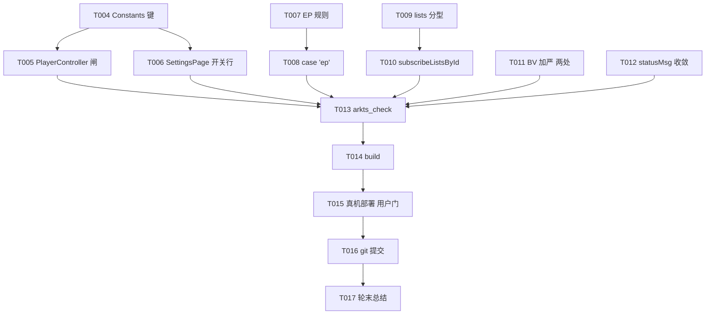

# Tasks: 移除前确认开关与识别链路收尾（v0.6-part4）

**Input**: Design documents from `spec/v0.6-part4-removal-confirm/`
**Prerequisites**: plan.md (required), spec.md (required for user stories)

**Tests**: 无测试套件（项目现状），不生成测试任务；UI/交互验收按项目默认以真机自查事项形式随实施轮总结输出（`docs/agents/verifying.md`）。

**Organization**: 按用户故事分组，故事内任务同文件顺序执行；登记对账任务前置（US6），代码任务按依赖顺序 US1→US2→US3→US4→US5，验证收尾。

## Format: `[ID] [P?] [Story] Description`

- **[P]**: 可并行（不同文件、无未完成依赖）
- **[Story]**: 所属用户故事（US1–US6）

## Path Conventions

- 单模块既有项目：源码 `entry/src/main/ets/`、活文档 `docs/`、根 `BILI_NOTES.md`
- 路径均相对仓库根，与 plan.md 一致；无新增源码文件，全部代码改动落在既有 5 文件

<!-- verification_scope: build-only -->

## Phase 1: 登记对账 (US6)

**Goal**: 活跃 spec 目录切换、PROJECT_NOTES 两处销项、BILI_NOTES §3 三条补录。

**Independent Test**: feature.json 指向本目录；PROJECT_NOTES 无已交付待决残留；BILI_NOTES §3 含 EP/lists/BV 三条新记载。

- [X] T001 [US6] spec/feature.json 活跃目录切换至 v0.6-part4-removal-confirm——spec/feature.json
- [X] T002 [US6] PROJECT_NOTES.md：KI-7 压缩为全销项状态（B8 口径注明）；第三章删除「订阅源导出导入」（v0.6-part3 已交付）——docs/PROJECT_NOTES.md
- [X] T003 [US6] BILI_NOTES.md §3 追加：EP 形态登记与拒收决策（3.9）、lists 无 type 歧义与回退链含未实测假设（3.10）、BV base58 字符集与 PiliPlus 旁证（3.11）——BILI_NOTES.md

## Phase 2: US1 移除前确认开关

**Goal**: 设置页账号组新增 Toggle 行，PlayerController 询问链路加开关闸。

**Independent Test**: 默认开弹窗行为不变；关闭后移除不弹窗、云端收藏保留；状态重启保持。

- [X] T004 [US1] Constants 新增 `KEY_UNFAVORITE_ASK`（'unfavoriteAsk'，缺省 1）——entry/src/main/ets/service/Constants.ets
- [X] T005 [US1] PlayerController `removeSelectedFromPlaylist` 询问条件追加 `askEnabled`（AppStore.getNumber 缺省 1），注释同步——entry/src/main/ets/service/PlayerController.ets
- [X] T006 [US1] SettingsPage：`@Local unfavoriteAskOn` 声明 + aboutToAppear 初始化 + 「移除前确认」SettingsRow（历史同步与退出登录之间，Toggle 样式照抄历史同步行）——entry/src/main/ets/pages/SettingsPage.ets

## Phase 3: US2 EP 明确提示

**Goal**: EP 三形态（URL/纯文本/短链）识别为 `'ep'` 并明确提示。

**Independent Test**: 粘贴番剧链接（含 b23.tv 短链）toast「暂不支持番剧/影视内容」，面板保持打开。

- [X] T007 [US2] LinkResolver `recognizeInput` 新增 EP URL 规则（bangumi/play/ep|ss → 'ep'）与纯文本规则（^ep|ss → 'ep'），文件头与 RecognizeResult 注释 type 枚举同步——entry/src/main/ets/service/LinkResolver.ets
- [X] T008 [US2] AddSubscriptionSheet `dispatchRecognized` 加 `case 'ep'` toast「暂不支持番剧/影视内容」——entry/src/main/ets/pages/AddSubscriptionSheet.ets

## Phase 4: US3 KI-7 B3 lists 回退链

**Goal**: 无 type 参数 lists URL 经回退链自动判定合集/系列。

**Independent Test**: 无 type 参数的系列/合集 lists 链接均订阅正确类型；双失败明确报错。

- [X] T009 [US3] LinkResolver lists 规则改显式定型（type=season|series 各自返回，无参数返回 'lists'）——entry/src/main/ets/service/LinkResolver.ets
- [X] T010 [US3] AddSubscriptionSheet：`case 'lists'` + `subscribeListsById` 回退链（fetchSeasonMeta → catch 转 fetchSeriesMeta → 双失败 toast「合集/系列信息获取失败」；season 分支含 cover、series 分支不含，各照抄既有 then 分支）——entry/src/main/ets/pages/AddSubscriptionSheet.ets

## Phase 5: US4 KI-7 B8 BV 加严

**Goal**: BV 形态校验收严为 base58 字符集，伪 BV 本地拦截。

**Independent Test**: 含 0/O/I/l 的伪 BV 提示未识别；真实 BV 零误拦。

- [X] T011 [US4] LinkResolver 两处 `BV[0-9A-Za-z]{10}` → `BV[1-9A-HJ-NP-Za-km-z]{10}`（recognizeInput 全文扫描 + shortLinkBvTarget 短路）——entry/src/main/ets/service/LinkResolver.ets

## Phase 6: US5 statusMsg 收敛

**Goal**: 登录状态提醒行观感收敛。

**Independent Test**: 提醒行字号 12、间距收紧、水平居中；显示条件不变。

- [X] T012 [US5] SettingsPage statusMsg 行：fontSize TOKEN_FONT_BODY_S、margin {top/bottom: TOKEN_SPACE_S}、补 width('100%')——entry/src/main/ets/pages/SettingsPage.ets

## Phase 7: Verification

**Goal**: 静态检查与构建全绿。

- [X] T013 [P] arkts_check 传全部改动 .ets（Constants/LinkResolver/AddSubscriptionSheet/PlayerController/SettingsPage）
- [X] T014 [P] devecocli build 零错误
- [ ] T015 真机部署 devecocli run --skip-build（用户指示：停在真机前——部署与真机自查由用户另行发起或确认后执行）

## Phase 8: 收尾

- [ ] T016 git 单轮一提交（先读 docs/agents/git-committing.md；真机部署/自查完成后再提交）
- [X] T017 轮末总结集中输出真机自查事项（US1 四场景 / US2 三形态 / US3 两类型 / US4 伪 BV / US5 观感 + B3 未实测假设观察点）

## Phase 9: 顺带文案与观感调整（用户追加）

**Goal**: 设置文案按用户反馈定稿；登录提醒行迁出卡片。

- [X] T018 「取消收藏提醒」行 title+subtitle 定稿（title「取消收藏提醒」、subtitle「删除来自个人收藏夹的歌单视频时，询问取消B站上的收藏」；原「移除前确认」文案用户反馈看不懂，经「删除前询问」迭代至「取消收藏提醒」）——entry/src/main/ets/pages/SettingsPage.ets
- [X] T019 「异常源自动跳过」行 title 改为「跳过未充电视频」（subtitle「检测到试听内容时提示并自动播放下一首」与 toast 文案口径不变）——entry/src/main/ets/pages/SettingsPage.ets
- [X] T020 statusMsg 登录提醒行迁出账号 SettingsGroup、置于 page_background（非卡片白底）上，与卡片视觉分离（显示条件与文案不变）——entry/src/main/ets/pages/SettingsPage.ets
- [X] T021 US3 真机验证发现合集/系列 id 跨 UP 撞号（系列 302414 删 type 后 season 端点命中别 UP mid=428192613 的真实合集，回退链按报错分型不触发、误订撞号合集）：`subscribeListsById`/`subscribeSeriesFallback` 改 URL mid 锚点消歧——meta.mid 与 URL ownerMid 匹配才采纳，无锚点时 mid>0 识别空 meta 桩（BILI_NOTES §3.10 实测结论同步）——entry/src/main/ets/pages/AddSubscriptionSheet.ets

## Mermaid Dependency Graph

