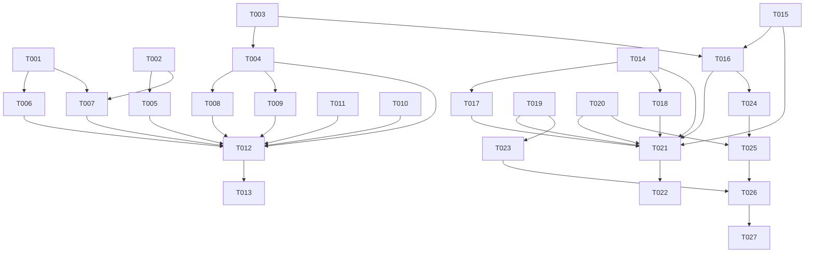

# Tasks: 队列插入位置控制（v0.7-part1）

**Input**: spec.md + plan.md (this directory)

**实施轮次建议**: 第一批 T001–T011 已实施（单轮完成）；再优化批 T014–T020 为第二批实施轮（置顶飞越 T015 先行、队列飞越 T016 复用其后——用户决策）；T021–T022 第二轮验证完成；第三修正批 T023–T025 为第三批实施轮（同时动画/双主按钮/气泡提示）；T026–T027 第三轮验证，**停到真机前**（构建通过即收尾，不执行真机部署/运行/UI 验证）。

## Phase 1: Setup

- [X] T001 新增 Preferences 键 `KEY_SINGLE_INSERT_NEXT = 'singleInsertNext'`（KEY_ANOMALY_SKIP 后键区，缺省 0=队列末播放）于 entry/src/main/ets/service/Constants.ets

## Phase 2: Foundational

- [X] T002 `loadPlaylistAndPlay` 扩第三可选参 `insertAfterCurrent = false`（D1：非空分支经 `getQueueEntryGroups` 定位当前条目游程后 splice 插入，默认路径与既有 4 调用零改动）于 entry/src/main/ets/service/PlayerController.ets
- [X] T003 新增 `moveFlatItems(indices: Set<number>, toEnd: boolean): number`（D2：越界丢弃、当前条目游程剔除、保序重组、复合键重定位 currentIndex、持久化三件套、statusMsg、不打断播放）于 entry/src/main/ets/service/PlayerController.ets

## Phase 3: User Stories

- [X] T004 [US1] 多选行加「移到最后」（`sys.symbol.arrow_down_to_line`）「下一首播放」（`sys.symbol.forward_end_fill`）两枚 36dp 图标玻璃按钮——位序 全选+N ···· 移除｜移到最后｜下一首播放｜退出（从右缘向内），text_primary 色，无选中时与移除共享禁用；点击收集选中条目扁平下标（单=起始下标、组=startIndex 起全区间）→ `moveFlatItems` → 成功退多选清空、无 toast 于 entry/src/main/ets/component/QueueSheet.ets
- [X] T005 [P] [US2] `selectActionBar` 扩三按钮：左「下一首播放 (N)」（card，`enqueueSelected(true)`）·中「标记已看完」(card，原左按钮)·右「队列末播放 (N)」(accent 主按钮，原「加入队列 (N)」更名)；三按钮 `TOKEN_FONT_BODY_S` + `TOKEN_SPACE_M` 边距、计数保留、过渡动画（左 START/右 END/中 OPACITY）于 entry/src/main/ets/pages/SourcePage.ets
- [X] T006 [P] [US3] 播放设置组「仅在 Wi-Fi 环境播放」后加 SettingsRow（title「单集插入位置」、valueText 当前值、showArrow）+ 复刻 `qualitySheetPanel` 的两选项单选 sheet（当前项 ✓ 高亮、选中即 `putNumber(KEY_SINGLE_INSERT_NEXT)` 并关闭）、`@Local` 状态 + aboutToAppear 读取于 entry/src/main/ets/pages/SettingsPage.ets
- [X] T007 [P] [US3] `enqueueAndToast` 实时读 `getNumber(KEY_SINGLE_INSERT_NEXT, 0) === 1` 传第三参（点击时生效；多选按钮显式参/添加订阅/历史面板零改动）于 entry/src/main/ets/pages/SourcePage.ets
- [X] T008 [US4] 单行头部 `trash`（清空）与 `wand_and_stars`（清除已播）两按钮块整体互换，新位序 清空→多选→清除已播（图标/onClick/样式/确认弹窗/空队列隐藏逻辑零改动，仅位置）于 entry/src/main/ets/component/QueueSheet.ets
- [X] T009 [US5] 多选行全选按钮右侧加独立计数 Text（按钮外，`TOKEN_FONT_BODY_S`、accent、`TOKEN_SPACE_XS` 间距、随勾选实时变化、0 也显示）；移除按钮去内嵌计数变纯 trash 图标于 entry/src/main/ets/component/QueueSheet.ets
- [X] T010 [P] [US5] 多选行全选按钮右侧加同档式独立计数 Text；「删除所选」按钮去内嵌计数变纯 trash 图标（danger_red/确认弹窗/onClick 零改动）；返回按钮不动于 entry/src/main/ets/component/HistorySheet.ets

## Phase 4: Polish

- [X] T011 版本号升级：`versionName` 0.6.0→0.7.0、`versionCode` 6000→7000 于 AppScope/app.json5

## Phase 5: Verification

<!-- verification_scope: build-only -->

- [X] T012 全部改动 `.ets` 文件 `arkts_check` 预检通过后 `devecocli build`，编译错误就地修复直至构建成功
- [X] T013 （真机前停点，用户指示）不执行真机部署/运行/UI 验证——构建通过即收尾，输出场景自查清单（SC-001~007 对应人工核验项）供用户真机自查

## Phase 6: 再优化批（第二批实施，用户六项再优化）

- [X] T014 [P] [US5] 字号令牌区新增 `TOKEN_FONT_17 = 17`（TOKEN_FONT_TITLE 与 TOKEN_FONT_18 之间），并将 QueueSheet 标题「播放队列 (N)」的字面 17 替换为该令牌（「已选N条」与标题同源）于 entry/src/main/ets/service/Constants.ets 与 entry/src/main/ets/component/QueueSheet.ets
- [X] T015 [P] [US7] 置顶飞越动画（D10，机制先行）：`pinToTop` 保留相邻交换冒泡通知，新增 `@Local flightKey: string = ''`——pinToTop 置被置顶行键、`animateTo` 的 `onFinish` 清空；列表行节点挂 `.zIndex(flightKey === 行键 ? 1 : 0)`（飞行期间盖在其他行上，结束复位）；首位幂等/长按菜单/拖拽/删除零改动于 entry/src/main/ets/pages/HomePage.ets
- [X] T016 [US1] 队列移动飞越 + toast（D11，复用 T015 机制、不抽公共组件）：`moveSelected` 改造——`@Local flightKeys: Set<string>` 赋值选中键集 → `animateTo(TOKEN_SELECT_ANIM_MS/EaseOut, onFinish)` 闭包内调 `moveFlatItems`（键稳定节点复用参与动画）→ 条目节点 `.zIndex(flightKeys.has(键) ? 1 : 0)`；`onFinish` 清 flightKeys → 退多选清空 → toast「已插入 N 项到当前播放之后」/「已移动 N 项至队尾」（内联模板串）；广播链异步降级不阻塞功能与 toast 于 entry/src/main/ets/component/QueueSheet.ets
- [X] T017 [P] [US5] 队列多选行计数升级「已选N条」：Text+Span 组合——N 本页 accentColor、其余字 text_primary、字号 `TOKEN_FONT_17`、间距 `TOKEN_SPACE_XS`、随勾选实时变化、0 也显示「已选0条」于 entry/src/main/ets/component/QueueSheet.ets
- [X] T018 [P] [US5] 历史多选行计数升级「已选N条」：同 T017 档式镜像（Text+Span/TOKEN_FONT_17/0 也显示）于 entry/src/main/ets/component/HistorySheet.ets
- [X] T019 [P] [US2] 源页底栏位序互换 + 双主色（D4）：左「队列末播放 (N)」（card 底 + accent 描边 `border({width: 1, color: accentColor})`，`enqueueSelected(false)`）·中「标记已看完」·右「下一首播放 (N)」（accent 底主按钮 + fg_on_dark，`enqueueSelected(true)`）；360dp 单行校验、过渡动画沿用 于 entry/src/main/ets/pages/SourcePage.ets
- [X] T020 [P] [US6] 两面板多选行全部图标按钮长按 toast 提示（D12）：队列 5 枚（全选/移除所选/移到最后/下一首播放/退出多选）、历史 3 枚（全选/删除所选/退出多选），`.gesture(LongPressGesture().onAction(…showToast))`，与 onClick 并存（手势竞争长按胜出不触发点击）于 entry/src/main/ets/component/QueueSheet.ets 与 entry/src/main/ets/component/HistorySheet.ets

## Phase 7: Verification（第二轮）

<!-- verification_scope: build-only -->

- [X] T021 第二批全部改动 `.ets` 文件 `arkts_check` 预检通过后 `devecocli build`，编译错误就地修复直至构建成功
- [X] T022 （真机前停点）不执行真机部署/运行/UI 验证——构建通过即收尾，输出再优化批核验清单（SC-001 场景 5/6 飞越与 toast、SC-002 场景 4 双主色位序、SC-007「已选N条」格式、SC-008 长按提示、SC-009 置顶飞越）供用户真机自查

## Phase 8: 第三修正批（第三批实施，用户三项修正）

- [X] T023 [P] [US2] 源页底栏第三修正（D4）：左「队列末播放 (N)」与右「下一首播放 (N)」统一 accent 底主按钮 + `fg_on_dark` 白字（两枚入队按钮样式一致，`enqueueSelected(false)`/`enqueueSelected(true)` 不变）；中「标记已看完」card 底 + accent 描边 `border({ width: 1, color: accentColor, radius: TOKEN_RADIUS_XXL })`；位序/计数/过渡/360dp 单行适配沿现状 于 entry/src/main/ets/pages/SourcePage.ets
- [X] T024 [US1] 队列移动退多选同时化（D11 修正）：`moveSelected` 闭包内 `moveFlatItems` 返回 `moved > 0` 时直接调裸 `exitSelectMode()`（endSweep + selectMode 翻转 + selectedKeys 清空，无动画壳避免嵌套 animateTo）——勾选框收起/头部切换与飞越同起点同参数同步驱动（总时长 ~300ms）；`moved === 0` 不退多选不 toast（闸保留）；`onFinish` 清 flightKeys + toast（「已插入 N 项到当前播放之后」/「已移动 N 项至队尾」）于 entry/src/main/ets/component/QueueSheet.ets
- [X] T025 [P] [US6] 两面板长按提示 toast→bindPopup 气泡（D12 修正）：各加 `@Local popupTip: string = ''`（单态互斥）；队列 5 枚（全选/移除所选/移到最后/下一首播放/退出多选）、历史 3 枚（全选/删除所选/退出多选）挂 `.bindPopup(popupTip === '<键>', { message: '功能名', placement: Placement.Bottom })` + `LongPressGesture` 置键；`onStateChange` 气泡不可见时清 `popupTip`（防状态残留致同按钮二次长按不弹）；autoCancel 点面板任意处消失；与 onClick 并存 于 entry/src/main/ets/component/QueueSheet.ets 与 entry/src/main/ets/component/HistorySheet.ets

## Phase 9: Verification（第三轮）

<!-- verification_scope: build-only -->

- [X] T026 第三批全部改动 `.ets` 文件 `arkts_check` 预检通过后 `devecocli build`，编译错误就地修复直至构建成功
- [X] T027 （真机前停点）不执行真机部署/运行/UI 验证——构建通过即收尾，输出第三修正批核验清单（SC-001 场景 5 同时动画/SC-002 场景 4 双主按钮与中描边/SC-008 气泡提示含消失与二次长按）供用户真机自查

## 📊 Dependency Graph

## ⚡ Parallel Execution Guide

| Phase | Tasks | Required Files | Execution Notes |
|---|---|---|---|
| Setup | T001 | Constants.ets | 已完成 |
| Foundational | T002, T003 | PlayerController.ets | 已完成 |
| Stories | T004→T008→T009 | QueueSheet.ets | 已完成（同文件串行） |
| Stories | T005, T007 | SourcePage.ets | 已完成 |
| Stories | T006 | SettingsPage.ets | 已完成 |
| Stories | T010 | HistorySheet.ets | 已完成 |
| Polish | T011 | AppScope/app.json5 | 已完成 |
| 再优化 | T014→T017→T016 | Constants/QueueSheet | 同文件串行；T015 机制先行后 T016 复用（用户决策） |
| 再优化 | T015 | HomePage.ets | 独立，可与 T014/T019 批次并行 |
| 再优化 | T018, T020 | HistorySheet.ets | 同文件串行，与其他批次可并行 |
| 再优化 | T019 | SourcePage.ets | 独立，可与任何批次并行 |
| Verification | T021, T022 | 全部 | 第二轮收尾已完成；真机前停 |
| 第三修正 | T023 | SourcePage.ets | 独立，可与任何批次并行 |
| 第三修正 | T024 → T025 | QueueSheet.ets | 同文件串行（T025 另含 HistorySheet.ets 气泡） |
| Verification | T026, T027 | 全部 | 第三轮收尾；真机前停 |

## Summary Report

- **总任务数**: 27（第一批 13 + 再优化批 9 已完成；第三修正批 实施 3 / 验证 2）
- **按故事（第三修正批）**: US1×1（T024 退多选同时化）、US2×1（T023 双主按钮+中描边）、US6×1（T025 气泡提示）
- **并行机会（第三修正批）**: T023（SourcePage）独立可并行；T024→T025 在 QueueSheet 串行（T025 的历史面板部分可与其他批次并行）
- **独立测试判据**: 每 US 场景见 spec.md SC-001~009；T027 输出第三修正批人工核验清单
- **验证范围**: build-only，真机前停（T027 为收尾停点，无部署/无 UI 验证任务）
