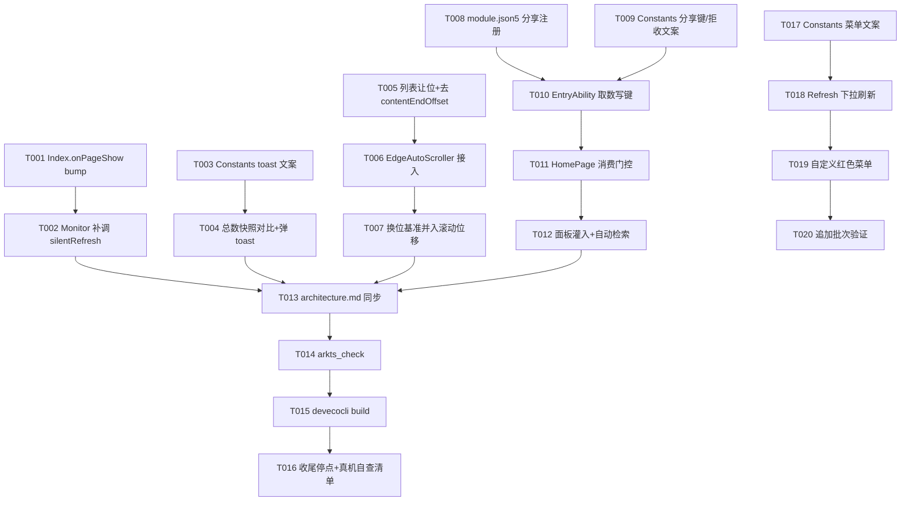

# Tasks: 回前台静默刷新、新集提醒、首页拖拽边缘滚动与分享导入（v0.7-part2-refresh-share）

**Input**: Design documents from `spec/v0.7-part2-refresh-share/`（spec.md 六 US + plan.md D1~D10）
**Prerequisites**: plan.md（已就绪）、spec.md（已就绪）
**Tests**: 无测试套件（项目现状），不生成测试任务；验证走 arkts_check + devecocli build

## Phase 1: User Story 1 - 回前台触发静默刷新 (Priority: P1) 🎯 MVP

**Goal**: 回前台经既有 homeRefreshTick 键链路触发静默刷新尝试，分源 CD 三层门收敛。
**Independent Test**: 进程存活、距上次刷新超 1 小时时回前台（不冷启动），首页数据自动更新；不足 1 小时的回前台零网络请求；冷启动保持 15 分钟 CD。

- [X] T001 [P] [US1] Index.ets 增加页面显示生命周期 onPageShow，以既有惯用法 bump 全局键（connectNum(Constants.AS_HOME_REFRESH_TICK, 0).value = Date.now()，与 SourcePage.onHidden 同款），文件 entry/src/main/ets/pages/Index.ets
- [X] T002 [US1] HomePage.ets 既有 @Monitor('homeRefreshTick.value') 回调由只调 rebuild() 扩为 rebuild() + silentRefresh()（三层门收敛多触发点，aboutToAppear 冷启动路径不动），文件 entry/src/main/ets/pages/HomePage.ets
- [X] T002b [US1][⑭] CD 分层与触发点 4 迁移：Constants.ets `HOME_SILENT_REFRESH_CD_MS` 更名 `HOME_COLD_START_REFRESH_CD_MS`（15 分钟）并新增 `HOME_FOREGROUND_REFRESH_CD_MS`（1 小时）；HomePage.ets silentRefresh 参数化（cdMs）——aboutToAppear 直调传冷启动 15 分钟、@Monitor tick 链传 1 小时，同一 `KEY_LAST_SILENT_REFRESH_AT` 时间戳判定；SettingsPage.ets 导入链移除导入完成时的首次 bump（新订阅数据由导入链 refreshAll(newSubs) 自拉无 CD，保留拉取完成后令首页重算的 bump），aboutToDisappear（设置层关闭=回首页）增 bump 同键（与源页退出同构），文件 entry/src/main/ets/service/Constants.ets / pages/HomePage.ets / pages/SettingsPage.ets

**Checkpoint**: 回前台触发链路可用，四触发点（冷启动 15 分钟 CD/onPageShow、源页退出、设置层关闭各 1 小时 CD）收敛为单次实际刷新。

## Phase 2: User Story 2 - 静默刷新新集 toast 提醒 (Priority: P2)

**Goal**: 静默刷新后全源新集总数正向增量弹一次「发现 N 集新节目」。
**Independent Test**: 无新集缓存下使某源出现新视频，CD 过期触发静默刷新，完成后弹 toast；再触发（无新集）不弹。

- [X] T003 [P] [US2] Constants.ets 新增 TOAST_NEW_EPISODES_FOUND（「发现 N 集新节目」，N 占位，TOAST_* 惯例落位），文件 entry/src/main/ets/service/Constants.ets
- [X] T004 [US2] HomePage.ets silentRefresh 过 CD 门后、发起刷新前快照全源新集总数（Σ countNew(loadEpisodes, lastSeenAt) 直读 SubscriptionStore）；finishSilentRefresh 重算总数，正向增量 N>0 弹 TOAST_NEW_EPISODES_FOUND（N 替换），失败 toast 语义不变两者并存；增量 ≤0/CD 跳过/未实际刷新不弹，文件 entry/src/main/ets/pages/HomePage.ets

**Checkpoint**: 新集提醒独立可用，与失败 toast 互不吞并。

## Phase 3: User Story 3 - 列表底缘永久让位与内建拖拽触发区上提 (Priority: P2)

**Goal**: 首页列表可视底缘永久收到 MiniPlayer 上方，内建拖拽触发区随视口上提。
**Independent Test**: 正常态滚动内容不经胶囊下穿过、最后一条静止位与现状一致；编辑态内建拖拽至胶囊上方触发滚动（真机验证点）。

- [X] T005 [P] [US3] HomePage.ets 列表容器（Stack + layoutWeight(1)）加底部让位量 = Constants.MINI_PLAYER_CLEARANCE + navBarHeight（与现 contentEndOffset 同值同式），移除 List 的 .contentEndOffset(...)；让位对正常态/编辑态恒生效，空态 emptyView 分支不收短，文件 entry/src/main/ets/pages/HomePage.ets

**Checkpoint**: 让位生效，最后一条完整露出位置与现状一致（视觉零跳变）。

## Phase 4: User Story 4 - 把手拖拽边缘自动滚动 (Priority: P2)

**Goal**: 把手拖拽补边缘自动滚动，滚动位移并入换位基准，不松手跨视口排序。
**Independent Test**: 编辑态把手拖卡片至底部触发带不放，列表持续滚动且被拖行持续换位，松手落位落盘。

- [X] T006 [US4] HomePage.ets 接入 EdgeAutoScroller（SelectLogic 原样复用）：持实例、List 挂 id（模块级 const，同 SourcePage SWEEP_LIST_ID 先例）供 getRectangleById 量视口矩形；onActionUpdate 与滚动 tick 做 globalY 带位检查（Constants.SELECT_SWEEP_EDGE_ZONE，进顶部/底部带起滚、出带停、atEnd 尽头停——向下 isAtEnd、向上 yOffset≤0）；onActionEnd/onActionCancel 统一 stop 后走既有 settleDrag，文件 entry/src/main/ets/pages/HomePage.ets
- [X] T007 [US4] HomePage.ets 换位基准扩展：起拖时快照列表 yOffset，processDragSwap 换位判定位移由手指累积纵向偏移扩为「手指偏移 +（当前 yOffset − 起拖快照）」；dragBaseline/dragFromIndex/settleDrag/sortOrder 归一化落盘链路零改动，文件 entry/src/main/ets/pages/HomePage.ets

**Checkpoint**: 把手拖拽跨视口排序可用，落位/落盘/互斥闸与既有一致。

## Phase 5: User Story 5 - 系统分享到应用导入 (Priority: P2)

**Goal**: 系统分享面板选 BiliRadio，抽到 B 站链接开加号面板灌入+自动检索，抽不到 toast 拒收。
**Independent Test**: 从浏览器分享 B 站视频链接到 BiliRadio，加号面板弹出、链接已填入、检索自动执行；分享纯文本不弹面板、toast 提示不支持。

- [X] T008 [P] [US5] module.json5 EntryAbility.skills 追加分享接收 skill：actions 含 ohos.want.action.sendData、uris 穷举 general.text（照官方应用内处理分享内容示例配置），文件 entry/src/main/module.json5
- [X] T009 [P] [US5] Constants.ets 新增 AS_SHARE_IMPORT_TEXT（'shareImportText'，AS_* 键惯例）与 TOAST_SHARE_UNSUPPORTED（拒收文案，TOAST_* 惯例），文件 entry/src/main/ets/service/Constants.ets
- [X] T010 [US5] EntryAbility.ets onCreate 处理分享 want 并新增 onNewWant 回调：经 systemShare.getSharedData(want)（@kit.ShareKit 导入）取分享数据，首条文本记录（record.content 为文本内容，本机 SDK d.ts 证实）原文写入全局键 connectStr(AS_SHARE_IMPORT_TEXT, '')；getSharedData 失败静默记日志不崩；Ability 层零业务逻辑（不引 extractBiliUrl），文件 entry/src/main/ets/entryability/EntryAbility.ets
- [X] T011 [US5] HomePage.ets 消费门控与视频短路路由：@Monitor('shareImportText.value') 镜像既有 homeRefreshTick 监听模式 + aboutToAppear 兜底读当前值（冷启动早于挂载写入不丢），消费即清键（拷贝至 @Local 后置 ''）；extractBiliUrl 抽到 B 站链接进入路由分流（routeShareImport → dispatchShareTarget）——视频类（短链先 resolveShortLink，bv 直接入队 / av 经 fetchVideoInfoByAid 归一化入队）成功（APPENDED/STARTED/DUPLICATE）仅 toast（enqueueToast）不开面板，FAILED/异常/短链解析失败回退 openShareSheet（灌原始链接走面板链）；订阅类 openShareSheet（抽得链接存 @Local + showAddSheet=true）；抽不到 → toast TOAST_SHARE_UNSUPPORTED 不弹面板，文件 entry/src/main/ets/pages/HomePage.ets
- [X] T012 [US5] AddSubscriptionSheet.ets 新增 @Param initialInput: string = ''，aboutToAppear 非空 → mainInput = initialInput + 调既有 handleMainInput() 一次检索；@Monitor('initialInput') 处理面板已开时再次分享（输入更新+重检索）；HomePage addSheetBuilder 传入 @Local shareImportText；handleMainInput 识别分发链零改动，文件 entry/src/main/ets/pages/AddSubscriptionSheet.ets

**Checkpoint**: 冷/热启动分享含链接文本开面板灌入+检索；非 B 站文本 toast 拒收；面板已开再分享更新重检索。

## Phase 6: Polish（跨故事收尾）

- [X] T013 [P] docs/architecture.md 同步：HomePage 职责描述（让位/边缘滚动/分享门控）、AddSubscriptionSheet 职责（initialInput 分享灌入）、EntryAbility 职责（分享接收传输层）、FR-015「视口延伸至屏底、内容从胶囊下穿过」设计废止记载，文件 docs/architecture.md

## Phase 7: Verification

<!-- verification_scope: build-only -->

**Purpose**: 构建验证即收尾（默认停到真机前，不执行真机部署/UI 验证）。

- [X] T014 对本轮编辑的全部 .ets 文件执行 arkts_check 预检，修复报错
- [X] T015 devecocli build 并修复编译错误（同一目标最多 3 次修复循环，仍失败暂停报告）
- [X] T016 收尾停点：输出真机自查点清单交用户（US3 场景 2 内建触发区随视口上提验证——不成立回退重议；US4 边缘滚动手感；让位视觉/最后一条静止位；US1 回前台刷新；US2 新集 toast；US5 冷/热启动分享导入与拒收 toast）

## Phase 8: User Story 6 - 源页下拉刷新与「取消订阅」红色警示 (Priority: P2)（验证后追加批次）

**Goal**: SourcePage 列表下拉刷新复用既有 refreshSource 链；「更多」菜单「取消订阅」红色警示、「刷新」默认色，行为与原菜单一致。
**Independent Test**: 源页打开时顶部无加载动画（提示区静息不显）；源页顶部下拉出现自定义提示区（旋转 LoadingProgress，文案「下拉刷新」→「释放刷新」→「刷新中」状态机切换）、松手触发刷新（toast「已更新」→回顶部）；多选模式跟手回弹保留、刷区无图标文案、不触发刷新；「···」菜单「取消订阅」红色、「刷新」默认色，两项行为一致。

- [X] T017 [P] [US6] Constants.ets 新增 MENU_LABEL_REFRESH/MENU_LABEL_UNSUBSCRIBE（菜单文案落 Constants，替换 bindMenu 数组裸字面量），文件 entry/src/main/ets/service/Constants.ets
- [X] T018 [US6] SourcePage.ets 下拉刷新：Stack 内 `Refresh({ refreshing: this.refreshing!!, refreshingContent: this.refreshContent })` 包裹既有 List + `.onRefreshing(() => this.refreshSource())`（刷新链 toast/回顶部/失败复位全复用）；刷新提示区 refreshingContent 自定义承载（⑪/⑫/⑬）：模块级 `class RefreshHintParams`（text/visible，visible 默认 false）+ `@Builder function refreshIndicatorBuilder(params)`（常渲染自转 LoadingProgress + 状态机文案，text_secondary 色，`.visibility(params.visible ? Visible : None)` 属性绑定）+ wrapBuilder + `aboutToAppear` 创建 `ComponentContent<RefreshHintParams>` / `aboutToDisappear` dispose + `.constraintSize({ minHeight: TOKEN_REFRESH_HINT_MIN_H })` 防塌缩；提示文案全状态机（⑫ 拍板）：`.onStateChange`（OverDrag→释放刷新 / Refresh→刷新中 / 其余→下拉刷新）+ `update(params)` 重渲染；提示区可见性刷新态门控（⑬ 真机反馈修复「点开详情即现加载动画」）：onStateChange 计算 visible（Drag/OverDrag/Refresh 且非多选 → 可见，Inactive/Done → 隐藏）；多选禁用（⑫ 拍板「恢复回弹藏图标」）：`.pullToRefresh(!this.selectMode)` 只挡发起 + 可见性门控 !selectMode 条件 + enterSelectMode 置 false / exitSelectMode 按 this.refreshing 恢复（顶部跟手回弹保留；pullDownRatio(0) 试用后被真机反馈推翻——连回弹一起焊死）；refreshSource 移除 refreshing 防重入守卫（双向绑定下守卫致下拉刷新永不执行；防重入由组件 refreshing 态 + 刷新中「···→LoadingProgress」图标替换承担），文件 entry/src/main/ets/pages/SourcePage.ets
- [X] T019 [US6] SourcePage.ets 「更多」菜单改自定义 @Builder：`@Builder private moreMenuBuilder()`（Menu + MenuItem），「刷新」默认色、「取消订阅」`.contentFontColor($r('app.color.danger_red'))`，`bindMenu(this.moreMenuBuilder, { placement: Placement.BottomRight })`（方法引用传参形态），两项 onClick 行为与原数组菜单一致，文件 entry/src/main/ets/pages/SourcePage.ets
- [X] T020 [US6] 追加批次验证：arkts_check（SourcePage.ets + Constants.ets）零错误 + devecocli build 通过

**Checkpoint**: 源页下拉刷新与红色警示可用，多选模式与菜单行为零回归。

---

## 📊 Dependency Graph

## ⚡ Parallel Execution Guide

| Phase | Tasks | Required Files | Execution Notes |
|-------|-------|----------------|-----------------|
| US1+US2+US3+US5 起手 | T001/T003/T005/T008/T009 | Index.ets / Constants.ets / HomePage.ets / module.json5 | T001/T008 异文件可并行；T003/T009 同为 Constants.ets 顺序执行；T005 依赖无前置 |
| US1/US2 收口 | T002/T004 | HomePage.ets | 与 T005~T007/T011 同文件，实施时顺序执行避免冲突 |
| US4 | T006→T007 | HomePage.ets | 依赖 T005（视口让位先定型，触发带随视口） |
| US5 | T010→T011→T012 | EntryAbility.ets / HomePage.ets / AddSubscriptionSheet.ets | 依赖 T008+T009（注册与常量先行） |
| US6（追加批次） | T017→T018→T019→T020 | Constants.ets / SourcePage.ets | 验证后追加批次，独立于 T001~T016（T017 先行避免 T018/T019 与 Constants 同批冲突） |
| Polish | T013 | docs/architecture.md | 全部故事完成后执行 |

## 实施轮次建议

改动面集中（5 源文件 + 2 常量/配置 + 1 文档），建议**单轮全量实施**（T001~T016 一批，一次验证收尾）；若需分批：轮次 A = T001~T004（刷新+toast，独立可验），轮次 B = T005~T007（让位+边缘滚动），轮次 C = T008~T012（分享导入），轮次 D = T013~T015（文档+验证）。分批时每批独立过 arkts_check + build。US6 追加批次（T017~T020）已独立实施完毕（验证后追加，含批次内验证）。

## Summary

- **总任务数**: 20（实施 16 + 验证 4）
- **每故事任务数**: US1×2、US2×2、US3×1、US4×2、US5×5、US6×4（含批次验证）、Polish×1、Verification×3
- **并行机会**: T001/T005/T008 异文件可并行；T003/T009 同文件顺序执行；HomePage.ets 内 T002/T004/T006/T007/T011 需顺序执行；US6 追加批次内 T017 先行（Constants），T018/T019 同文件顺序执行
- **独立测试标准**: 每 US 的 Independent Test 见各 Phase（构建层验证以 T014/T015/T020 为准，真机层以 T016 清单为准）
- **MVP 范围**: US1（T001+T002）——回前台刷新先行独立交付
