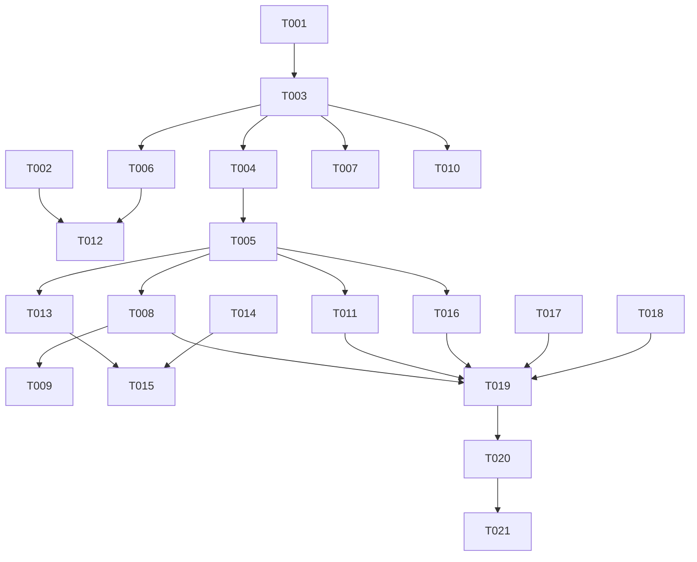

# Tasks: v0.7-part3 队列失效视频识别与播放失败处理

**Input**: Design documents from `spec/v0.7-part3-invalid-video/`
**Prerequisites**: plan.md (required), spec.md (required for user stories)

**Tests**: 本轮不建测试文件（项目无测试套件）；新非平凡逻辑（错误分类函数）以日志自检 + `devecocli check arkts` 静态检查覆盖。

**Organization**: 任务按用户故事分组。注意：US1/US4/US2/US5 共享 playIndex catch 改造（同文件同函数），按依赖顺序排列——US1 建骨架 → US4 补瞬时分支 → US2 补 VIP 分支 → US5 入口分类；优先级标注保留 spec 原值（US1/US4 为 P1）。

## Format: `[ID] [P?] [Story] Description`

- **[P]**: 可并行（不同文件、无未完成依赖）
- **[Story]**: 所属用户故事
- 描述含精确文件路径

## Path Conventions

- 单模块项目：源码根 `entry/src/main/ets/`（service/pages/component 分层），资源根 `entry/src/main/resources/`
- 任务描述中的文件路径相对仓库根（如 `entry/src/main/ets/service/PlayerController.ets`）
- 文档路径相对仓库根（`BILI_NOTES.md`、`docs/architecture.md`）

---

## Phase 1: Setup (Shared Infrastructure)

- [X] T001 [P] Constants 新增与改值：新增 `KEY_INVALID_BVIDS`、`TOAST_INVALID_SKIP`（视频已失效，已跳过）、`TOAST_VIP_SKIP`（需要大会员，已跳过）、`TOAST_NETWORK_RETRY`（网络异常，请检查网络后重试）、`TOAST_RISK_RETRY`（请求被拦截，请稍后重试）；`TOAST_ANOMALY_SKIP` 值改为「音源异常，已跳过」——entry/src/main/ets/service/Constants.ets
- [X] T002 [P] color.json 新增 `warning_amber`（#FF9500）——entry/src/main/resources/base/element/color.json

---

## Phase 2: Foundational (Blocking Prerequisites)

**⚠️ 用户故事开工前必须完成本阶段**

- [X] T003 PlayerController invalidSet 全套基建：字段 `invalidSet`、`loadInvalidSet`/`persistInvalidSet`（镜像 anomalySet 既有 JSON 模式）、`markInvalid`（幂等 + 持久化 + Logger + emitUi；失效判定优先：标记时同时 `clearAnomaly` 摘异常标记）、公开 `hasInvalid(bvid)`；init 在 anomalySet 加载处（:361 旁）同步加载——entry/src/main/ets/service/PlayerController.ets
- [X] T004 PlayerController 新增私有分类函数 `classifyPlayError`（消息提取五档，plan D1）：`Bili API error -404` → 失效；`Bili API error -104` → 大会员；`BiliService.isRiskControlError(message)` → 风控瞬时；`HTTP request failed` 前缀 → 网络瞬时；其余 → 其他瞬时（好友文案如 -101 登录失效透传，无则通用兜底）——entry/src/main/ets/service/PlayerController.ets

**Checkpoint**: 标记集与分类器就绪，用户故事可开工

---

## Phase 3: User Story 1 - 连播撞上失效视频：识别与必跳过 (Priority: P1) 🎯 MVP

**Goal**: -404 失效条目标 X 必跳过自动连播；失败持久化/停声/意图复位骨架就位
**Independent Test**: 队列放入已删除 BV 连播——toast「视频已失效，已跳过」、自动跳下一首、条目红叉、重启恢复至实际在播条目

- [X] T005 [US1] playIndex catch 重写为分类分发骨架（:1050-1061）：进门失败条目统一持久化 `savePlaylistFile(playlist, currentIndex, 0, currentQualityCode)`（FR-014，D3）；接线 classifyPlayError；INVALID 分支完整——`markInvalid`（含摘异常）、`showAnomalyToast(TOAST_INVALID_SKIP)`、有下一条则 `playIndex(next, 0)` 跳过、队尾则停口（提取私有停口助手：`playIntent=false`（FR-008）+ `setPlaying(false)` + `player.pause()`（FR-015）+ `mediaSession.updateState(false, currentTime)` + `stopBackground()` + statusMsg 分型短语，镜像 onError :436-446 处理）+ 分类 Logger 日志；确定性失败不触发 playbackError toast——entry/src/main/ets/service/PlayerController.ets
- [X] T006 [US1] [P] 四渲染点 X 条件切换 `hasAnomaly` → `hasInvalid`（视觉不变：xmark_circle + danger_red）：QueueSheet :919/:1053、HistorySheet :807、SourcePage :1128——entry/src/main/ets/component/QueueSheet.ets、entry/src/main/ets/component/HistorySheet.ets、entry/src/main/ets/pages/SourcePage.ets
- [X] T007 [US1] 「清除已播」口径增补：`collectPlayedRemovable`（:2119）与 `playedRemovableCount` 判定增加 `hasInvalid(bvid)`（X 条目随已播可清，计数/确认弹窗/实际移除三处自动一致）——entry/src/main/ets/service/PlayerController.ets

**Checkpoint**: US1 独立可验——失效连播一次通过、X 三处显示、清除已播可清

---

## Phase 4: User Story 4 - 播放异常处理状态一致性 (Priority: P1)

**Goal**: 瞬时失败分型停等人工；播放键态/持久化/旧声三修复收口
**Independent Test**: 弱网播放失败——播放键回正确状态、toast 分型、状态栏无原始错误码、条目无标记、队列未推进

- [X] T008 [US4] catch 瞬时分支（风控/网络/其他）分型：不标不跳不自动重试；停口助手处置（FR-008/015 经 US1 骨架）；statusMsg 分型文案（FR-012，不外露 raw code，-101 好友文案透传）；`playbackError` 扩展公开快照字段 `errorMsg`（分型文案，Index 消费；既有 errorCode/errorTick/dedup 不变）——entry/src/main/ets/service/PlayerController.ets
- [X] T009 [US4] [P] Index errorTick toast 消费改显动态文案：:105 由硬编码 `TOAST_PLAYBACK_ERROR` 改为显示 `controller.errorMsg`（常量保留作 OTHER 兜底）——entry/src/main/ets/pages/Index.ets
- [X] T010 [US4] init 恢复自动续播抑制（:479，plan D6）：恢复目标已标记（`hasInvalid || hasAnomaly`）时不自动 `playIndex`——恢复显示态照常（currentIndex/进度/封面/标记可见），等用户操作；未标记条目行为不变——entry/src/main/ets/service/PlayerController.ets

**Checkpoint**: US4 独立可验——瞬时失败停等人工、按钮态正确、分型 toast

---

## Phase 5: User Story 2 - 大会员专限视频：异常标记 (Priority: P2)

**Goal**: -104 会员稿标橙感叹号异常标记跳过，官方原因直报
**Independent Test**: 队列放会员专限 UGC 的 BV 播放——toast「需要大会员，已跳过」、自动连播、条目橙感叹号（非红叉）

- [X] T011 [US2] catch VIP 分支：`markAnomaly`（复用既有异常集，-104 语义）+ `showAnomalyToast(TOAST_VIP_SKIP)` + 跳过/队尾停口复用 US1 骨架（有下一条跳过、队尾停口助手处置）——entry/src/main/ets/service/PlayerController.ets
- [X] T012 [US2] [P] 四渲染点新增异常标记渲染：条件 `hasAnomaly` → SymbolGlyph（sys.symbol.exclamationmark_circle）+ warning_amber（尺寸/边距沿用 X 既有 token）；与 X 防御性共存时 X 优先（hasInvalid 分支在前，else-if 呈现）——entry/src/main/ets/component/QueueSheet.ets、entry/src/main/ets/component/HistorySheet.ets、entry/src/main/ets/pages/SourcePage.ets

**Checkpoint**: US2 独立可验——会员稿跳过标橙感叹、开通大会员重播自动摘（既有 prepared 摘除路径覆盖）

---

## Phase 6: User Story 3 - 时长异常视频：开关废止 (Priority: P2)

**Goal**: 「异常源处理」开关废止，时长异常恒跳过标异常标记
**Independent Test**: 播放存量充电稿——无条件跳过、toast「音源异常，已跳过」（不提充电）、设置页无开关行

- [X] T013 [US3] handleAnomalyOnPrepared 开关废止（:330-334）：KEY_ANOMALY_SKIP !== 1 试听分支删除，行为恒跳过；队尾停口（:336-342）补 `savePlaylistFile`（FR-014 既有缺口）；toast 接 `TOAST_ANOMALY_SKIP` 新值——entry/src/main/ets/service/PlayerController.ets
- [X] T014 [US3] [P] SettingsPage「异常源处理」开关行三处删除：字段（:57）、同步（:111）、行 UI（:1250-1254）——entry/src/main/ets/pages/SettingsPage.ets
- [X] T015 [US3] Constants 清理：删除 `KEY_ANOMALY_SKIP`、`TOAST_ANOMALY_TRIAL`（依赖 T013/T014 引用清零后执行）——entry/src/main/ets/service/Constants.ets

**Checkpoint**: US3 独立可验——设置页无开关、时长异常恒跳过、试听分支与 TRIAL 常量无残留引用

---

## Phase 7: User Story 5 - 添加失效 BV：分型提示不入队 (Priority: P2)

**Goal**: 添加/分享解析入口撞失效视频分型提示，不入队
**Independent Test**: 添加已删除 BV——提示「视频不存在或已失效」，队列未新增条目

- [X] T016 [US5] addSingleVideo catch 分类分型（:1542-1547，plan D7）：-404 → statusMsg「视频不存在或已失效」；风控 → TOAST_RISK_RETRY 文案；网络 → TOAST_NETWORK_RETRY 文案；好友文案（-101）透传；无则「解析失败，请稍后重试」兜底；EnqueueResult.FAILED 返回值不变（HomePage/AddSubscriptionSheet 两入口天然覆盖）——entry/src/main/ets/service/PlayerController.ets

**Checkpoint**: US5 独立可验——两入口添加失效 BV 均分型提示不入队

---

## Phase 8: Polish & Cross-Cutting Concerns

- [X] T017 [P] BILI_NOTES 补录：§1 端点表 playurl 行补「会员/付费 -104」语义标注与 fav 源下发会员专限 UGC（attr 只滤 &1 失效、不含会员标记，领域知识待实测标注）；-104 经 playurl/view 的实测形态留待实测标注——BILI_NOTES.md
- [X] T018 [P] docs/architecture.md 同步：PlayerController 职责描述补双标记集（invalidSet/anomalySet 转语义）、SettingsPage 开关移除；核对本轮触点文件既有误导性注释（X/异常语义混用注释随代码更新，代码零注释规则下仅改误导注释）——docs/architecture.md

---

## Phase 9: Verification

<!-- verification_scope: build-only -->

**Purpose**: 构建验证通过即收尾（默认停到真机前，不执行真机部署/运行/UI 验证）

- [x] T019 静态检查：本轮全部改动 .ets 文件一次性过 `devecocli check arkts`（T003-T016 触点：PlayerController/QueueSheet/HistorySheet/SourcePage/SettingsPage/Index），告警对比既有基线无新增
- [x] T020 构建验证：`devecocli build`，修复编译错误至成功（同一目标最多 3 次仍失败即暂停报告）
- [x] T021 收尾停点：构建通过即收尾——真机部署/运行/UI 验证不在本轮范围；真机自查事项集中输出交用户（见下节），不写入 PROJECT_NOTES.md

---

### 真机自查事项（不阻塞实施，轮次结束交用户）

- **-104 实测（plan D10）**：真机验证收藏夹会员专限 UGC 下发（fav 源 attr 不滤会员稿）、playurl 对会员稿回 -104、view 对会员稿返回形态（正常元数据 or 也回 -104）——实测结论补录 BILI_NOTES §1/§3；若 view 也回 -104，分类落点自动前移（catch 分类对触发层不敏感，无需改码）
- **连播撞失效**：队列放已删除 BV 连播——toast 文案、自动跳过、红叉标记、条目仍在队列
- **重启恢复**：手动切到队尾失效条目触发停口后重启——恢复至该条目（标记可见、不自动重播），不回退上一条
- **播放按钮态**：弱网/断网取流失败——播放键回正确状态（不卡暂停态假象）、toast 分型、状态栏无 `Bili API error` 原始串
- **旧声停播**：播放中手动切换撞 404——旧声音立即停止，无「声音旧、界面新」错位
- **开关移除**：设置页无「异常源处理」行；存量充电稿无条件跳过、toast 只报音源异常

---

## 📊 Dependency Graph



## ⚡ Parallel Execution Guide

| Phase | Tasks | Required Files | Execution Notes |
|-------|-------|----------------|-----------------|
| Setup | T001, T002 | Constants.ets / color.json | 不同文件可并行 |
| Foundational | T003 → T004 | PlayerController.ets | 同文件顺序执行 |
| US1 | T006, T007 | QueueSheet/HistorySheet/SourcePage / PlayerController.ets | T006（三渲染文件）与 T005/T007（PlayerController）可并行；T005 依赖 T003+T004 |
| US4 | T009 | Index.ets | 与 T010（PlayerController）并行；T009 依赖 T008 |
| US2 | T012 | QueueSheet/HistorySheet/SourcePage.ets | 三渲染文件可与 T011（PlayerController）并行；依赖 T006（else-if 结构）+T002 |
| US3 | T014 | SettingsPage.ets | 与 T013（PlayerController）并行；T015 必须最后（引用清零后删常量） |
| US5 | T016 | PlayerController.ets | 依赖 T005（骨架）；与其他 PlayerController 任务按序 |
| Polish | T017, T018 | BILI_NOTES.md / docs/architecture.md | 不同文件可并行 |
| Verification | T019 → T020 → T021 | 全部改动文件 | 严格顺序：静态检查 → 构建 → 收尾停点 |

## Dependencies & Execution Order

### Phase Dependencies

- **Setup（Phase 1）**: 无依赖，立即开始
- **Foundational（Phase 2）**: 依赖 Setup（T001 常量就位）；阻塞全部用户故事
- **User Stories（Phase 3-7）**: 全部依赖 Foundational；执行顺序按依赖链（US1 骨架 → US4/US2/US3/US5 补分支），不按纯优先级排序（同文件同函数改造，骨架先行）
- **Polish（Phase 8）**: 依赖用户故事完成（架构文档同步反映实施结果）
- **Verification（Phase 9）**: 依赖全部前序任务；严格顺序 T019 → T020 → T021

### User Story Dependencies

- **US1（P1）**: Foundational 后即可开始（T005 依赖 T003/T004）——建 catch 骨架，阻塞 US4/US2/US5 的 catch 分支
- **US4（P1）**: 依赖 US1 骨架（T008 复用停口助手）；T010 仅依赖 T003
- **US2（P2）**: 依赖 US1 骨架（T011 复用跳过/停口）；T012 渲染依赖 T006 结构 + T002 色值
- **US3（P2）**: T013 依赖 T005（catch 区域稳定）；T014 独立；T015 依赖 T013+T014 引用清零
- **US5（P2）**: 依赖 T005（分类函数经 US1 接线后可复用于 addSingleVideo）

### Within Each User Story

- 服务层（PlayerController）先行，渲染/页面层随后（[P] 并行窗口）
- Constants 删除类任务（T015）必须最后执行
- 每故事 Checkpoint 独立验收后再进下一故事

## Parallel Example

```bash
# US1 并行窗口（PlayerController 与渲染三文件不同文件）:
Task: "T005 [US1] playIndex catch 重写"            # PlayerController.ets
Task: "T006 [US1] 四渲染点 X 条件切换 hasInvalid"   # QueueSheet/HistorySheet/SourcePage.ets

# US3 并行窗口:
Task: "T013 [US3] handleAnomalyOnPrepared 开关废止" # PlayerController.ets
Task: "T014 [US3] SettingsPage 开关行三处删除"      # SettingsPage.ets
# 之后串行收口:
Task: "T015 [US3] Constants 删 KEY_ANOMALY_SKIP/TOAST_ANOMALY_TRIAL"
```

## Implementation Strategy

### MVP First (Setup + Foundational + US1)

1. 完成 Phase 1 Setup + Phase 2 Foundational
2. 完成 Phase 3 US1（catch 骨架 + 失效必跳过 + X 渲染 + 清除已播口径）
3. **STOP and VALIDATE**: 失效连播一次通过即核心痛点解决
4. 此时 US4/US2/US5 的 catch 分支尚缺（-104/瞬时落入 transient 兜底），行为安全但未分型

### Incremental Delivery

1. Setup + Foundational → 标记集/分类器就绪
2. US1 → 失效识别必跳过（MVP）
3. US4 → 瞬时失败分型 + 按钮态/持久化/停声收口
4. US2 → 会员稿异常标记
5. US3 → 开关废止 + 时长异常恒跳过
6. US5 → 添加入口拦截
7. Polish → 文档同步
8. Verification → 静态检查 + 构建 + 收尾停点

## Summary Report

- **总任务数**: 21（Setup 2 / Foundational 2 / US1 3 / US4 3 / US2 2 / US3 3 / US5 1 / Polish 2 / Verification 3）
- **每故事任务数**: US1=3（P1）、US4=3（P1）、US2=2（P2）、US3=3（P2）、US5=1（P2）
- **并行机会**: 跨文件任务 8 个标 [P]（渲染三文件组、SettingsPage、Index、color.json、两文档）；PlayerController.ets 内任务（T003/T004/T005/T007/T008/T010/T011/T013/T016）因同文件同函数区域须按序执行
- **独立测试标准**: 每故事 Checkpoint 列独立验收路径（见各 Phase）
- **MVP 范围建议**: T001-T007（Setup + Foundational + US1）——失效视频识别必跳过即核心痛点解决；US4 分型与 US2/US3/US5 为完整交付
- **实施轮次建议**: 单轮全量实施——触点集中（PlayerController 为主战场），拆轮无独立交付价值；子代理一轮执行 T001-T018 后进验证

## Notes

- [P] 任务=不同文件且依赖已完成；PlayerController 系列任务同文件按编号顺序执行
- 本轮代码零注释（AGENTS 规则），仅更新既有误导性注释（T018 核对）
- Constants 删除任务（T015）必须在引用清零（T013/T014）后执行
- Verification 默认 build-only（AGENTS：验证范围默认停到真机前）；需要 UI 验证须用户显式提出并将标记改为 `<!-- verification_scope: build+ui -->`
